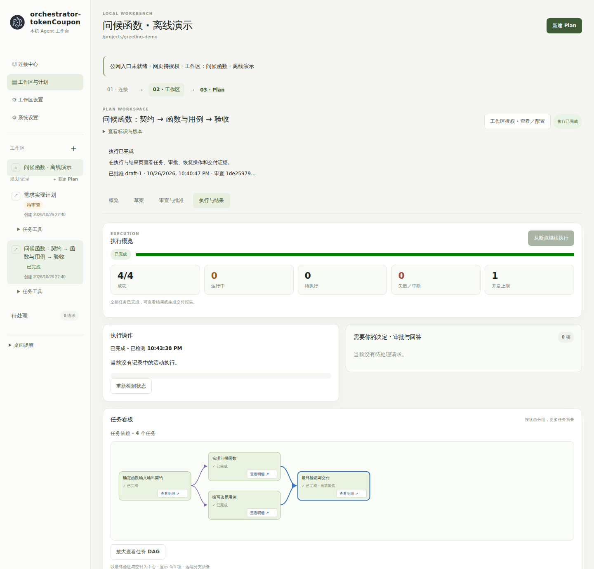
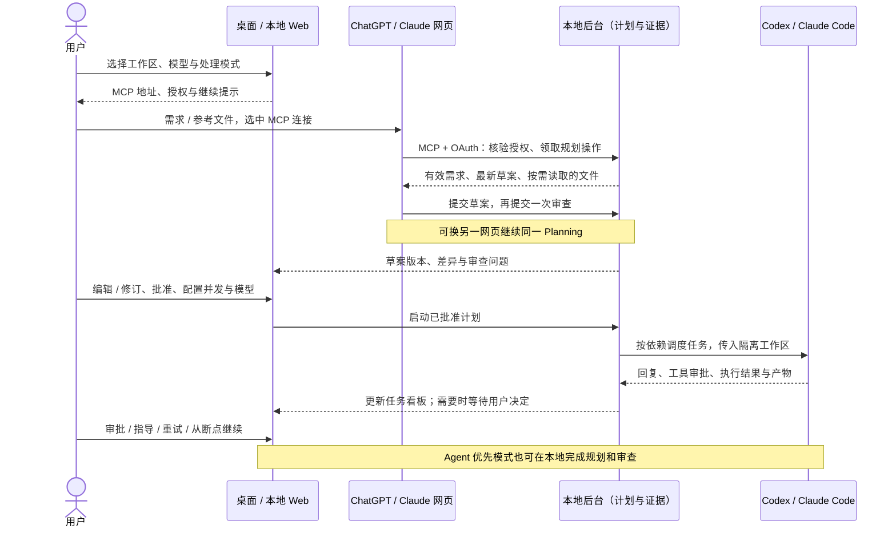
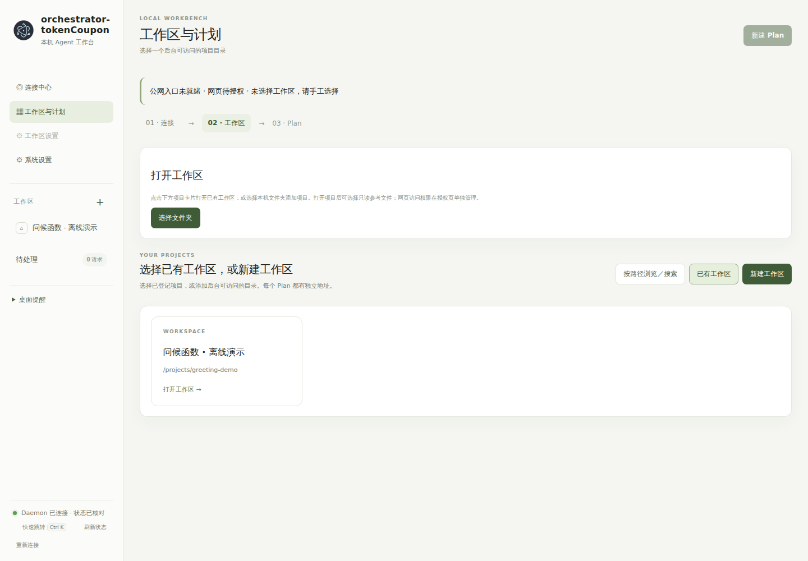
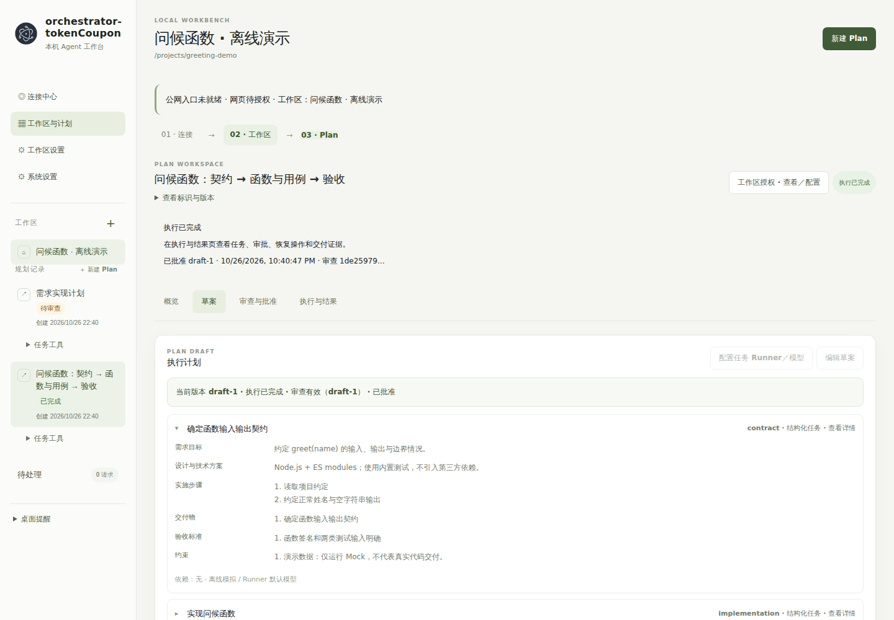

# orchestrator-tokenCoupon

**把规划与审查交给网页 LLM，把代码执行交给本机 Agent，用一份计划协调整个任务。**

orchestrator-tokenCoupon 是一个面向长任务的本地多 Agent 编排工作台。它通过 MCP 连接 ChatGPT、Claude 网页，在本机管理需求、草案、审查与执行记录，再调用 Codex、Claude Code 完成代码修改和测试。

目标是减少重复规划、重复传递上下文和失败后的重复执行，让已有的网页模型额度与本机 Coding Agent 各司其职。

[Windows 下载](https://github.com/DerrickJc/orchestrator-tokenCoupon/releases) · [快速开始](#快速开始) · [网页连接](#连接-chatgpt--claude-网页) · [规划与执行](#从需求到交付) · [跨网页交接](#在-chatgpt-与-claude-之间交接) · [开发](#开发与项目结构)

> 当前为预览版本，本文对应 `main` 源码。公开的 `desktop-preview-0.1.0-20261022-1` 安装包早于后续 Windows 快捷连接与界面修复；体验本文完整流程，请先使用源码启动。后续安装包以 [Releases](https://github.com/DerrickJc/orchestrator-tokenCoupon/releases) 的版本说明为准。



*当前界面的离线演示：真实本地后台完成四项 Mock 任务；不代表真实 Agent 已编写代码或通过业务测试。*

## 为什么做这个项目

一项开发任务经常要经历需求澄清、方案设计、代码实现、测试、失败定位和返工。把这些工作都交给同一个 Coding Agent，容易产生重复调研、冗长上下文，以及切换模型后重新解释项目的问题。

本项目把这些环节放进同一条可追溯的执行流程：

- **减少额外模型调用。** 规划、审查、修订和错误分析可以使用已连接的网页 LLM，复用用户已有的订阅或免费额度。
- **按任务配置执行模型。** 为整份计划设置默认 Runner／模型，也可以逐任务覆盖，让不同 Agent 分工实现、测试和验证。
- **减少重复上下文。** 交接以本地保存的有效需求、最新草案、审查与执行证据为准；文件和历史对话按需读取。
- **减少失败后的重做。** 已完成任务与产物保留，失败任务单独重试，再继续剩余依赖任务。

这里的“节省 Token”指减少额外 API／Agent 调用与重复上下文成本，并不代表模型不消耗 Token。网页服务和 Agent 仍受各自额度与计费规则约束；目前尚未提供统一的节省比例基准，也不宣称固定降本百分比。

## 主要功能

| 功能 | 可以做什么 |
| --- | --- |
| 网页与本机模式切换 | 规划、审查、修订、错误分析分别选择“网页优先”或“指定 Agent 优先”，也可统一设置 |
| 结构化任务计划 | 按目标、技术方案、实施步骤、交付物、验收标准、约束编辑任务，查看修订差异 |
| 草案校验与审查 | 校验结构和依赖，记录审查问题、修订建议与处理结果；批准绑定当前有效版本 |
| 多 Agent 编排 | 同一计划内混用 Codex、Claude Code，配置全局默认或逐任务 Runner／模型 |
| 依赖与并行调度 | 按任务依赖图启动就绪任务，配置并发数量，并在依赖汇合后进行最终验证 |
| Git worktree 隔离 | 为执行创建隔离目录与分支，保留变更、提交及交付证据；也支持共享工作区串行执行 |
| 长任务与断点继续 | 持久化 Session、任务和 Attempt，支持状态核验、暂停、取消、重试与继续剩余任务 |
| 任务看板与依赖图 | 查看运行中、待处理、已完成和失败任务，展开依赖图、模型回复、工具活动与产物 |
| 人工审批与回答 | 处理命令审批和 Agent 提问，允许、拒绝或补充指导后按支持的交互流程继续 |
| 失败诊断 | 在本地调用 Agent 分析，或导出证据，通过获准网页分析后选择修复方案 |
| 跨网页共享计划 | ChatGPT 规划、Claude 审查，或切换网页继续已有计划，无需手工搬运计划 JSON |
| 桌面与浏览器入口 | Windows 桌面预览、本地 Web 工作台，以及连接同一后台的 CLI |

主要执行 Runner 为 **Codex、Claude Code**；另有离线 Mock 和其他适配器。能力以界面检测与 Runner 支持情况为准。项目也保留了可选的 DeepSeek API 规划入口。

## 协作机制




**MCP 是协作通道，本地计划是共同依据。** 网页模型通过获准工具读取工作区、获取规划或审查上下文，并把结构化结果提交到本地。网页聊天中的文字、附件或“已完成”声明，不代替本地提交回执。

三个对象串起执行过程：

- **Planning**：保存需求、草案版本、审查、批准和网页交接状态。
- **Session**：执行一份已批准计划，管理任务依赖、并发和整体状态。
- **Attempt**：记录某个任务的一次执行，包括实际 Prompt、输出、工具活动和结果。重试会留下新的执行记录。

网页负责提出和审查方案；本地控制台负责编辑、批准、执行、审批与恢复。网页不能绕过本地批准直接启动业务任务。

## 快速开始

### 1. 启动本地工作台

源码运行需要 **Node.js 22.12+、npm 10+**。使用 Git worktree 时，还需安装 Git。

```bash
git clone https://github.com/DerrickJc/orchestrator-tokenCoupon.git
cd orchestrator-tokenCoupon
npm ci
npm run daemon -- --port 4177
```

在浏览器打开 **http://127.0.0.1:4177**，进入本地 Web 控制台。

需要桌面窗口时，在完成依赖安装后运行：

```bash
npm run desktop
```

Windows 桌面入口须在原生 Windows 终端、本机源码目录中运行；在 Linux／WSL 中可以先使用浏览器工作台。只使用 Web 的开发者可在安装依赖前设置 `ELECTRON_SKIP_BINARY_DOWNLOAD=1`，省去 Electron 下载；之后使用桌面版需补齐对应平台的 Electron。

桌面应用会发现或启动受身份核验保护的本地后台。若已有后台运行，请复用同一实例，避免重复启动相同数据目录的后台。

### 2. 准备执行 Agent

打开 **系统设置 → Agent 组件**，检测本机 Codex、Claude Code。已有安装可以复用；缺少时可使用按需安装入口，或按官方方式手工安装。

组件安装需要可用的 npm。完成后按界面提供的启动方式登录，再刷新检测。检测到程序不代表账号已经登录或所有模型都有权限。

网页模型在 ChatGPT／Claude 网页中选择；执行模型在本地控制台中选择。它们可以使用不同的服务和模型，不要求一致。

### 3. 选择处理模式

首次初始化或 **系统设置** 中，可以统一设置，也可以分别设置规划、审查、修订、错误分析：

| 模式 | 适用方式 |
| --- | --- |
| 网页优先 | 本地准备 MCP 交接，你在 ChatGPT／Claude 网页发起调用；适合复用网页额度 |
| 指定 Agent 优先 | 本地直接调用所选 Codex／Claude Code 及模型；适合希望在本地完成整条流程的场景 |

选择网页优先不会在后台自动打开聊天或发送消息，也不会悄悄改为本地模型调用。

## 连接 ChatGPT / Claude 网页

只使用本机 Agent 时，可以跳过网页连接。

1. 在本地 **连接中心 → 新建快捷连接**，按提示确认获取官方 cloudflared 组件，等待公网自检通过，复制完整 MCP 地址。
2. 在 ChatGPT 或 Claude 的自定义 MCP／连接器设置中添加该地址，使用 OAuth 发起授权。账号或组织需支持这项功能。
3. 返回本地 **权限与工作区**，选择网页来源、允许访问的项目及权限，保存授权，再回到原网页完成连接。
4. 在网页聊天中实际选中刚建立的连接，发送一次验证提示，核对返回的项目名称与工作区标识。

**公网入口可用、权限已保存、网页实际工具调用成功，是三个不同状态。** 本地会展示授权和调用状态，便于区分连接是否真正可用。

快捷连接会通过 Cloudflare 转发 MCP／OAuth 请求；本地控制台本身不作为公网管理页面开放。网页只可按授权访问工作区和工具，但读取到的内容会进入相应服务的处理流程，请按项目需要授权。

快捷隧道支持在后台重启后复用仍存活的连接；隧道进程退出、系统重启或重新创建连接后，地址可能改变。地址变更时，需要更新网页中的 MCP 配置。

## 从需求到交付

### 1. 打开工作区

在 **工作区与计划** 中打开已有项目，或选择文件夹新建工作区。支持路径定位、目录搜索、Windows 系统文件夹选择；也可选择项目内文件作为规划参考。

参考文件会按授权通过 MCP 读取。网页自己的沙箱不能直接访问你电脑的绝对路径。



*示例目录以 `/projects/greeting-demo` 代替随机临时路径。*

### 2. 提出需求并生成草案

点击 **新建 Plan**，选择规划方式和执行默认配置。

- 网页模式：复制应用生成的规划提示，在已选中对应 MCP 连接的网页聊天中粘贴，再补充需求或参考文件。
- Agent 模式：在本地输入需求，直接开始规划，查看任务状态和回复。

例如：

```text
为当前工作区实现一个简单的课程、教师管理后端。
先明确技术方案，安排设计、实现和测试验收任务。
关键选择缺失时集中询问，不扩大范围。
本轮只规划：不要在网页沙箱写代码、运行测试或生成交付压缩包。
草案提交本地后，接着审查一次。
```

规划可以从一段需求开始，也可以基于项目内需求文档、技术设计或已有产物继续。已有文件需要重新核验，不能仅凭历史回复认定已实现或测试通过。

### 3. 编辑、审查与批准

在计划页面查看结构化任务、依赖、技术约束和验收标准，按需编辑并查看差异。审查可以使用网页 LLM 或本机 Agent。

对审查问题选择建议或输入自定义修订方案，生成新草案后重新审查。草案正文和相关依据变化可能使原审查、批准失效；执行前须有适用于当前版本的审查和批准。严重问题需修订或显式豁免并留下记录。



*目标、技术方案、步骤和验收分字段展示；示例使用离线 Mock。*

### 4. 配置并运行

批准后进入 **运行参数**：

- **Runner／模型**：沿用计划、所有任务统一配置，或逐任务配置。
- **并发数量**：同时启动多少个已满足依赖的任务。
- **隔离方式**：共享工作区串行执行，或独立 Git worktree。
- **最终验证任务**：在隔离执行中承担结果整合后的验证。

并发大于 1 时使用 Git worktree。运行前界面会检查仓库、首次提交、未提交变更和运行记录是否被错误跟踪，并提供处理入口。创建 Git 提交需要有效姓名、邮箱；已有配置可以复用。

随后点击 **确认参数并运行**。调度器按依赖启动任务，不同 Agent 可以同时处理不同任务，再在依赖汇合后继续验证。

### 5. 观测、审批与恢复

在任务面板查看状态、依赖图、当前 Runner／模型和最新回复。需要命令审批或补充信息时，在待处理区域回答，或拒绝并提供指导。

任务失败后可以查看日志与产物、分析原因，再单独重试。后台重启或执行中断后，先检测真实状态，再使用 **从断点继续执行**。已完成任务结果和历史 Attempt 保留；恢复以任务与执行记录为边界，不保证还原所有 Runner 的进程内部状态。

未启动任务和后续重试可以配置新模型；立即更换正在执行任务的模型采用停止并重试的方式。

### 6. 核对交付

查看最终验证结果、生成文件、Git 差异和提交证据。worktree 的改动保存在隔离目录中，不等于已经进入原工作分支；按交付信息核对后，再显式完成 Git 合并。

任务默认不设置固定执行总时限，但仍可能受到 Runner、网络、额度和工具权限影响。后台继续运行时关闭桌面窗口不会取消任务；暂停、取消会话与退出后台是不同操作。

## 在 ChatGPT 与 Claude 之间交接

同一工作区、同一 Planning 可以跨网页继续，例如：

```text
ChatGPT 需求澄清与规划 → Claude 审查 → Codex / Claude Code 执行
        ↑                                      ↓
        └───────── 网页分析失败证据并修订 ────────┘
```

1. 让两家网页分别连接当前 MCP 地址，并授权访问同一个工作区。
2. 在当前计划的 **网页规划与审查交接** 中选择目标网页和处理角色，按提示归还或转交仍被领取的操作。
3. 复制应用生成的继续提示，在目标网页实际选中它自己的 MCP 连接，再发送提示。
4. 目标网页读取本地最新需求、草案、审查和待处理操作，领取并提交结果。本地控制台会展示新版本及回执。

这样可以在网页额度不足、需要另一模型复审，或更换聊天窗口时继续同一计划。共享的是本地保存的计划和证据，不是自动复制两家网页的完整聊天记录。

本地后台不能主动唤起普通网页对话。因此，保存修订或完成转交后，网页侧仍可能需要你发送一次继续提示；不必手工导出、修改和搬运计划 JSON。

## 不连接模型，先试运行

可以先用 Mock 验证计划执行流程，不需要模型账号，也不消耗模型额度：

```bash
npm run build
node packages/cli/dist/main.js plan run --file examples/plan.phase2.mock.json --workspace .
```

这是编排模拟，不代表真实 Agent 已生成代码或完成业务测试。正式体验时建议选择独立项目目录。

## 数据与访问边界

- 项目执行记录保存在工作区的 `.token-coupon/`，包括计划、Session、Attempt、日志和隔离执行目录；不应提交到业务仓库。
- 后台注册、授权和配置默认保存在用户目录的 `~/.token-coupon/daemon`；可以通过 `TOKEN_COUPON_DAEMON_HOME` 指定独立目录。
- MCP 通过 HTTPS、OAuth 和工作区权限限制访问；本地 API 与桌面 IPC 另有身份和来源校验。
- 全局切换处理方式不会替你批准计划或工具调用。网页模式无需为了连接而填写模型 API Key；可选 API 规划入口则使用独立配置。

## 开发与项目结构

```text
packages/
  core/       计划校验、Runner 协议、任务调度、执行持久化与 worktree
  daemon/     本地 API、MCP/OAuth、网页交接与后台服务
  web/        本地工作台、任务看板、审批与恢复界面
  desktop/    Electron 桌面壳、原生目录选择与通知
  cli/        命令行入口和后台操作
  client/     共享 API、协议及后台身份核验客户端
scripts/      演示、验证与桌面打包工具
examples/     可复现的计划示例
```

```bash
npm run typecheck
npm test
```

`npm test` 会先构建再运行测试。Windows 桌面包须在原生 Windows 构建；打包时还需提供指定版本的随包 Node，具体参数见 `scripts/package-desktop.mjs`。Codex、Claude Code 执行器按需使用，不作为桌面安装包的必需内置二进制。

欢迎通过 [Issues](https://github.com/DerrickJc/orchestrator-tokenCoupon/issues) 反馈问题，附上版本、平台、操作步骤和脱敏后的诊断信息。

**许可：** 项目代码采用 [Apache-2.0](LICENSE)，版权说明见 [NOTICE](NOTICE)。第三方组件保留各自许可，参见 [THIRD_PARTY_NOTICES](packages/daemon/THIRD_PARTY_NOTICES.md)。
