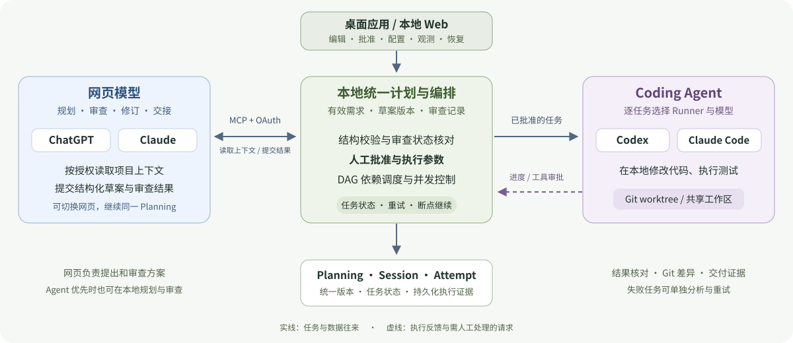

# orchestrator-tokenCoupon

**把规划与审查交给网页 LLM，把代码执行交给本机 Agent，用一份计划协调整个任务。**

orchestrator-tokenCoupon 是一个面向长任务的本地多 Agent 编排工作台。它通过 MCP 连接 ChatGPT、Claude 网页，在本机管理需求、草案、审查与执行记录，再调用 Codex、Claude Code 完成代码修改和测试。

目标是减少重复规划、重复传递上下文和失败后的重复执行，让已有的网页模型额度与本机 Coding Agent 各司其职。

[Windows 下载](https://github.com/DerrickJc/orchestrator-tokenCoupon/releases/download/desktop-preview-0.1.0-20261022-1/Token-Coupon-0.1.0-x64-preview-setup.exe) · [快速开始](#快速开始) · [网页连接](guides/mcp.md) · [规划与执行](guides/workflow.md) · [跨网页交接](guides/handoff.md) · [开发](guides/development.md)

> 当前为预览版本，本文对应 `main` 源码。公开的 `desktop-preview-0.1.0-20261022-1` 安装包早于后续 Windows 快捷连接与界面修复；体验本文完整流程，请先使用源码启动。后续安装包以 [Releases](https://github.com/DerrickJc/orchestrator-tokenCoupon/releases) 的版本说明为准。

*当前界面的离线演示：真实本地后台完成四项 Mock 任务；不代表真实 Agent 已编写代码或通过业务测试。*

## 为什么做这个项目

一项开发任务经常要经历需求澄清、方案设计、代码实现、测试、失败定位和返工。把这些工作都交给同一个 Coding Agent，容易产生重复调研、冗长上下文，以及切换模型后重新解释项目的问题。

本项目把这些环节放进同一条可追溯的执行流程：

- **减少额外模型调用。** 规划、审查、修订和错误分析可以使用已连接的网页 LLM，复用用户已有的订阅或免费额度。
- **按任务配置执行模型。** 为整份计划设置默认 Runner／模型，也可以逐任务覆盖，让不同 Agent 分工实现、测试和验证。
- **减少重复上下文。** 交接以本地保存的有效需求、最新草案、审查与执行证据为准；文件和历史对话按需读取。
- **减少失败后的重做。** 已完成任务与产物保留，失败任务单独重试，再继续剩余依赖任务。

这里的“节省 Token”指减少额外 API／Agent 调用与重复上下文成本，并不代表模型不消耗 Token。网页服务和 Agent 仍受各自额度与计费规则约束；目前尚未提供统一的节省比例基准，也不宣称固定降本百分比。

## 主要功能

| 功能 | 可以做什么 |
| --- | --- |
| 网页与本机模式切换 | 规划、审查、修订、错误分析分别选择“网页优先”或“指定 Agent 优先”，也可统一设置 |
| 结构化任务计划 | 按目标、技术方案、实施步骤、交付物、验收标准、约束编辑任务，查看修订差异 |
| 草案校验与审查 | 校验结构和依赖，记录审查问题、修订建议与处理结果；批准绑定当前有效版本 |
| 多 Agent 编排 | 同一计划内混用 Codex、Claude Code，配置全局默认或逐任务 Runner／模型 |
| 依赖与并行调度 | 按任务依赖图启动就绪任务，配置并发数量，并在依赖汇合后进行最终验证 |
| Git worktree 隔离 | 为执行创建隔离目录与分支，保留变更、提交及交付证据；也支持共享工作区串行执行 |
| 长任务与断点继续 | 持久化 Session、任务和 Attempt，支持状态核验、暂停、取消、重试与继续剩余任务 |
| 任务看板与依赖图 | 查看运行中、待处理、已完成和失败任务，展开依赖图、模型回复、工具活动与产物 |
| 人工审批与回答 | 处理命令审批和 Agent 提问，允许、拒绝或补充指导后按支持的交互流程继续 |
| 失败诊断 | 在本地调用 Agent 分析，或导出证据，通过获准网页分析后选择修复方案 |
| 跨网页共享计划 | ChatGPT 规划、Claude 审查，或切换网页继续已有计划，无需手工搬运计划 JSON |
| 桌面与浏览器入口 | Windows 桌面预览、本地 Web 工作台，以及连接同一后台的 CLI |

主要执行 Runner 为 **Codex、Claude Code**；另有离线 Mock 和其他适配器。能力以界面检测与 Runner 支持情况为准。项目也保留了可选的 DeepSeek API 规划入口。

## 协作机制

网页模型按授权读取项目、提交草案与审查；本地工作台保存统一计划，由你批准后调度 Agent 执行。换网页时沿用同一 Planning，进度、产物和失败证据持续保存在本地。

[查看详细交互时序与对象说明](guides/collaboration.md)

## 快速开始

| 使用方式 | 入口 | 操作说明 |
| --- | --- | --- |
| **Windows 桌面版** | [直接下载 Windows x64 安装器](https://github.com/DerrickJc/orchestrator-tokenCoupon/releases/download/desktop-preview-0.1.0-20261022-1/Token-Coupon-0.1.0-x64-preview-setup.exe) | [安装与首次使用](guides/windows.md) |
| **浏览器工作台** | [启动并打开本地网页](guides/browser.md) | [源码启动、环境准备](guides/browser.md#从源码启动) |

[连接 ChatGPT / Claude](guides/mcp.md) · [创建计划与执行任务](guides/workflow.md) · [跨网页继续已有计划](guides/handoff.md)

## 网页 MCP 连接示例

<!-- MCP 图例占位：将截图放入 assets/readme/mcp-connection.png，再把下方图片路径改为 assets/readme/mcp-connection.png。可放单张截图或拼接后的连接/授权步骤图。 -->

[查看连接、授权与验证步骤](guides/mcp.md)

## 使用指南

| 你想做什么 | 查看指南 |
| --- | --- |
| 生成草案、修改任务、审查并批准 | [规划与执行](guides/workflow.md) |
| 配置模型、并发和 Git worktree | [运行参数](guides/workflow.md#4-配置并运行) |
| 查看任务、处理审批、重试或断点继续 | [观测、审批与恢复](guides/workflow.md#5-观测审批与恢复) |
| ChatGPT 规划、Claude 审查，或更换聊天窗口 | [跨网页交接](guides/handoff.md) |
| 离线体验、源码开发或了解数据目录 | [开发与离线演示](guides/development.md) |

欢迎通过 [Issues](https://github.com/DerrickJc/orchestrator-tokenCoupon/issues) 反馈问题，附上版本、平台、操作步骤和脱敏后的诊断信息。

## License

本项目采用 [Apache License 2.0](LICENSE) 开源。

Copyright © 2026 orchestrator-tokenCoupon contributors. 版权说明见 [NOTICE](NOTICE)，第三方组件保留各自许可，参见 [第三方组件说明](packages/daemon/THIRD_PARTY_NOTICES.md)。
