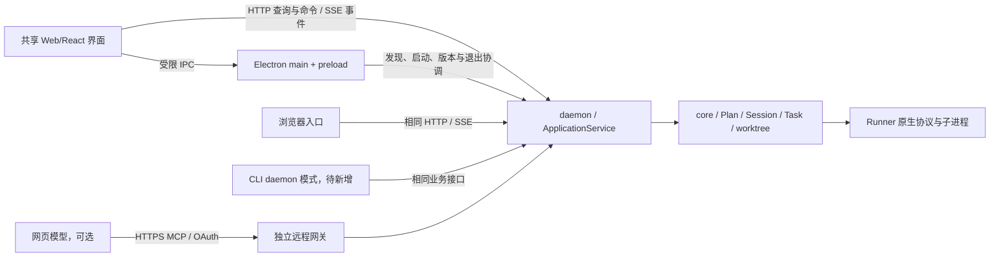

# Windows 客户端需求与技术方案

日期：2026-10-19。状态：**需求与技术方案草案；桌面工程、平台适配、前端迁移和本文新增功能均未实施，本轮未运行产品测试或真实模型验收。**

本文整理本轮需求讨论、开源项目检索与当前工作树的只读核查结果。当前存在未提交业务代码，本文不把工作树能力等同于已发布版本；实施前需记录代码基线和既有变更归属。

关联文档：

- [项目路线图](../roadmap.md)：阶段划分与当前能力。
- [Phase 7 实施指南](PHASE_7_IMPLEMENTATION_GUIDE.md)：现有本机 Web、daemon、MCP、Runner 的使用与证据边界。
- [Phase 7 后续设计](PHASE_7_NEXT_STEPS_AND_TASK_REVIEW_PLAN.md)：任务产物 Review、成果追溯、CLI daemon 模式等既有缺口。
- [Token 优化方案](PHASE_7_TOKEN_OPTIMIZATION_PLAN.md)：可信用量、上下文控制与建议型模型路由。

文档可见性：当前仓库忽略 `roadmap.md` 和多数 Phase 7 文档，以上链接在本工作区可读，干净检出中可能缺失。本次只为本文新增 Git 跟踪例外；公开发布前须将用户需要的指南及引用纳入发布资料，或提供可公开访问的等价说明。

## 1. 产品目标与方案基线

建设可供其他用户安装使用的 Windows 桌面工作台，完成“打开项目 → 规划与计划审查 → 批准执行 → 处理输入与工具审批 → 查看产物与交付”的流程。保留浏览器入口，所有界面操作同一套领域状态和执行服务。

### 1.1 本轮方案采用的方向

| 项目 | 方案基线 | 说明 |
| --- | --- | --- |
| 桌面容器 | Electron | 优先考虑当前 TypeScript/Node 技术栈的交付与维护效率；实际整包体积和资源占用仍需测量 |
| 前端目标 | React + TypeScript | 按组件、页面渐进迁移；首个可安装预览可以复用现有静态界面 |
| 前端开发与构建 | Vite | 开发期提供构建与预览，发布时生成静态资源；它与 Electron 组合使用 |
| 业务后端 | 现有 TypeScript daemon + ApplicationService + core | 复用 Plan、Session、Task、Attempt、RunnerRegistry、DAG 和 worktree，不新增界面侧调度状态源 |
| 界面通信 | 本机 HTTP JSON API + SSE | HTTP 完成查询、命令与回答；SSE 提供事件通知；可交互终端引入时再评估 WebSocket |
| 默认执行环境 | 原生 Windows | WSL 作为可选运行环境；当前原生 Windows 后端尚未具备发布条件 |
| 安装交付 | 一个完整安装包，包含软件自身运行时与生产资源 | 允许安装目录包含多个文件；单文件 EXE 优化后置 |
| 可选替代 | Tauri + Node sidecar | 有明确包体或资源目标时比较完整产品，不同时维护两套首发桌面壳 |

这些是后续实施的设计基线，不代表已经完成实现、Windows 验收或发布授权。

### 1.2 “轻量、快捷”的衡量方式

首先减少用户手工安装步骤、启动命令和必选服务。软件自身不要求用户手工安装 Node、npm、Python、Rust、Docker 或 WSL；使用本机模型、网页模型和不同 Runner 时，仅增加实际选用能力的依赖。

安装包大小、安装后磁盘占用、冷启动耗时、空闲 CPU、全部相关进程的内存和长日志场景开销分别记录。测量包含实际 SDK、资源和运行时；隧道、Runner 与项目构建进程单独列出。本文不承诺未经整包测量的体积、启动时间或节省比例。形成首个真实基线后，再在发布前确定数值目标。

React/Vite 属于维护者的开发构建依赖。用户运行的是构建后的静态界面。Electron 提供桌面窗口和系统集成，daemon 提供执行服务；三个层次分别评估成本。

## 2. 当前能力与迁移起点

| 范围 | 当前事实 | 迁移处理 |
| --- | --- | --- |
| 编排与交付 | 已有依赖调度、并发、Attempt、worktree、串行 Git 整合、恢复和交付记录 | 通过后台接口复用，保持状态、批准和隔离语义 |
| Web | 当前为 `packages/web/public` 中的 HTML/CSS/JS；主要交互集中于 `app.js` | 先提取接口、订阅、路由和视图状态，再逐页迁移组件 |
| HTTP 与事件 | 本机 `/api/v1`、Cookie/Origin 检查、SSE 与有限历史窗口已存在 | 保留本机权限边界；增加桌面发现、版本与能力协商 |
| 静态资源 | HTTP 层当前只显式提供首页、`app.js`、`style.css` | 适配 Vite 分块、资源清单和 MIME；现有白名单不能直接服务新构建 |
| CLI | 旧 CLI 直接调用 core，依靠工作区锁协调 | 增加显式 daemon 客户端模式；不声称当前所有入口已共用后台 |
| 平台锁 | `acquireLockCoordination` 明确要求 Linux `flock`；daemon 启动也调用它 | 原生 Windows 启动前的阻塞项，先建立跨进程协调能力 |
| 常驻隧道 | 已有独立 supervisor，仍依赖 Linux/WSL 协调与私有 Unix socket 约束 | 原生 Windows 单独适配与验收；文件名存在 Windows 分支不等于端到端支持 |
| Runner | 已有 managed Runner 与交互；命令查找、进程终止仍有平台适配缺口 | 发布支持矩阵精确到平台、Runner、安装形式与模式 |
| 模拟执行 | Mock Runner 的进程入口当前来自测试 fixture | 演示所需入口改为可发布资源，避免安装后引用源码测试目录 |
| 产物审查 | 有计划 Review；关键任务产物 Review 与等待门禁尚未实现 | 作为独立 core 功能建设，界面按能力显示 |

源代码入口：[HTTP 服务](../packages/daemon/src/http-server.ts)、[ApplicationService](../packages/daemon/src/application-service.ts)、[daemon 入口](../packages/daemon/src/main.ts)、[owner 锁](../packages/core/src/owner-lock.ts)、[常驻隧道](../packages/daemon/src/persistent-tunnel.ts)、[隧道 supervisor](../packages/daemon/src/tunnel-supervisor.ts)、[Mock Runner](../packages/core/src/runners/mock-runner.ts)。

## 3. 用户场景、范围与功能需求

### 3.1 主要使用场景

1. 新用户安装客户端，选择已有项目和一种可用 Runner，从本机开始规划与执行。
2. 已有 ChatGPT/Claude 网页用户继续通过 MCP 规划或审查，桌面端负责本机确认、执行和观测。
3. 用户同时查看多个任务，集中处理提问、审批、失败和待审成果。
4. 用户关闭窗口、休眠或断线后返回，能够核对任务真实状态并继续操作。
5. 现有浏览器/CLI 用户逐步迁移，保留规划、批准、Attempt、Git 成果和历史证据。

### 3.2 桌面首版需求

下表中的“首版”指可安装且具备真实操作闭环的桌面版本；分批预览可以先提供部分能力，但应显示明确的能力状态。

| 编号 | 需求 | 首版行为与验收要点 |
| --- | --- | --- |
| WIN-01 | 安装与首次启动 | 普通用户安装后打开应用，不运行 npm 或手工启动后台；显示启动进度、失败归属与可操作的修复入口 |
| WIN-02 | 环境检测 | 检测所选 profile 的 Git、Runner、版本、登录/可用性；缺失只影响相关能力，不阻止查看界面、记录和演示 |
| WIN-03 | 工作区管理 | 原生选择目录、登记已有项目、最近项目；清楚显示工作区所属 Windows/WSL 环境，目录不存在时保留登记并提示修复 |
| WIN-04 | 规划入口 | 提供本机 Agent、现有 API、网页 MCP 和导入已有计划的适用入口；按实际能力启用；执行前仍需计划审查与本机批准 |
| WIN-05 | 计划审查 | 显示需求、决策、任务、依赖、执行配置与草案 diff；批准绑定版本与哈希；修订形成新版本 |
| WIN-06 | 执行工作台 | 任务列表/看板与聚焦依赖图共享同一后台事实；显示运行、等待输入、失败、中断及下一步，不通过拖动改变业务完成状态 |
| WIN-07 | 任务与 Attempt 详情 | 消息、工具活动、文件变化、工作目录、Runner/模型和执行结果在同一任务上下文；明确最新与历史 Attempt |
| WIN-08 | 待处理中心 | 分别展示问题、工具审批、网页授权、计划批准、恢复和待产物审查；每个动作绑定正确请求与任务，已失效请求不可提交 |
| WIN-09 | 执行控制 | 复用暂停、取消、恢复、重试与执行配置规则；显示请求已接收和实际已生效的区别；切换模型不伪装成原生会话无缝热切换 |
| WIN-10 | 结果与交付 | 展示变更、验证命令及对应版本、整合/冲突状态、交付报告；人工选择整合/交付动作；保留既有 Git 确认要求 |
| WIN-11 | 桌面交互 | 单实例、原生选择窗口、窗口尺寸/位置恢复、托盘、通知；通知点击定位对应项目和任务，通知本身不授予审批 |
| WIN-12 | 恢复与诊断 | 断线重连后重新查询权威状态；保留未提交输入；显示后台失联、Runner 中断、网页连接失效的不同原因 |
| WIN-13 | 升级与卸载 | 显示版本、兼容性与重启时机；运行中的工作先妥善处理；默认保留用户记录和项目，卸载清理范围单独说明 |

首个预览版可复用旧页面提供 WIN-03 至 WIN-10 的既有能力。正式版覆盖的 Runner 和模式以真实平台验收为准，未安装或未验证的组合显示相应状态。

### 3.3 依赖与功能边界

| 依赖 | 交付策略 | 用户界面行为 |
| --- | --- | --- |
| 软件自己的 Node 环境、生产模块、静态资源、演示资源 | 随安装包提供，路径不依赖系统全局 Node/npm | 正常启动无需配置开发环境 |
| Git | 检测已有安装，缺失时给明确安装/配置指引；是否提供可选便携组件另行评估 | worktree/并行能力按 Git 与仓库状态启用；不静默改成共享目录并行 |
| coding-agent Runner 与认证 | 按所选 Runner 检测和引导；不要求安装所有支持项 | 显示命令路径、支持模式与故障；凭证由原 Runner 或受保护配置持有 |
| 网页 MCP、cloudflared | 网页协作时按需启用，复用现有下载校验、同意与授权流程 | 首次本机使用不必先建立公网连接 |
| 项目的 JDK、数据库、Node 等工具链 | 属于被执行项目的环境要求；在执行前检查和说明 | 缺失工具链不能被显示成客户端安装失败或测试通过 |

免装软件运行环境不等于任何项目都能无依赖执行。如果未来希望用户只填 API 配置便可执行任务，需要新增 API Runner 与相应工具执行环境；当前 API Planner 不能替代这项能力。

## 4. 页面与交互方案

默认路径为“打开项目 → 选择规划/执行方式 → 规划与计划审查 → 批准 → 执行与待处理 → 结果与交付”。网页连接是可选的协作设置。

| 页面/区域 | 主要内容 | 交互约束 |
| --- | --- | --- |
| 首页与工作区 | 最近项目、打开项目、环境状态、演示入口 | 不因后台刷新自动选中项目或启动任务 |
| 工作区概览 | 计划与 Session、进行中的工作、待处理数量 | 用户优先看到需要处理的事项和下一步 |
| 规划与审查 | 需求与决策、草案、版本变化、审查、批准 | 未保存编辑保留；新草案不覆盖旧批准快照 |
| 执行工作台 | 执行中、等待处理、已结束的任务；依赖图 | 展示分组从领域状态推导，UI 不维护第二套成功状态 |
| 任务详情 | 消息/输出、工具活动、文件差异、证据、历史 Attempt | 大内容分页，原始事件折叠；阅读历史时不自动跳到最新 |
| 待处理中心 | 提问、工具审批、授权、恢复、产物审查 | 类型、作用范围、来源、失效状态明确，避免通用“允许”按钮混淆权限 |
| 结果与交付 | 候选/整合版本、验证覆盖、审查、冲突与交付 | Attempt 执行成功、产物已接受、Git 已整合分别表达 |
| 设置与诊断 | Runner、模型、运行 profile、网页连接、代理、版本与日志 | 配置变化仅作用于明确范围，不能静默改写已批准计划 |

宽窗口采用“工作区导航 + 主内容 + 可收起任务详情”的布局，窄窗口收起次要区域。系统文字缩放、高 DPI、键盘访问、中文输入法和长路径应纳入 Windows 验收。

模型信息区分任务配置值、Runner 原生报告和网页声明；未知时显示未知。任务图聚焦依赖与状态，不把每段模型输出扩展成节点。

前端迁移需保留以下行为：导航前处理未保存编辑；后台更新不抢焦点、不清空回答；按钮显示处理中且防止重复提交；错误归属具体请求；多页切换正确清理订阅；系统通知去重。React effect、组件挂载和开发期重复执行不得触发有副作用的业务命令。

## 5. 技术架构与工程组织

### 5.1 职责与通信



- renderer 展示状态、收集输入、发送明确命令；不直接操作 Git、启动 Runner 或修改领域存储。
- Electron main/preload 负责窗口、托盘、系统通知、选择器、启动发现和升级协调，桥接接口逐项定义。
- daemon 管理业务操作、交互请求和执行 owner；core 保持调度与状态校验。
- 本机 HTTP/SSE 与外部 MCP 是两条入口。MCP 隧道只发布受限网关，不转发桌面 API、批准入口或完整日志。
- 浏览器与桌面共享状态；旧 CLI 迁移完成前继续受跨入口锁约束，不静默绕过 daemon 冲突直接启动 core。

### 5.2 拟议目录

以下目录为规划，不代表已经创建：

```text
packages/
  core/                 现有领域与编排，补平台能力适配
  daemon/               现有服务、HTTP/SSE、MCP、平台资源与生命周期
  cli/                  保留直接模式，增加显式 daemon 客户端模式
  client/               拟新增：纯接口类型、HTTP 客户端、SSE 订阅与错误模型
  web/
    public/             现有页面，迁移期间保留兼容构建入口
    src/                拟新增：React 页面、组件、路由与视图状态
    dist/               Vite 生产构建输出
  desktop/              拟新增：Electron main/preload、宿主适配与发布配置
```

接口包保持浏览器可用，不引入 daemon/core 的 Node 运行时代码或业务状态所有权。是否增加独立 DTO 包按实际依赖复杂度决定；首版无需生成多套 SDK 或引入新编排框架。

### 5.3 Vite、静态资源与本机授权

首版优先由 daemon 托管 Vite 生产构建，Electron 加载同一本机 Origin；浏览器入口沿用相同页面。这样可复用当前首页设置的 HttpOnly Cookie、写请求 Origin 校验和同源 SSE。Electron renderer 禁用 Node 集成并启用隔离；外部网页通过系统浏览器打开。

当前静态服务需要支持构建清单、`assets/` 下的哈希 JS/CSS、动态导入、字体及图标等资源。只允许读取已打包静态根目录，检查路径归一化、目录穿越、符号链接、MIME 与缓存策略。首页避免长期缓存；哈希资源可以长期缓存，升级时处理旧窗口与旧分块的版本一致性。

现有 hash 路由先保持兼容。逐页迁移时，同一个路由只由一个前端入口拥有；React 与旧脚本不能同时绑定同一按钮或订阅同一副作用。旧路由到新路由的映射、未保存状态与深链定位一起验证。

开发环境允许使用 Vite dev server，但须明确同源代理/限定开发 Origin、Cookie、POST Origin 与 SSE 不缓冲的配置；生产包不运行 Vite dev server。以后若改为 `app://` 加载静态资源，需同步设计 Cookie 引导、Origin、CSP、SSE 和 API 认证，不能通过关闭校验解决跨域问题。

### 5.4 API、事件与桌面发现

既有 `/api/v1` 兼容演进。当前 health 也受本机 Cookie 保护，桌面发现不能假设已有匿名版本接口。拟新增或扩展的握手信息包括：应用版本、构建标识、协议版本、能力版本、实例身份、epoch、运行 profile 和环境；敏感信息与业务状态在认证后读取。

发现记录和健康应答只用于定位候选服务，还需核验受保护的实例身份。PID、端口和相同数据目录必须一致；不能因某个 4177 端口返回 200 就信任它，也不能因连接失败就杀进程或创建第二个 owner。具体挑战方式与 Windows 跨进程锁在迁移批次 B 确定。

业务命令沿用版本/哈希、请求身份和已有幂等键；接口包只对有明确幂等契约的操作使用该能力。写请求响应丢失时先查询 job/操作回执，不自动重放批准、重试、整合或回答。

SSE 用于通知和有限事件回放，权威数据通过快照/详情接口查询。重连、epoch 变化、保留窗口不足和前端切换时进行对账；历史 Attempt 日志单独分页读取。问题与批准绑定当前 requestId、Task、Attempt 和版本，超时或被其他客户端处理后显示失效。

## 6. 后台生命周期、数据与发布

### 6.1 启动、关闭、退出与升级

1. 应用取得桌面单实例锁，解析稳定的数据目录和运行 profile。
2. 读取并验证已有 daemon。兼容且身份明确时复用；冲突、版本不兼容或 owner 不明时展示诊断，不强制接管。
3. 无活跃 owner 时，按明确运行时路径启动随包后台，等待已认证的就绪状态，再打开工作区界面。
4. 首次打开首页建立本机授权上下文，随后加载快照和事件订阅。后台错误显示失败阶段与重试入口，避免无限空白页。
5. 关闭主窗口默认隐藏到托盘，保持应用及已托管后台运行；设置和托盘中明确区分“关闭窗口”“退出应用”“停止网页连接”。
6. 真正退出时，活动任务、待回答与后台来源分别处理：用户可返回后台运行，或明确执行停止/退出；附着到用户另行启动的 daemon 时只断开界面，不擅自停止它。
7. 升级在兼容性和活动状态检查后进行。需要停止的 Runner/后台正常收尾，持久化完成再替换文件；不对运行中的执行进程承诺热更新。

daemon 重启后的恢复复用现有真实状态规则。原生 Runner 进程或内存交互已消失时，需要新 Attempt 或显式恢复；应用重新打开不等于原生对话、审批和工具执行均自动续传。

### 6.2 运行时与常驻连接

优先验证随包提供的标准 Node 运行环境和生产模块布局，保持 SDK 资源及 supervisor 独立进程的启动语义。Electron `utilityProcess` 可作为复用其 Node 能力的候选，但必须验证 `process.execPath`、独立 supervisor 存活、SDK 子进程和退出行为后再采用。不得把所有后台服务直接移进 renderer。

Node SEA/其他单文件打包方式另行验证动态依赖、资源文件、原生模块和子进程入口。首版交付目标是一份完整安装包，不把单文件形式设为发布前提。

常驻连接已有“业务 daemon 重启保留隧道”的语义。Windows 迁移要处理跨进程锁、私有转发端点、进程身份、控制凭证与访问权限。可比较 named pipe 与带身份认证的 loopback 转发，沿用独立远程网关隔离，不能临时把公网隧道指向桌面控制台。

原生 Windows 的 MCP/隧道适配可以分批交付。本机执行预览不依赖它；正式版承诺的网页协作能力必须经过对应平台真实验收，缺失能力显示“未支持/未验证”，不静默替换为 WSL。

### 6.3 数据目录与旧记录

- 桌面窗口、主题、用户体验设置使用应用用户目录；开发环境使用独立目录，避免和安装版争抢 Chromium profile 与后台。
- daemon 首版优先兼容现有 `~/.token-coupon/daemon` 及显式 `--data-dir` 设置，使用 `os.homedir()` 等确定用户路径。当前入口的 `HOME ?? "."` 必须处理，防止从快捷方式启动时把状态写进安装目录或当前目录。
- 规划、批准、Session、Attempt 和 Git 成果继续按既有项目 `.token-coupon/` 规则存放，不重复复制进 Electron 存储。
- 凭证、Cookie、连接控制秘密和 Runner 认证不进入前端状态持久化、URL、深链、日志导出或模型提示；本机文件权限需适配 Windows ACL。
- 记录迁移前做版本检查与备份；写入具备版本和失败恢复策略。回退旧版前检查数据格式兼容性，不承诺所有写入都能无损降级。
- 卸载默认保留全局记录、工作区和 worktree；清理入口展示确切路径、关联工作和可恢复性，由用户选择。

### 6.4 Windows/WSL 切换边界

运行 profile 明确区分 Windows 本机和特定 WSL 发行版，包含后台地址、环境与受保护的数据目录引用。切换 profile 是切换后台上下文，UI 不把不同环境的记录当成同一个活跃执行实例。

已有 WSL 数据不会通过替换路径前缀自动迁成 Windows 可恢复 Session。需核对仓库位置、提交、worktree 元数据、Runner 身份、文件权限、可用路径及引用；先支持重新登记项目和读取历史，再单独评估成果导入。旧 PID、锁、OAuth 控制秘密和存活中的交互不跨系统继承。

首版不允许 Windows 与 WSL 两个独立后台同时管理可识别为同一物理仓库的执行。跨环境共享磁盘的协调能力尚未验证时阻止双启动，并要求先正常结束或释放原 owner；未知身份不能靠删除锁文件解决。

## 7. 迁移边界与处理清单

下表是实施输入，不是已修复列表。严重程度分为“阻塞”与“必验”；具体方案在对应批次实现，结果记录到验收报告。

| 编号 | 边界与当前依据 | 处理要求 | 级别 |
| --- | --- | --- | --- |
| MIG-01 | `owner-lock.ts` 对非 Linux 直接拒绝，daemon 启动即依赖它 | 建立 Windows 跨进程互斥/协调适配，覆盖竞争、崩溃、接管与释放；禁止用内存布尔值或不安全删除锁替代 | 阻塞 |
| MIG-02 | owner 身份主要使用 Linux `/proc`、启动时间与 boot 身份 | Windows 使用可验证的进程身份、持有秘密和代际；PID 复用、权限不足和身份不明保持安全阻塞 | 阻塞 |
| MIG-03 | Runner 按 `claude`/`codex` 等精确名字查找 | 统一 Windows 可执行解析，处理 `.exe`、`.cmd`、`PATHEXT`、用户 PATH、绝对路径与受支持安装方式；命令垫片须安全启动 | 阻塞 |
| MIG-04 | Windows 取消目前主要作用于直接子进程 | 验证受控进程树清理，可评估 Job Object/平台执行器；区分原生中断与强制清理，仅处理本应用拥有的进程 | 阻塞 |
| MIG-05 | 暂停、取消、退出与异常重启语义不同 | 根据真实退出与持久化结果显示状态；不因窗口关闭宣称任务取消，不因连接恢复宣称任务成功 | 必验 |
| MIG-06 | `process.execPath` 被用于 supervisor 与协调辅助进程 | 明确执行用运行时路径，验证 Electron/Node/单文件模式下的含义；不能误启动第二个 GUI 或旧版本资源 | 阻塞 |
| MIG-07 | Unix socket 与目录权限校验绑定当前隧道 | 设计 Windows 私有转发与控制端点、ACL 和身份校验；保持远程网关与本机 API 隔离 | 网页协作阻塞 |
| MIG-08 | HTTP 层目前固定提供 `app.js`、`style.css` | 接入 Vite manifest/安全静态资源服务，覆盖动态分块、字体、图标、MIME、缓存和路径限制 | 新界面阻塞 |
| MIG-09 | 本机 API 依赖首页 Cookie 和合法 Origin；health 也受保护 | 定义发现与授权引导；开发代理和生产加载方式分别验收，不能暴露浏览器 token 到 renderer | 阻塞 |
| MIG-10 | API 目前缺少完整的发布版本协商 | 扩展协议/构建/能力信息，拒绝不兼容写操作；不同客户端共享同一能力判断 | 必验 |
| MIG-11 | SDK、许可、静态文件使用相对资源位置 | 明确打包后资源根、可执行资源位置与生产依赖；不能假定所有文件可从 ASAR/虚拟文件系统直接执行 | 阻塞 |
| MIG-12 | Mock 依赖测试 fixture 路径 | 发布独立演示资源；不依赖源码目录、测试框架或维护者 Node 路径，演示记录与真实执行区分 | 必验 |
| MIG-13 | 全局数据入口存在 `HOME` 回退当前目录行为 | 用户目录与 `--data-dir` 一致解析；安装目录只读，开发/生产数据隔离 | 阻塞 |
| MIG-14 | Windows/WSL 路径、盘符、大小写与 UNC 不同 | 由目标后台规范化和 realpath 校验；覆盖空格、中文、长路径、不同盘、符号链接及失效挂载 | 必验 |
| MIG-15 | 快捷方式启动不经过用户交互 shell | 检测真实 PATH/Runner 环境；代理与必要配置显式传入；避免继承不必要的敏感环境到隧道等组件 | 必验 |
| MIG-16 | GUI 启动可能没有可用 stdout/stderr | 后台输出进入有界日志文件并可诊断；处理无终端、错误管道与日志轮转 | 必验 |
| MIG-17 | Git worktree、冲突与环境准备影响调度 | 检查 Git 身份/版本、仓库状态、CRLF/换行、可执行位和 worktree 路径；不全局关闭 Git 安全检查 | 必验 |
| MIG-18 | worktree 的依赖可能指向原仓库构建产物 | 记录实际工作目录与依赖来源；保留现有 setup 规则，避免测试了另一份代码 | 必验 |
| MIG-19 | SSE 有有限回放窗口与 epoch，页面有刷新对账 | 统一订阅和清理、窗口不足时重载快照、按身份去重；写请求不因重连自动重放 | 必验 |
| MIG-20 | 问答与审批可能在原生进程内等待 | 请求关联 Task/Attempt/版本，跨页保留输入；重启后辨别请求失效，不伪造原生交互恢复 | 必验 |
| MIG-21 | 模型选择、配置值与原生上报不同 | 保留现有证据分层；多 Runner 不继承错误模型；批准后的配置遵守既有修订/切换规则 | 必验 |
| MIG-22 | 旧 UI 与 React 迁移并存 | 路由、控件和事件只有一个 owner；保留未保存编辑、阅读位置、筛选、IME 和错误归属；effect 不执行写命令 | 必验 |
| MIG-23 | 升级时旧 daemon/supervisor 可能仍使用资源文件 | 停机对账、版本与文件占用检查，必要时版本化资源目录或延后替换；不强杀未确认归属的进程 | 必验 |
| MIG-24 | OAuth 地址、授权和数据目录有关联 | 同实例按现有规则复用；跨 profile/地址变化重新核验；不复制授权秘密冒充可用连接 | 必验 |
| MIG-25 | Windows 权限模型不同于 Unix mode 位 | 处理 token、发现文件、私有管道与控制记录的用户访问范围；失败时说明原因 | 必验 |
| MIG-26 | 打包后缺少开发工具、缓存与网络时行为不同 | 干净 Windows 验证安装/启动/演示；组件按需下载、代理可诊断；本机使用不触发无关云组件下载 | 发布阻塞 |
| MIG-27 | 浏览器、桌面、旧 CLI、多个 profile 可能同时操作 | 本地实例锁、工作区执行锁与跨入口协调分别检查；重复客户端只能复用后台或明确冲突 | 必验 |
| MIG-28 | 历史 Session、worktree、人工补丁来自不同环境 | 分开处理历史查看、配置导入、成果导入与执行恢复；保留来源，不能继承旧验证结论为当前通过 | 必验 |

具体代码核查入口还包括：[Claude managed Runner](../packages/core/src/runners/claude-managed-runner.ts)、[Codex Runner](../packages/core/src/runners/codex-runner.ts)、[子进程运行](../packages/core/src/runners/child-process.ts)、[工作区路径](../packages/daemon/src/workspace-path.ts)、[daemon owner](../packages/daemon/src/daemon-owner.ts)。

## 8. 后续建议与既有待办衔接

本表面向桌面规划安排依赖，不重排 Phase 7 已确认的质量、成果追溯和 Token 优化主线。未实施的 core 能力使用明确的 capability 和等待说明，不能仅通过增加前端按钮冒充已有功能。

| 建议 | 当前状态/原方案位置 | 纳入方式与完成边界 |
| --- | --- | --- |
| 关键任务产物 Review | Phase 7 的 P0-2，尚未实现独立快照/存储/调度门禁 | core 与桌面工程可分批推进；候选冻结 → 审查报告 → 本机接受/修复 → 整合放行；旧路径和历史记录保持明确语义 |
| 系统内成果追溯、人工补丁和显式外部导入 | Phase 7 的 P0-3 | 先系统内来源，显示准确差异与当前验证；导入形成新候选/基线，不复制外部成功声明 |
| 按需上下文、可信用量与建议型模型路由 | Phase 7 的 P0-4、P1-4 | 复用已有上下文预算，分模型记录原生用量和计费口径；网页未知 token 不记零；升级建议由用户确认 |
| 待处理中心与统一时间线 | Phase 7 的 P1-3、P1-5；现有部分横幅/任务记录可复用 | 桌面首版聚合既有输入与恢复；新增产物 Review 后接入同一中心，保留事件因果和任务归属 |
| 分阶段批准与审查证据语义 | Phase 7 的 P1-1、P1-2 | 明确批准范围、未决条件、事实与声明；范围变化生成关联规划，不扩大旧授权 |
| CLI daemon 客户端模式 | Phase 7 的 P1-6，尚未完整接入 | 显式模式访问统一服务；后台离线时说明不可用，保留旧直接模式及跨入口锁 |
| worktree 清理、归档与空间管理 | Phase 7 的 P1-5及阶段 8诊断方向 | 先展示差异、占用、归属与恢复路径，再确认清理；不删除活跃、失败未接受或来源不明成果 |
| Git/验证证据统一 | 已有基础记录，进一步整合界面 | 命令、目录、提交、结果与日志关联；最终整合 HEAD 变化时重新核对验证有效性 |
| 可交互终端 | 新增独立扩展 | 引入 PTY/ConPTY 与 WebSocket、权限和进程生命周期；不以展示原始日志代替终端 |
| 项目预览与浏览器 | 新增独立扩展 | 先外部浏览器预览，后评估隔离 profile；远程内容不继承桌面桥接权限 |
| 多仓库、更多 Runner、VS Code/TUI | 阶段 8选择性扩展 | 统一接口和能力协议稳定后逐项立项，不复制 owner |
| API 执行 Runner | 新建议，现有 API 仅有规划入口 | 另建工具执行、安全、交互、用量与交付链路，评估对用户 CLI 依赖的真实减少 |
| Tauri 或无桌面壳发行 | 技术备选 | 只在完整依赖与相同功能下比较安装、运行和维护成本；不把替代壳作为同时维护的首发范围 |

产物 Review 的默认原则仍为“关键交付点必须审查，普通任务按需”。尚未具备 core 门禁时，不出现可误解为已完成审查的状态；已结束 Attempt 也不能通过 UI 被直接改成已接受的候选。

## 9. 分批迁移与交付计划

| 批次 | 主要工作 | 前置与可审查交付 | 完成门槛 |
| --- | --- | --- | --- |
| A：基线与契约 | 记录代码基线、现有入口/存储/平台假设、支持矩阵与依赖清单 | 本文及 MIG 清单；保留当前未提交工作的归属 | 明确原生 Windows 阻塞、桌面预览范围和首发支持对象 |
| B：平台能力 | Windows 锁/进程身份、命令解析、进程树、路径、数据目录、Node/SDK资源；网页组件单列 | A；平台接口与隔离演示工程 | 原生 Windows 后台能够安全启动、执行、停止和恢复；未支持能力明确关闭 |
| C：共享客户端与资源 | 接口类型、HTTP/SSE封装、版本/能力协商、Vite构建、静态服务；先保持原页面业务行为 | A；与 B可按依赖分项推进 | 浏览器与候选桌面加载相同业务接口，无双重订阅或重复命令 |
| D：可安装桌面预览 | Electron main/preload、启动发现、托盘、通知、原生选择器、完整安装资源 | B、C；可先复用旧页面 | 干净 Windows 无开发环境启动、演示与一个已支持真实 Runner 闭环 |
| E：界面渐进迁移 | React路由、工作区、规划、执行、详情、待处理与交付；逐页替换 | C、D；每页有迁移清单和兼容入口 | 原有权限与状态语义保留；编辑、历史阅读、缩放和输入法场景可用 |
| F：质量与协作补齐 | 按 Phase 7方案建设产物 Review、成果追溯、用量与 CLI客户端；接入桌面能力显示 | 各自 core协议与既有方案，不以D完成视为功能已完成 | 所承诺能力各自有快照、门禁、恢复和真实证据；其余维持未支持/待验收 |
| G：公开发布 | 用户版README、项目许可与第三方说明、贡献/问题反馈指引、构建产物、版本与升级策略；核对文档跟踪与引用可见性 | 支持矩阵内功能验收、原生平台报告和完整生产资源 | 安装/升级/退出/恢复可复现；干净检出与发布资料的必要链接可用；支持与限制清楚；签名和发布渠道方案已落实 |

每批次以可审查差异推进，不将桌面壳、全部 UI 重写、跨平台与所有后续能力捆成一次切换。旧静态前端在过渡期保留明确的发布入口；回退界面不回滚业务数据或已批准计划。仅在目标页面和存量路由验证后移除旧入口。

## 10. 后续验收场景与证据

以下均为待执行场景。本次编写文档没有运行这些检查、启动真实模型、操作业务 Session 或改动用户项目 Git。

| 场景 | 预期结果 | 应保留证据 |
| --- | --- | --- |
| 干净 Windows 安装 | 无全局 Node/npm/Rust/WSL/Docker仍可打开界面和演示；无自动公网连接 | OS/架构、安装包版本与哈希、安装及启动日志 |
| 非管理员与不同目录 | 在用户权限内运行；安装目录只读，中文/空格路径和用户目录正常 | 实际路径、错误和状态目录；不含秘密 |
| Runner能力矩阵 | 受支持安装方式可发现和登录；无效路径/未知模式给明确提示 | Runner版本、路径/安装类型、模式和原生能力报告 |
| 本机真实闭环 | 规划/导入 → 审查批准 → 实际执行 → 工具审批/回答 → 结果与交付 | Planning/Session/Task/Attempt、命令、提交与交付记录 |
| 重复启动与跨入口 | 第二个窗口复用；数据目录与工作区锁有效；旧CLI冲突清楚 | 实例身份、锁生命周期与重复请求回执 |
| 任务控制和进程树 | 暂停/取消按各自语义生效；取消后所拥有子进程清理完成 | 原生中断、进程归属、退出结果与最终持久状态 |
| 关闭窗口与真正退出 | 关闭窗口保留工作；退出按选择处理活动任务与附着后台 | 托管关系、动作、状态与重开后的对账 |
| 断线、休眠、后台崩溃 | 重查快照、回放有界事件；不重复批准/回答/启动/merge | epoch、事件范围、job回执与恢复路径 |
| 新旧界面与大记录 | 存量路由可打开；输入不丢、阅读位置稳定、日志分页有界 | 页面与数据规模、操作记录、资源采样 |
| Vite生产资源 | 动态分块、字体、MIME、深链与升级后资源均可用；越界路径被拒绝 | 构建清单、请求与版本信息 |
| 本机权限与桌面IPC | Cookie/Origin和受限桥接有效；网页/深链无法越权批准或启动业务 | 限定来源与拒绝结果；不记录凭证正文 |
| Windows网页协作 | 支持后才验收隧道、OAuth、MCP交接、批准与恢复 | 对应平台的真实入口/工具回执，模拟证据单独标明 |
| 产物Review | 能力落地后验收候选冻结、审查等待、修复基线、接受整合与依赖放行 | 候选/验收版本、报告、本机选择与最终Git证据 |
| Windows/WSL迁移 | 环境清楚、旧记录可辨；不继承活跃锁与进程；不允许双owner管理同一仓库 | profile、仓库与worktree核对、来源和迁移记录 |
| 升级与卸载 | 活动工作先处理；格式变更有备份；默认保留用户项目和成果 | 版本、备份/恢复结果、确切清理范围 |

实现后运行与实际变更相关的自动检查和隔离场景，再执行支持矩阵内的干净 Windows 验收。真实模型、网页账号与安装行为分别记录，不用此前 Linux/Mock 结果替代 Windows 发布证据。性能对比包含 Electron全进程、daemon、SDK资源与可选组件，避免只比较空壳。

## 11. 实施前需落定的决策

| 决策 | 本文建议 | 落定方式 |
| --- | --- | --- |
| OS/架构支持范围 | 首先建立Windows x64实机基线，其他版本/架构按实际需求与Runner矩阵扩展 | 平台、Runner和安装包联合验收后公布支持清单 |
| 后台运行时 | 标准Node随包布局优先；utilityProcess/单文件作为待验证选项 | 使用实际SDK、supervisor、退出和升级场景比较 |
| Windows锁与进程管理 | 独立平台适配，保持跨进程身份和安全接管语义 | 竞争/崩溃/PID复用/子进程树场景验证后固定机制 |
| Windows私有转发 | 在named pipe和受保护loopback方案中选择 | 保持网关隔离、私密性、重启复用与生命周期一致 |
| 产物Review发布范围 | 可以与桌面工程分批，但对外承诺需和core能力一致 | 定义预览版/正式版能力表，不提前宣称已有门禁 |
| Git/Runner附带方式 | 首版检测现有安装，提供明确引导；可选组件另评估 | 综合实际安装负担、更新策略和分发条件 |
| 体积/启动/内存目标 | 先建立真实整包与真实操作基线 | 对齐相同功能和依赖后设定发布数值门槛 |
| 签名、升级、许可与发布渠道 | 公开发布前明确；预览版标识实际签名与支持状态 | 形成发布流程与用户说明，不把文档草案当已发布版本 |

## 12. 开源参考与设计取舍依据

参考核对时间：2026-10-19，本会话已读取的官方文档及源码。分支内容可能继续变化；实施记录应补上实际参考的版本/提交。以下只说明设计依据，不表明本项目已经拥有参考产品的全部能力。

| 来源 | 本次核对内容 | 本项目取舍 |
| --- | --- | --- |
| [Orchestrator.inc架构](https://github.com/OrchestratorInc/agent-orchestrator/blob/main/docs/architecture.md)、[前端依赖](https://github.com/OrchestratorInc/agent-orchestrator/blob/main/frontend/package.json) | Electron/React，daemon REST/SSE，终端WebSocket，任务上下文与事实派生状态 | 借鉴统一任务视图、待处理看板与后台owner；复用本项目core |
| [Vibe Kanban项目结构](https://github.com/BloopAI/vibe-kanban/blob/main/AGENTS.md)、[Tauri入口](https://github.com/BloopAI/vibe-kanban/blob/main/crates/tauri-app/src/main.rs) | React/TS/Vite共享界面，Tauri入口启动Rust/Axum服务并加载本机URL | 借鉴共享前端与服务；其Rust后端布局不能直接推导本项目Node整包体积 |
| [OpenCode v1.19.3桌面依赖](https://github.com/anomalyco/opencode/blob/v1.19.3/packages/desktop/package.json)、[服务接口](https://opencode.ai/docs/server/) | 指定版本使用Electron/SolidJS；HTTP/OpenAPI与SSE服务 | 固定版本比较；界面框架与桌面容器分别选择 |
| [Goose桌面说明](https://github.com/block/goose/blob/main/ui/desktop/README.md) | Electron/React/Vite，启动随包CLI并与ACP服务通信 | 借鉴完整运行资源随包交付；协议选择依据已有能力 |
| [Electron utilityProcess](https://www.electronjs.org/docs/latest/api/utility-process)、[安全指南](https://www.electronjs.org/docs/latest/tutorial/security/) | Node子进程能力、renderer隔离和有限桥接 | 验证后台兼容；原生能力不直接暴露给远程内容 |
| [Tauri Windows安装](https://v2.tauri.app/distribute/windows-installer/)、[Node sidecar](https://v2.tauri.app/learn/sidecar-nodejs/) | WebView2安装策略、Node随包运行方式 | Tauri作为完整产品备选比较，不仅比较壳大小 |

## 13. 本次整理结果

本文新增需求、方案基线、页面范围、迁移清单、后续建议与待执行验收，README、路线图和当前后续设计增加导航入口；现有路线图及Phase 7索引仍按仓库当前规则作为本地文档保存。`.gitignore`仅为本文增加精确跟踪例外。没有创建桌面工程、修改生产代码、迁移业务数据、变更Runner配置或执行本文验收。后续进展应逐批追加实现记录，并把“待验证”更新为对应平台的实际证据。
