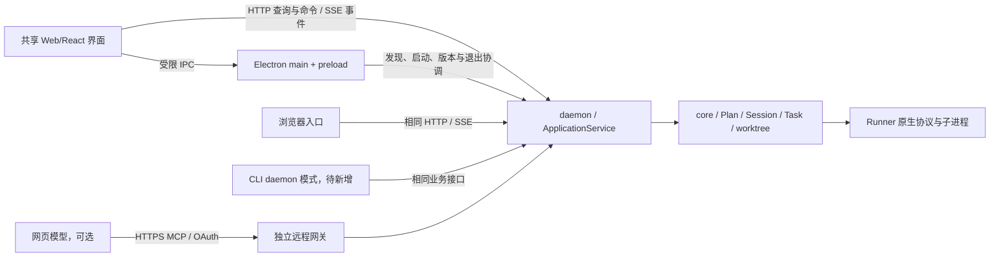

# Windows 客户端需求与技术方案

日期：2026-10-19，实施记录更新至 2026-10-20。状态：**实施中；Electron 桌面工程未实施，Windows 平台适配已完成部分基础能力，完整后台与安装验收仍待完成。Web 页面已具备 Vite 构建/静态分发基础和输入快捷键；快速导航、工作区/计划导航、规划方式选择器、执行 Runner 选择器、规划/执行/审查模型选择器及其目录状态/刷新控件、审查方式选择器、运行方式选择器、执行 Runner／模型配置方式选择器、并发/隔离/最终验证选择器、运行中任务换模型控件、系统设置的 Agent／网页路由选择器、计划页标签、概览、草案只读任务卡片、草案结构化编辑表单、草案差异视图、审查结果区、需求/澄清输入、对话记录、执行状态摘要、本次执行回复区、任务看板、DAG 预览面板及完整依赖图弹窗、DAG 任务详情、Session 控制、断点继续入口、待审批摘要及交互表单/动作、Attempt 状态摘要/选择器/记录读取控件、模型回复列表、工具活动列表/分页、原始事件正文/筛选/分页控件、诊断对话历史、诊断输入框、诊断历史/模型选择界面、网页证据导出弹窗和任务生成结果弹窗已由 React 管理。Runner／模型目录请求、响应竞态与配置提交、待审批卡片组装与生命周期、诊断模型目录请求与诊断请求调度和 Session 判定逻辑仍由原生 JavaScript 管理。尚未完成真实浏览器交互和 Windows 桌面验收。**

本文整理需求讨论、开源项目检索与代码只读核查结果，并补充桌面前端设计和交互方案。代码核查是当时工作树的事实，不等同于已发布版本；实施前需重新记录代码基线和既有变更归属。

关联文档：

- [项目路线图](../roadmap.md)：阶段划分与当前能力。
- [Phase 7 实施指南](PHASE_7_IMPLEMENTATION_GUIDE.md)：现有本机 Web、daemon、MCP、Runner 的使用与证据边界。
- [Phase 7 后续设计](PHASE_7_NEXT_STEPS_AND_TASK_REVIEW_PLAN.md)：任务产物 Review、成果追溯、CLI daemon 模式等既有缺口。
- [Token 优化方案](PHASE_7_TOKEN_OPTIMIZATION_PLAN.md)：可信用量、上下文控制与建议型模型路由。

文档可见性：当前仓库忽略 `roadmap.md` 和多数 Phase 7 文档，以上链接在本工作区可读，干净检出中可能缺失。本次只为本文新增 Git 跟踪例外；公开发布前须将用户需要的指南及引用纳入发布资料，或提供可公开访问的等价说明。

## 1. 产品目标与方案基线

建设可供其他用户安装使用的 Windows 桌面工作台，完成“打开项目 → 规划与计划审查 → 批准执行 → 处理输入与工具审批 → 查看产物与交付”的流程。保留浏览器入口，所有界面操作同一套领域状态和执行服务。

### 1.1 本轮方案采用的方向

| 项目 | 方案基线 | 说明 |
| --- | --- | --- |
| 桌面容器 | Electron | 优先考虑当前 TypeScript/Node 技术栈的交付与维护效率；实际整包体积和资源占用仍需测量 |
| 前端目标 | React + TypeScript | 按组件、页面渐进迁移；首个可安装预览可以复用现有静态界面 |
| 前端开发与构建 | Vite | 开发期提供构建与预览，发布时生成静态资源；它与 Electron 组合使用 |
| 业务后端 | 现有 TypeScript daemon + ApplicationService + core | 复用 Plan、Session、Task、Attempt、RunnerRegistry、DAG 和 worktree，不新增界面侧调度状态源 |
| 界面通信 | 本机 HTTP JSON API + SSE | HTTP 完成查询、命令与回答；SSE 提供事件通知；可交互终端引入时再评估 WebSocket |
| 默认执行环境 | 原生 Windows | WSL 作为可选运行环境；当前原生 Windows 后端尚未具备发布条件 |
| 安装交付 | 一个完整安装包，包含软件自身运行时与生产资源 | 允许安装目录包含多个文件；单文件 EXE 优化后置 |
| 可选替代 | Tauri + Node sidecar | 有明确包体或资源目标时比较完整产品，不同时维护两套首发桌面壳 |

这些是后续实施的设计基线，不代表已经完成实现、Windows 验收或发布授权。

### 1.2 “轻量、快捷”的衡量方式

首先减少用户手工安装步骤、启动命令和必选服务。软件自身不要求用户手工安装 Node、npm、Python、Rust、Docker 或 WSL；使用本机模型、网页模型和不同 Runner 时，仅增加实际选用能力的依赖。

安装包大小、安装后磁盘占用、冷启动耗时、空闲 CPU、全部相关进程的内存和长日志场景开销分别记录。测量包含实际 SDK、资源和运行时；隧道、Runner 与项目构建进程单独列出。本文不承诺未经整包测量的体积、启动时间或节省比例。形成首个真实基线后，再在发布前确定数值目标。

React/Vite 属于维护者的开发构建依赖。用户运行的是构建后的静态界面。Electron 提供桌面窗口和系统集成，daemon 提供执行服务；三个层次分别评估成本。

## 2. 当前能力与迁移起点

| 范围 | 当前事实 | 迁移处理 |
| --- | --- | --- |
| 编排与交付 | 已有依赖调度、并发、Attempt、worktree、串行 Git 整合、恢复和交付记录 | 通过后台接口复用，保持状态、批准和隔离语义 |
| Web | 当前为 `packages/web/public` 中的 HTML/CSS/JS；主要交互集中于 `app.js` | 先提取接口、订阅、路由和视图状态，再逐页迁移组件 |
| HTTP 与事件 | 本机 `/api/v1`、Cookie/Origin 检查、SSE 与有限历史窗口已存在 | 保留本机权限边界；增加桌面发现、版本与能力协商 |
| 静态资源 | HTTP 层当前只显式提供首页、`app.js`、`style.css` | 适配 Vite 分块、资源清单和 MIME；现有白名单不能直接服务新构建 |
| CLI | 旧 CLI 直接调用 core，依靠工作区锁协调 | 增加显式 daemon 客户端模式；不声称当前所有入口已共用后台 |
| 平台锁 | 已接入 Linux `flock` 与 Windows Mutex；Windows 竞争/崩溃释放已做隔离实测 | 仍需完整 Windows 后台、工作区与多客户端验收，见 13.60 |
| 常驻隧道 | 已有独立 supervisor，仍依赖 Linux/WSL 协调与私有 Unix socket 约束 | 原生 Windows 单独适配与验收；文件名存在 Windows 分支不等于端到端支持 |
| Runner | 已有 managed Runner 与交互；命令查找、进程终止仍有平台适配缺口 | 发布支持矩阵精确到平台、Runner、安装形式与模式 |
| 模拟执行 | Mock Runner 的进程入口当前来自测试 fixture | 演示所需入口改为可发布资源，避免安装后引用源码测试目录 |
| 产物审查 | 有计划 Review；关键任务产物 Review 与等待门禁尚未实现 | 作为独立 core 功能建设，界面按能力显示 |

源代码入口：[HTTP 服务](../packages/daemon/src/http-server.ts)、[ApplicationService](../packages/daemon/src/application-service.ts)、[daemon 入口](../packages/daemon/src/main.ts)、[owner 锁](../packages/core/src/owner-lock.ts)、[常驻隧道](../packages/daemon/src/persistent-tunnel.ts)、[隧道 supervisor](../packages/daemon/src/tunnel-supervisor.ts)、[Mock Runner](../packages/core/src/runners/mock-runner.ts)。

## 3. 用户场景、范围与功能需求

### 3.1 主要使用场景

1. 新用户安装客户端，选择已有项目和一种可用 Runner，从本机开始规划与执行。
2. 已有 ChatGPT/Claude 网页用户继续通过 MCP 规划或审查，桌面端负责本机确认、执行和观测。
3. 用户同时查看多个任务，集中处理提问、审批、失败和待审成果。
4. 用户关闭窗口、休眠或断线后返回，能够核对任务真实状态并继续操作。
5. 现有浏览器/CLI 用户逐步迁移，保留规划、批准、Attempt、Git 成果和历史证据。

### 3.2 桌面首版需求

下表中的“首版”指可安装且具备真实操作闭环的桌面版本；分批预览可以先提供部分能力，但应显示明确的能力状态。

| 编号 | 需求 | 首版行为与验收要点 |
| --- | --- | --- |
| WIN-01 | 安装与首次启动 | 普通用户安装后打开应用，不运行 npm 或手工启动后台；显示启动进度、失败归属与可操作的修复入口 |
| WIN-02 | 环境检测 | 检测所选 profile 的 Git、Runner、版本、登录/可用性；缺失只影响相关能力，不阻止查看界面、记录和演示 |
| WIN-03 | 工作区管理 | 原生选择目录、登记已有项目、最近项目；清楚显示工作区所属 Windows/WSL 环境，目录不存在时保留登记并提示修复 |
| WIN-04 | 规划入口 | 提供本机 Agent、现有 API、网页 MCP 和导入已有计划的适用入口；按实际能力启用；执行前仍需计划审查与本机批准 |
| WIN-05 | 计划审查 | 显示需求、决策、任务、依赖、执行配置与草案 diff；批准绑定版本与哈希；修订形成新版本 |
| WIN-06 | 执行工作台 | 默认紧凑任务列表＋聚焦依赖图，共享同一后台事实；显示运行、等待输入、失败、中断及下一步，不通过拖动改变业务完成状态 |
| WIN-07 | 任务与 Attempt 详情 | 消息、工具活动、文件变化、工作目录、Runner/模型和执行结果在同一任务上下文；明确最新与历史 Attempt |
| WIN-08 | 待处理中心 | 分别展示问题、工具审批、网页授权、计划批准、恢复和待产物审查；每个动作绑定正确请求与任务，已失效请求不可提交 |
| WIN-09 | 执行控制 | 复用暂停、取消、恢复、重试与执行配置规则；显示请求已接收和实际已生效的区别；切换模型不伪装成原生会话无缝热切换 |
| WIN-10 | 结果与交付 | 展示变更、验证命令及对应版本、整合/冲突状态、交付报告；人工选择整合/交付动作；保留既有 Git 确认要求 |
| WIN-11 | 桌面交互 | 单实例、原生选择窗口、窗口尺寸/位置恢复、托盘、通知；通知点击定位对应项目和任务，通知本身不授予审批 |
| WIN-12 | 恢复与诊断 | 断线重连后重新查询权威状态；保留未提交输入；显示后台失联、Runner 中断、网页连接失效的不同原因 |
| WIN-13 | 升级与卸载 | 显示版本、兼容性与重启时机；运行中的工作先妥善处理；默认保留用户记录和项目，卸载清理范围单独说明 |

首个预览版可复用旧页面提供 WIN-03 至 WIN-10 的既有能力。正式版覆盖的 Runner 和模式以真实平台验收为准，未安装或未验证的组合显示相应状态。

### 3.3 依赖与功能边界

| 依赖 | 交付策略 | 用户界面行为 |
| --- | --- | --- |
| 软件自己的 Node 环境、生产模块、静态资源、演示资源 | 随安装包提供，路径不依赖系统全局 Node/npm | 正常启动无需配置开发环境 |
| Git | 检测已有安装，缺失时给明确安装/配置指引；是否提供可选便携组件另行评估 | worktree/并行能力按 Git 与仓库状态启用；不静默改成共享目录并行 |
| coding-agent Runner 与认证 | 按所选 Runner 检测和引导；不要求安装所有支持项 | 显示命令路径、支持模式与故障；凭证由原 Runner 或受保护配置持有 |
| 网页 MCP、cloudflared | 网页协作时按需启用，复用现有下载校验、同意与授权流程 | 首次本机使用不必先建立公网连接 |
| 项目的 JDK、数据库、Node 等工具链 | 属于被执行项目的环境要求；在执行前检查和说明 | 缺失工具链不能被显示成客户端安装失败或测试通过 |

免装软件运行环境不等于任何项目都能无依赖执行。如果未来希望用户只填 API 配置便可执行任务，需要新增 API Runner 与相应工具执行环境；当前 API Planner 不能替代这项能力。

## 4. 前端设计与交互方案

本节是待实现的界面规范。默认路径为“打开项目 → 规划与计划审查 → 批准并配置执行 → 执行与待处理 → 结果与交付”。网页连接按需配置，不作为本机使用的必经首页。开源参考与具体取舍见第 12.2 节；以下布局、文案与行为是本项目的方案，不能视为参考项目或当前产品已经实现。

### 4.1 已确认的交互选择

| 项目 | 用户已确认 | 应用规则 |
| --- | --- | --- |
| 执行页默认主视图 | **紧凑任务列表＋聚焦依赖图** | 列表用于操作和状态扫描；图用于解释依赖；首版不另建完整看板或多终端主界面 |
| 多行输入框 | **Enter 发送，Shift+Enter 换行** | 规划、澄清、诊断统一；中文输入法确认候选词、多行粘贴均不发送；保留可点击的发送按钮 |

### 4.2 信息架构与窗口布局

一个 Planning 对应一个可直接定位的页面，页内分为“概览、计划、审查、执行、交付”。工作区、规划和任务选择保持明确层级；切换页面只切换观察对象，不创建 Session、不改变授权项目，也不启动模型。

| 页面/区域 | 首屏内容与主要动作 | 按需展开 |
| --- | --- | --- |
| 首页与工作区 | 最近项目、选择已有/新建、打开文件夹、环境摘要 | 完整路径、依赖检测与修复详情 |
| 工作区概览 | 规划记录、创建时间、状态、待处理数量；新建规划 | 历史 Session、归档记录 |
| 计划 | 有效需求、关键决策、结构化任务；编辑/保存、查看差异 | 来源、哈希、原始协议与历史版本 |
| 审查 | 适用版本、阻塞问题、修订选项；审查/修订/批准 | 完整报告、已处理问题、历史审查 |
| 执行 | 待处理事项、执行操作、任务列表与聚焦图 | 任务详情、执行配置、诊断与历史 Attempt |
| 交付 | 产物、验证与整合状态；查看变更和交付记录 | Git 原始输出、各次验证证据 |
| 待处理中心 | 所有项目的提问、审批、授权与恢复；定位并处理 | 已完成或失效事项 |
| 设置与诊断 | 系统默认策略、工作区设置、Runner/模型、连接 | 代理、版本、组件、脱敏日志 |

宽窗口采用“左侧导航＋弹性主内容＋可收起详情侧栏”；详情打开后仍能看到所选任务。左栏上部放项目切换和规划列表，规划项显示名称、状态和创建时间；下部放待处理中心、设置、桌面提醒与刷新状态。主区域顶部显示项目、Planning 名称、当前阶段和主要动作，避免将全部设置堆入内容区。

```text
┌ 项目 / Planning 名称 ─ 当前阶段 ─ 待处理数量 ───────────┐
│ 左侧导航      │ 概览  计划  审查  执行  交付 │ 任务详情 │
│ 项目切换      │ 当前结论 / 待处理事项        │ 结论     │
│ 规划及状态    │ 执行操作与审批回答           │ 消息     │
│ 创建时间      │ 紧凑任务列表 ＋ 聚焦依赖图   │ 工具     │
│               │ 本次执行返回                 │ 文件变更 │
│ 设置 / 提醒   │                              │ 历史     │
└──────────────────────────────────────────────────────┘
```

拟以可用内容宽度约 1280 CSS px 作为三栏布局起点，详情栏约 360–480 px、导航约 220–260 px，均可收起；较窄时详情改抽屉，再窄时单栏导航。数值是原型起点，需经缩放和实机验证调整，不是固定屏幕分辨率要求。主内容随窗口扩展，避免左右大片留白；表单和正文限制适宜行宽，任务表和 diff 可以充分使用空间。

只保存窗口位置、栏宽、筛选、折叠与阅读位置等视图偏好。Planning、Session、Task、Attempt 的业务状态仍来自后台；浏览器和桌面不能各自维护一份“已完成”状态。

### 4.3 首次使用、工作区与设置

1. 首次启动先显示“后台就绪、所选运行环境、Runner 可用性”，失败时指出阶段并提供重试/诊断。用户可以先查看记录或演示，不必先配置网页连接。
2. “选择已有 / 新建工作区”放在同一区域，取消新建回到原选择。登记后明确显示已选项目并打开该工作区；连接成功只可进入工作区选择页，不自动打开某个项目。
3. 桌面同机使用原生目录选择器；浏览器远程访问时默认“浏览后台目录”，提供路径输入、搜索、上级目录和选择。Windows 原生入口标明只在后台所在电脑弹出，取消和超时可见，避免远程用户无限等待。
4. 工作区设置集中放重命名、路径/环境、网页授权、切换授权与归档。名称唯一性按后端规则校验，错误保留已填内容；打开项目与授予网页访问分别操作。
5. 初始化可统一选择“指定 Agent 优先 / 网页优先”，再按规划、修订、审查、诊断分别调整。每个入口显示本次实际方式与模型，并允许临时覆盖；修改默认值不静默接管已有网页操作，接管时确认后使旧交接失效。

模型选择先选 Runner，再加载其可用模型；切换 Runner 时清除不兼容值并显示新的有效选项。区分可用、未安装、需登录、尚未验证，不把未配置项伪装成可运行。网页模型由用户在对应网页选择，桌面只能展示声明值，不能保证网页当前实际模型。

### 4.4 规划、草案编辑与运行参数

新建规划提供三个清晰入口：

| 入口 | 用户输入 | 界面反馈 |
| --- | --- | --- |
| 描述需求 | 多行需求和后续澄清 | 对话、有效需求、待确认决策；执行中的规划调用状态 |
| 参考项目文件 | 工作区内只读选择、搜索、预览文件；可补充需求 | 相对路径、用途、已选数量与读取范围；不要求手工复制全文 |
| 接手已有成果 | 选择已有 Planning/Session 或显式导入来源 | 来源、基线、已有产物和缺少的验证；不继承外部“通过”声明 |

入口按后台能力启用；成果导入尚未完成时说明限制，不能仅有上传按钮就宣称可恢复原执行。参考文件按文件夹分组，支持组内全选与取消、路径搜索；选中不等于立即发送，发送前能看到范围。上下文预算、剩余量与扩容确认按既有规则展示，大文件通过分页/范围读取，不自动全量注入。

草案采用结构化表单，任务以“任务 N：标题”作为一级标题。下面按字段编辑，不把整段 prompt 或含元数据的 JSON 作为默认编辑入口：

| 字段组 | 展示与编辑方式 |
| --- | --- |
| 目标与范围 | 目标、输入与前提、约束、排除范围分别展示 |
| 实施方案 | 技术选择及依据、步骤、预期产物分项编辑 |
| 验收 | 可检查的验收条件、验证命令/方式、证据要求 |
| 关联关系 | 前置任务选择器、需求引用、参考文件；可定位对应对象 |
| 执行配置 | Runner、模型及合法模式独立区域；全局默认＋逐任务覆盖 |
| 系统元数据 | ID、版本、来源、哈希、批准绑定只读；原始协议折叠查看 |

最终字段名与执行 prompt 由 core 的结构化协议统一定义，界面不另建一套拼接规则；旧计划保持旧正文展示，不自动拆分或推断结构化技术决策。新字段的协议、校验和兼容实施属于对应 core 工作。

编辑态显示“有未保存修改”，保存后回到阅读态并显示新版本。保存执行结构校验，失败定位字段；离开时提供“保存后离开 / 放弃修改 / 继续编辑”。后台产生新版本时保留本地编辑，提示版本冲突并展示差异，不直接覆盖。diff 优先展示变化的任务和字段，支持新旧对照；元数据变化默认收起。

批准后显示清晰的“已批准 · 绑定草案版本”，进入运行参数配置：可统一设置所有任务，也可展开逐任务覆盖；并发、隔离、Runner/模型和适用范围共同确认。执行配置变化是否需要重新审查/批准由现有核心规则判断，不能用批准后的配置表绕过绑定校验。

### 4.5 审查与修订

审查页顶部固定显示草案版本、最近审查是否适用、待处理阻塞数及下一步。每个问题展示“严重性、中文说明、影响任务、依据、处理建议”，长证据折叠；问题与建议保持关联，不把所有内容混成一段模型正文。

每项提供可选择的建议和“自定义修订 / 保留并说明理由”。用户完成多项选择后预览汇总，合并成一次修订请求；修订生成新草案，展示 diff，再审查一次。涉及用户取舍时集中提问，不无限自动修订。严重问题的显式豁免仍需核心规则允许并留下记录。

本机 Agent 与网页审查使用相同报告视图，按钮标明本次方式；调用 Agent 时显示实时进度。网页方式提供一条格式分段的继续提示，包含项目、当前版本和当前目标；保留一次用户在网页触发工具的动作，不假定后台能主动唤起普通网页聊天。已有有效审查时停止重复调用，并显示可选下一步。

计划审查与任务产物审查分别标注。关键交付点的产物 Review 依赖未来的候选快照与调度门禁；能力未实现时不显示可操作的“审查通过并放行”按钮。批准计划、批准工具和接受产物不能使用同一个无范围说明的“批准”。

### 4.6 执行工作台与聚焦依赖图

执行页按“待处理与执行操作 → 概览 → 任务列表/图 → 本次执行返回”排列。执行操作放任务区上方；暂停会话、取消会话与检测状态在同一区域，取消使用危险样式。桌面提醒设置放左侧工具区。切到其他页面后，用紧凑悬浮条显示计划名称、运行/等待状态和待处理数量，点击整条返回对应计划。

概览使用有限的指标块：已完成/总任务、运行中、待处理、失败/中断、执行环境。任务数不等于耗时完成比例，不按 token 或已完成任务数伪造进度百分比。存在网页审查等额外门禁时单独显示等待原因。

任务行显示标题、状态、Runner/模型、最新活动时间；创建时间可在次级信息中查看。按运行中、等待处理、错误中断、未开始、已完成分组；普通组超过 3 项默认折叠，显示隐藏数量。当前等待决策和运行中的事项始终有可见摘要，展开后保留筛选与阅读位置。每行“查看明细”打开同一详情栏；依赖文案使用“等待前置任务完成：XX”，并区分依赖已完成但尚有审查/整合门禁的情况。

依赖图采用有向分层布局，默认围绕正在运行或用户选择的任务，显示直接前置和后继。并行执行时提供当前运行任务切换；无活跃任务时聚焦阻塞点或所选任务。节点显示任务名、状态图标和状态文字，连接线用箭头表达方向，不额外写“出/入”。任务线可用不同色，状态同时使用文字/图标，避免仅靠颜色解释含义。

长链与远端分支折叠为“另外 N 个前置/后继”，点击展开；阻断链可以一键定位。预览图点击后打开独立全屏图层，提供缩放、拖动、适应画布、回到焦点和节点详情；缩放只影响图，不修改整个应用。关闭图层恢复原阅读位置。大图分级加载，节点来自调度依赖，不把每条模型消息变成节点。

### 4.7 任务详情、模型回复与日志

详情分为“结论、消息、工具与审批、文件变更、执行历史”，始终标出任务及当前 Attempt。结论区优先显示最新完成/中止/错误结论；对话消息仍按时间顺序阅读，避免倒序破坏工具调用因果。阅读历史、切换折叠和后台刷新不自动滚到末尾；只有用户已经在最新位置时才随新内容更新。

| 内容 | 默认显示 | 详细内容 |
| --- | --- | --- |
| 模型结论 | 标题、中文摘要、完成项/阻塞项/下一步 | 完整回复、证据引用和时间 |
| 运行进度 | 阶段、已用时间、最后输出时间、连接状态 | 分页消息和调用记录；无输出提示不等于任务失败 |
| 工具活动 | 工具名、中文用途、执行中/完成/失败 | 参数、目录、命令、输出摘要和原始事件 |
| 文件产物 | 变更/新增文件数量、主要路径 | 按目录折叠、搜索、预览与 diff；区分本次变更和原有文件 |
| 模型信息 | 配置模型、实际报告模型及来源 | 未上报标为未知，网页声明不当作 Runner 实际报告 |

流式小片段合并为可读消息，不能每个 delta 单独占一行；工具输出按行缓冲、分页并限制已加载规模。结构化数据用字段标签展示，原始 JSON/JSONL 收起。引用路径可打开获准文件或对应版本，不把 worktree 绝对路径当作网页沙箱可访问路径。

渲染只展示已有协议允许的回复与工具摘要，不要求或暴露模型隐藏推理。Markdown/代码/命令按安全内容渲染，不执行模型输出的 HTML 或脚本。失败时保留错误码、实际退出码与证据；“进程退出 0”“任务满足完成条件”“产物可交付”分别表达。

### 4.8 待处理中心与审批回答

待处理中心提供全局入口，当前计划执行页同时显示属于自己的待处理卡片。卡片先回答“哪个任务、为什么要我处理、处理后会发生什么”，再显示命令/选项；requestId 等诊断信息折叠。长说明可折叠，但关键动作和范围必须可见，完整命令始终可展开核对。

| 类型 | 主要信息 | 操作 |
| --- | --- | --- |
| 命令/工具审批 | 中文原因、命令、实际目录、请求范围 | 本次允许、拒绝并指导；其他批准范围只按 Runner 真正能力提供 |
| 模型提问 | 完整问题、上下文、建议选项 | 选择选项或自定义回答；不能只有“输入回答”而没有问题 |
| MCP 表单/网页确认 | 来源、表单含义、所属任务 | 按协议展示；不将链接确认伪装成任意本机文件权限 |
| 网页授权 | 客户端名称、网页来源、工作区和权限 | 明确选择后授权或拒绝，不自动全选工作区 |
| 恢复/失败处理 | 阻塞点、最近执行结论和处理影响 | 检测状态、分析原因、满足条件后恢复/重试 |

“拒绝并指导”提供对话式输入，说明将拒绝本次请求并把指导传回该任务；它不自动批准替代命令或创建新的计划授权。诊断支持本机只读对话和复制网页分析提示，调用前显示方式及模型。后续修复、重试和修改计划仍单独确认。

回答只在后台确认接收后清空输入；失败保留文字。提交时防重复；请求已被其他窗口处理、Attempt 已结束或版本失效时禁用并解释，不把回答发到新 Attempt。通知点击定位卡片，不执行允许/拒绝；系统提醒按 requestId 去重，待处理事项一直保留到实际处理完成或失效。

### 4.9 操作反馈与连接状态

| 情况 | 用户可见反馈 | 后续动作 |
| --- | --- | --- |
| 点击规划/审查/运行 | “已提交 · 计划名称”，随后显示后台调用阶段 | 有 job 回执可定位；响应丢失先查结果，不重复创建 |
| 点击暂停/取消 | “正在请求暂停/取消”，说明正在等待的收尾 | 收到后台实际状态才显示已暂停/已取消；失败给原因 |
| 恢复/重试 | “正在核对状态 → 已恢复运行 / 等待用户决定 / 未恢复原因” | 恢复成功去掉处理中；等待时给明确处理入口 |
| 连接或状态未知 | 最后确认时间、“正在重新核对” | 不把旧的运行状态当作当前存活，也不把失联当作成功/取消 |
| 修改执行模型 | 明确作用于未启动任务、重试或当前任务 | 当前任务立即切换按 Runner 能力处理；需要中止重试时先说明影响 |
| 按钮不可用 | 相邻显示缺失项或阻塞原因 | 提供定位入口，不只靠灰色按钮或悬停提示 |

成功反馈轻量展示并可关闭；错误与需要动作的信息保留在所属页面，含摘要、修复入口和“X”关闭。关闭只隐藏提示，不清除后台失败/审批事实。避免浏览器 `alert` 和快速消失的错误 toast；持续故障仍可从页面状态和待处理中心找到。通知采用可访问的状态播报，流式输出不反复打断屏幕阅读器。

连接设置拆为“连接”和“授权”：连接提供复用/新建及最近状态；授权提供权限/工作区及保存/编辑。权限标题单独一行，全选勾选框与标签紧凑同排；每个工作区的勾选和名称放在同一单元格。连接摘要显示别名、网页来源、当前 MCP 地址及同排复制按钮；网页自定义名称无法从客户端取得时允许本机别名，不能猜测客户端名称。

状态分别表达“本机就绪、公网入口可读、OAuth 已交换、该客户端获准工作区、实际网页工具已验证”。不能用一个“已连接”同时代表所有阶段；自检不能冒充网页工具调用。历史授权按时间降序，默认概览并折叠早期/重复记录；显示创建/到期时间、客户端身份和最近真实调用，不对每条记录重复同一提示。

收到授权请求时在显眼位置给出“处理网页授权”入口；用户无未保存输入时可切到授权区域，有编辑时先保留并提示，不抢输入。保存后变成“已保存”阅读态。工作区切换不自动扩大网页授权，MCP 操作继续绑定明确 workspaceId、Planning 和交接版本，不能采用所有网页共用一个活动项目的隐式切换。

### 4.10 交付、Git 与版本证据

交付页先展示完成结论、未解决项、产物入口和验证摘要；Git 作为独立分区。文件列表按文件夹紧凑分组，箭头、复选框和文件名同行，支持路径搜索、组内/本次全选；只提交明确选中的文件，既有暂存内容单独提醒。

| Git 状态 | 展示与可选动作 |
| --- | --- |
| 不是仓库 | 中文解释，并提供“初始化 Git / 我手动处理”；不静默执行 |
| 已初始化但没有提交 | 提示需要初始提交，预览拟提交文件；避免直接抛 `Needed a single revision` |
| 运行记录被跟踪 | 说明影响，提供“取消跟踪并保留文件”的独立修复；不和业务提交混在一起 |
| 修改未提交/存在冲突 | 展示差异与冲突文件，提供明确处理指引；不自动覆盖或清理 |
| 成果待整合/验证 | 显示基线、候选提交、整合目标和对应验证；能力允许时才提供整合动作 |

明确区分执行基线、任务成果提交、整合后 HEAD、已验证 HEAD；HEAD 变化时重新判断验证适用性。合并、推送、丢弃和清理等动作显示范围并沿用用户确认要求。首版保留系统编辑器/外部工具入口，不为 Git 页面同时建设完整 IDE 和交互终端。

### 4.11 视觉规范、输入与可访问性

视觉采用中性底色、柔和边框与少量品牌色；状态配图标和文字，成功/等待/错误具有稳定语义。支持跟随系统的浅色/深色；不以彩色大卡片重复罗列同一状态。初始建议以 4 px 为间距基础，常用 8/12/16/24 px，正文约 14 px、表格约 13 px、标签约 12 px，后续用原型验证密度；不压缩关键文字来换取“紧凑”。

表单按“标签、控件、辅助说明”统一三层对齐，同行下拉框高度一致；说明换行不推歪邻列。复选框和文本共用点击区域。软圆角、焦点框、下拉菜单、禁用原因与按钮层级统一；只给当前阶段一个明显主要动作，其他动作放次级按钮或菜单。

| 操作 | 首版行为 |
| --- | --- |
| Enter / Shift+Enter | 发送 / 换行；按钮旁给出快捷键提示 |
| 中文输入法 | `composition` 期间及候选确认事件不发送；覆盖不同浏览器的事件顺序，不能只检查字面 Enter |
| 粘贴多行 | 保留完整内容与换行，粘贴事件不触发提交；菜单选择也不能冒泡成发送 |
| Ctrl+K | 打开上下文命令面板，搜索导航、任务与可用操作；写操作仍需明确选择与原有确认 |
| Ctrl+S | 仅草案编辑等明确上下文中保存，其他页面不伪装成全局业务提交 |
| Esc | 关闭最上层菜单/抽屉/图层；有未保存修改时处理离开确认，不取消运行任务 |
| 键盘与辅助技术 | Tab 顺序稳定、焦点可见、弹层关闭后回到触发按钮；控件有标签，图提供等价依赖列表 |

后台刷新不抢焦点、不清空输入、不自动改变所选任务或移动滚动位置。大列表分页或虚拟化时保留键盘定位；高 DPI/系统文字缩放下主要操作可达，不能以禁用用户缩放解决布局问题。桌面通知使用系统机制并可关闭，通知内容避免暴露不必要的命令/文件正文。

### 4.12 组件边界与实施顺序

| 组件/模块 | 责任 | 不能承担的责任 |
| --- | --- | --- |
| AppShell / WorkspaceSwitcher | 导航、工作区和 profile、视图偏好 | 选择即授权、自动调度 |
| DraftEditor / PlanDiffViewer | 可编辑字段、版本差异、冲突提示 | 修改系统元数据、绕过 core 校验 |
| TaskList / FocusedDag / TaskInspector | 共享所选任务，状态、依赖、消息与证据 | 推断成功、修改 DAG 或复制调度器 |
| PendingRequestCard / OperationFeedback | 类型化审批、回答、job 回执和反馈 | 扩大授权、重连时重放写操作 |
| AgentProgressPanel / ConnectionSummary | 阶段、最后输出、来源及连接分层 | 假进度、用内部自检替代实际网页回执 |
| ArtifactBrowser / GitChanges | 文件分类、预览、diff 和版本证据 | 任意路径访问、自动提交/整合 |

服务快照/事件缓存与本地输入/筛选分开；异步响应按 workspaceId、Planning、Task/Attempt 与请求版本归属，切页后的旧响应不能写入新页面。React effect 只负责受控查询/订阅及清理，挂载或开发期重复 effect 不触发业务写命令。

按第 9 节批次 E 分步交付：先做导航壳、视觉基础与静态可点击原型；再迁移工作区/规划/审查；随后执行列表、进度与待处理；最后 diff、聚焦图、大记录和交付。每步先验证原有规则，再移除对应旧入口。基础组件库在原型阶段用下拉框、表单、对话框和虚拟列表验证后选择，不同时引入多套主题与控件；具体依赖不是本次文档确定的安装操作。

## 5. 技术架构与工程组织

### 5.1 职责与通信



- renderer 展示状态、收集输入、发送明确命令；不直接操作 Git、启动 Runner 或修改领域存储。
- Electron main/preload 负责窗口、托盘、系统通知、选择器、启动发现和升级协调，桥接接口逐项定义。
- daemon 管理业务操作、交互请求和执行 owner；core 保持调度与状态校验。
- 本机 HTTP/SSE 与外部 MCP 是两条入口。MCP 隧道只发布受限网关，不转发桌面 API、批准入口或完整日志。
- 浏览器与桌面共享状态；旧 CLI 迁移完成前继续受跨入口锁约束，不静默绕过 daemon 冲突直接启动 core。

### 5.2 拟议目录

以下目录为规划，不代表已经创建：

```text
packages/
  core/                 现有领域与编排，补平台能力适配
  daemon/               现有服务、HTTP/SSE、MCP、平台资源与生命周期
  cli/                  保留直接模式，增加显式 daemon 客户端模式
  client/               拟新增：纯接口类型、HTTP 客户端、SSE 订阅与错误模型
  web/
    public/             现有页面，迁移期间保留兼容构建入口
    src/                拟新增：React 页面、组件、路由与视图状态
    dist/               Vite 生产构建输出
  desktop/              拟新增：Electron main/preload、宿主适配与发布配置
```

接口包保持浏览器可用，不引入 daemon/core 的 Node 运行时代码或业务状态所有权。是否增加独立 DTO 包按实际依赖复杂度决定；首版无需生成多套 SDK 或引入新编排框架。

### 5.3 Vite、静态资源与本机授权

首版优先由 daemon 托管 Vite 生产构建，Electron 加载同一本机 Origin；浏览器入口沿用相同页面。这样可复用当前首页设置的 HttpOnly Cookie、写请求 Origin 校验和同源 SSE。Electron renderer 禁用 Node 集成并启用隔离；外部网页通过系统浏览器打开。

当前静态服务需要支持构建清单、`assets/` 下的哈希 JS/CSS、动态导入、字体及图标等资源。只允许读取已打包静态根目录，检查路径归一化、目录穿越、符号链接、MIME 与缓存策略。首页避免长期缓存；哈希资源可以长期缓存，升级时处理旧窗口与旧分块的版本一致性。

现有 hash 路由先保持兼容。逐页迁移时，同一个路由只由一个前端入口拥有；React 与旧脚本不能同时绑定同一按钮或订阅同一副作用。旧路由到新路由的映射、未保存状态与深链定位一起验证。

开发环境允许使用 Vite dev server，但须明确同源代理/限定开发 Origin、Cookie、POST Origin 与 SSE 不缓冲的配置；生产包不运行 Vite dev server。以后若改为 `app://` 加载静态资源，需同步设计 Cookie 引导、Origin、CSP、SSE 和 API 认证，不能通过关闭校验解决跨域问题。

### 5.4 API、事件与桌面发现

既有 `/api/v1` 兼容演进。当前 health 也受本机 Cookie 保护，桌面发现不能假设已有匿名版本接口。拟新增或扩展的握手信息包括：应用版本、构建标识、协议版本、能力版本、实例身份、epoch、运行 profile 和环境；敏感信息与业务状态在认证后读取。

健康应答只用于定位候选服务，桌面发现还会请求 `/api/v1/daemon-challenge` 并核验受保护的 owner 身份。challenge 使用 256 位随机 nonce，HMAC 覆盖请求地址/端口、进程 PID/启动时间、profile、协议与 daemon epoch；Node 主进程通过 Node 专用 client 入口读取 `daemon-owner.json`，检查当前进程身份和 owner 文件访问边界，再验证签名。Linux 检查文件所有者、0600 权限和目录链；Windows 检查 owner 文件 ACL 及可替换它的父目录 ACL。权限无法确认时 capability 为 0，挑战端点不可用，调用方不得附着。challenge 是只读身份核验，不接受命令；它不替代 Cookie/Origin API 认证。不能因某个 4177 端口返回 200 就信任它，也不能因连接失败就杀进程或创建第二个 owner。

业务命令沿用版本/哈希、请求身份和已有幂等键；接口包只对有明确幂等契约的操作使用该能力。写请求响应丢失时先查询 job/操作回执，不自动重放批准、重试、整合或回答。

SSE 用于通知和有限事件回放，权威数据通过快照/详情接口查询。重连、epoch 变化、保留窗口不足和前端切换时进行对账；历史 Attempt 日志单独分页读取。问题与批准绑定当前 requestId、Task、Attempt 和版本，超时或被其他客户端处理后显示失效。

## 6. 后台生命周期、数据与发布

### 6.1 启动、关闭、退出与升级

1. 应用取得桌面单实例锁，解析稳定的数据目录和运行 profile。
2. 读取并验证已有 daemon。兼容且身份明确时复用；冲突、版本不兼容或 owner 不明时展示诊断，不强制接管。
3. 无活跃 owner 时，按明确运行时路径启动随包后台，等待已认证的就绪状态，再打开工作区界面。
4. 首次打开首页建立本机授权上下文，随后加载快照和事件订阅。后台错误显示失败阶段与重试入口，避免无限空白页。
5. 关闭主窗口默认隐藏到托盘，保持应用及已托管后台运行；设置和托盘中明确区分“关闭窗口”“退出应用”“停止网页连接”。
6. 真正退出时，活动任务、待回答与后台来源分别处理：用户可返回后台运行，或明确执行停止/退出；附着到用户另行启动的 daemon 时只断开界面，不擅自停止它。
7. 升级在兼容性和活动状态检查后进行。需要停止的 Runner/后台正常收尾，持久化完成再替换文件；不对运行中的执行进程承诺热更新。

daemon 重启后的恢复复用现有真实状态规则。原生 Runner 进程或内存交互已消失时，需要新 Attempt 或显式恢复；应用重新打开不等于原生对话、审批和工具执行均自动续传。

### 6.2 运行时与常驻连接

优先验证随包提供的标准 Node 运行环境和生产模块布局，保持 SDK 资源及 supervisor 独立进程的启动语义。Electron `utilityProcess` 可作为复用其 Node 能力的候选，但必须验证 `process.execPath`、独立 supervisor 存活、SDK 子进程和退出行为后再采用。不得把所有后台服务直接移进 renderer。

Node SEA/其他单文件打包方式另行验证动态依赖、资源文件、原生模块和子进程入口。首版交付目标是一份完整安装包，不把单文件形式设为发布前提。

常驻连接已有“业务 daemon 重启保留隧道”的语义。Windows 迁移要处理跨进程锁、私有转发端点、进程身份、控制凭证与访问权限。可比较 named pipe 与带身份认证的 loopback 转发，沿用独立远程网关隔离，不能临时把公网隧道指向桌面控制台。

原生 Windows 的 MCP/隧道适配可以分批交付。本机执行预览不依赖它；正式版承诺的网页协作能力必须经过对应平台真实验收，缺失能力显示“未支持/未验证”，不静默替换为 WSL。

### 6.3 数据目录与旧记录

- 桌面窗口、主题、用户体验设置使用应用用户目录；开发环境使用独立目录，避免和安装版争抢 Chromium profile 与后台。
- daemon 首版优先兼容现有 `~/.token-coupon/daemon` 及显式 `--data-dir` 设置，使用 `os.homedir()` 等确定用户路径。当前入口的 `HOME ?? "."` 必须处理，防止从快捷方式启动时把状态写进安装目录或当前目录。
- 规划、批准、Session、Attempt 和 Git 成果继续按既有项目 `.token-coupon/` 规则存放，不重复复制进 Electron 存储。
- 凭证、Cookie、连接控制秘密和 Runner 认证不进入前端状态持久化、URL、深链、日志导出或模型提示；本机文件权限需适配 Windows ACL。
- 记录迁移前做版本检查与备份；写入具备版本和失败恢复策略。回退旧版前检查数据格式兼容性，不承诺所有写入都能无损降级。
- 卸载默认保留全局记录、工作区和 worktree；清理入口展示确切路径、关联工作和可恢复性，由用户选择。

### 6.4 Windows/WSL 切换边界

运行 profile 明确区分 Windows 本机和特定 WSL 发行版，包含后台地址、环境与受保护的数据目录引用。切换 profile 是切换后台上下文，UI 不把不同环境的记录当成同一个活跃执行实例。

已有 WSL 数据不会通过替换路径前缀自动迁成 Windows 可恢复 Session。需核对仓库位置、提交、worktree 元数据、Runner 身份、文件权限、可用路径及引用；先支持重新登记项目和读取历史，再单独评估成果导入。旧 PID、锁、OAuth 控制秘密和存活中的交互不跨系统继承。

首版不允许 Windows 与 WSL 两个独立后台同时管理可识别为同一物理仓库的执行。跨环境共享磁盘的协调能力尚未验证时阻止双启动，并要求先正常结束或释放原 owner；未知身份不能靠删除锁文件解决。

## 7. 迁移边界与处理清单

下表是实施输入，不是已修复列表。严重程度分为“阻塞”与“必验”；具体方案在对应批次实现，结果记录到验收报告。

| 编号 | 边界与当前依据 | 处理要求 | 级别 |
| --- | --- | --- | --- |
| MIG-01 | 已实现 Windows Mutex 与 Linux flock 分派；竞争、大小写与崩溃释放实测见 13.60 | 完整后台、多客户端和恢复组合仍需支持矩阵验收；禁止不安全降级 | 部分完成 |
| MIG-02 | 已实现 Windows 进程启动时间核验与 owner 平台标识，跨平台记录保持 unknown | 继续覆盖权限不足、历史数据及完整后台恢复；不能因 PID 相同而信任 owner | 部分完成 |
| MIG-03 | 已统一 PATH/PATHEXT 发现与 Windows cmd 垫片启动，特殊参数实测见 13.61 | 继续真实 Runner 安装形式、登录与完整执行验收；进程树清理独立处理 | 部分完成 |
| MIG-04 | 已接入受控 Job Object，取消/正常退出/宿主崩溃实测见 13.64 | 继续真实 Runner 与安装包组合验收；仅清理本应用所属进程，业务副作用不等于可回滚 | 部分完成 |
| MIG-05 | 暂停、取消、退出与异常重启语义不同 | 根据真实退出与持久化结果显示状态；不因窗口关闭宣称任务取消，不因连接恢复宣称任务成功 | 必验 |
| MIG-06 | `process.execPath` 被用于 supervisor 与协调辅助进程 | 明确执行用运行时路径，验证 Electron/Node/单文件模式下的含义；不能误启动第二个 GUI 或旧版本资源 | 阻塞 |
| MIG-07 | Unix socket 与目录权限校验绑定当前隧道 | 设计 Windows 私有转发与控制端点、ACL 和身份校验；保持远程网关与本机 API 隔离 | 网页协作阻塞 |
| MIG-08 | HTTP 层目前固定提供 `app.js`、`style.css` | 接入 Vite manifest/安全静态资源服务，覆盖动态分块、字体、图标、MIME、缓存和路径限制 | 新界面阻塞 |
| MIG-09 | 本机 API 依赖首页 Cookie 和合法 Origin；health 也受保护 | 定义发现与授权引导；开发代理和生产加载方式分别验收，不能暴露浏览器 token 到 renderer | 阻塞 |
| MIG-10 | API 目前缺少完整的发布版本协商 | 扩展协议/构建/能力信息，拒绝不兼容写操作；不同客户端共享同一能力判断 | 必验 |
| MIG-11 | SDK、许可、静态文件使用相对资源位置 | 明确打包后资源根、可执行资源位置与生产依赖；不能假定所有文件可从 ASAR/虚拟文件系统直接执行 | 阻塞 |
| MIG-12 | Mock 依赖测试 fixture 路径 | 发布独立演示资源；不依赖源码目录、测试框架或维护者 Node 路径，演示记录与真实执行区分 | 必验 |
| MIG-13 | 全局数据入口存在 `HOME` 回退当前目录行为 | 用户目录与 `--data-dir` 一致解析；安装目录只读，开发/生产数据隔离 | 阻塞 |
| MIG-14 | Windows/WSL 路径、盘符、大小写与 UNC 不同 | 由目标后台规范化和 realpath 校验；覆盖空格、中文、长路径、不同盘、符号链接及失效挂载 | 必验 |
| MIG-15 | 快捷方式启动不经过用户交互 shell | 检测真实 PATH/Runner 环境；代理与必要配置显式传入；避免继承不必要的敏感环境到隧道等组件 | 必验 |
| MIG-16 | GUI 启动可能没有可用 stdout/stderr | 后台输出进入有界日志文件并可诊断；处理无终端、错误管道与日志轮转 | 必验 |
| MIG-17 | Git worktree、冲突与环境准备影响调度 | 检查 Git 身份/版本、仓库状态、CRLF/换行、可执行位和 worktree 路径；不全局关闭 Git 安全检查 | 必验 |
| MIG-18 | worktree 的依赖可能指向原仓库构建产物 | 记录实际工作目录与依赖来源；保留现有 setup 规则，避免测试了另一份代码 | 必验 |
| MIG-19 | SSE 有有限回放窗口与 epoch，页面有刷新对账 | 统一订阅和清理、窗口不足时重载快照、按身份去重；写请求不因重连自动重放 | 必验 |
| MIG-20 | 问答与审批可能在原生进程内等待 | 请求关联 Task/Attempt/版本，跨页保留输入；重启后辨别请求失效，不伪造原生交互恢复 | 必验 |
| MIG-21 | 模型选择、配置值与原生上报不同 | 保留现有证据分层；多 Runner 不继承错误模型；批准后的配置遵守既有修订/切换规则 | 必验 |
| MIG-22 | 旧 UI 与 React 迁移并存 | 路由、控件和事件只有一个 owner；保留未保存编辑、阅读位置、筛选、IME 和错误归属；effect 不执行写命令 | 必验 |
| MIG-23 | 升级时旧 daemon/supervisor 可能仍使用资源文件 | 停机对账、版本与文件占用检查，必要时版本化资源目录或延后替换；不强杀未确认归属的进程 | 必验 |
| MIG-24 | OAuth 地址、授权和数据目录有关联 | 同实例按现有规则复用；跨 profile/地址变化重新核验；不复制授权秘密冒充可用连接 | 必验 |
| MIG-25 | Windows 权限模型不同于 Unix mode 位 | 处理 token、发现文件、私有管道与控制记录的用户访问范围；失败时说明原因 | 必验 |
| MIG-26 | 打包后缺少开发工具、缓存与网络时行为不同 | 干净 Windows 验证安装/启动/演示；组件按需下载、代理可诊断；本机使用不触发无关云组件下载 | 发布阻塞 |
| MIG-27 | 浏览器、桌面、旧 CLI、多个 profile 可能同时操作 | 本地实例锁、工作区执行锁与跨入口协调分别检查；重复客户端只能复用后台或明确冲突 | 必验 |
| MIG-28 | 历史 Session、worktree、人工补丁来自不同环境 | 分开处理历史查看、配置导入、成果导入与执行恢复；保留来源，不能继承旧验证结论为当前通过 | 必验 |

具体代码核查入口还包括：[Claude managed Runner](../packages/core/src/runners/claude-managed-runner.ts)、[Codex Runner](../packages/core/src/runners/codex-runner.ts)、[子进程运行](../packages/core/src/runners/child-process.ts)、[工作区路径](../packages/daemon/src/workspace-path.ts)、[daemon owner](../packages/daemon/src/daemon-owner.ts)。

## 8. 后续建议与既有待办衔接

本表面向桌面规划安排依赖，不重排 Phase 7 已确认的质量、成果追溯和 Token 优化主线。未实施的 core 能力使用明确的 capability 和等待说明，不能仅通过增加前端按钮冒充已有功能。

| 建议 | 当前状态/原方案位置 | 纳入方式与完成边界 |
| --- | --- | --- |
| 关键任务产物 Review | Phase 7 的 P0-2，尚未实现独立快照/存储/调度门禁 | core 与桌面工程可分批推进；候选冻结 → 审查报告 → 本机接受/修复 → 整合放行；旧路径和历史记录保持明确语义 |
| 系统内成果追溯、人工补丁和显式外部导入 | Phase 7 的 P0-3 | 先系统内来源，显示准确差异与当前验证；导入形成新候选/基线，不复制外部成功声明 |
| 按需上下文、可信用量与建议型模型路由 | Phase 7 的 P0-4、P1-4 | 复用已有上下文预算，分模型记录原生用量和计费口径；网页未知 token 不记零；升级建议由用户确认 |
| 待处理中心与统一时间线 | Phase 7 的 P1-3、P1-5；现有部分横幅/任务记录可复用 | 桌面首版聚合既有输入与恢复；新增产物 Review 后接入同一中心，保留事件因果和任务归属 |
| 分阶段批准与审查证据语义 | Phase 7 的 P1-1、P1-2 | 明确批准范围、未决条件、事实与声明；范围变化生成关联规划，不扩大旧授权 |
| CLI daemon 客户端模式 | Phase 7 的 P1-6，尚未完整接入 | 显式模式访问统一服务；后台离线时说明不可用，保留旧直接模式及跨入口锁 |
| worktree 清理、归档与空间管理 | Phase 7 的 P1-5及阶段 8诊断方向 | 先展示差异、占用、归属与恢复路径，再确认清理；不删除活跃、失败未接受或来源不明成果 |
| Git/验证证据统一 | 已有基础记录，进一步整合界面 | 命令、目录、提交、结果与日志关联；最终整合 HEAD 变化时重新核对验证有效性 |
| 可交互终端 | 新增独立扩展 | 引入 PTY/ConPTY 与 WebSocket、权限和进程生命周期；不以展示原始日志代替终端 |
| 项目预览与浏览器 | 新增独立扩展 | 先外部浏览器预览，后评估隔离 profile；远程内容不继承桌面桥接权限 |
| 多仓库、更多 Runner、VS Code/TUI | 阶段 8选择性扩展 | 统一接口和能力协议稳定后逐项立项，不复制 owner |
| API 执行 Runner | 新建议，现有 API 仅有规划入口 | 另建工具执行、安全、交互、用量与交付链路，评估对用户 CLI 依赖的真实减少 |
| Tauri 或无桌面壳发行 | 技术备选 | 只在完整依赖与相同功能下比较安装、运行和维护成本；不把替代壳作为同时维护的首发范围 |

产物 Review 的默认原则仍为“关键交付点必须审查，普通任务按需”。尚未具备 core 门禁时，不出现可误解为已完成审查的状态；已结束 Attempt 也不能通过 UI 被直接改成已接受的候选。

## 9. 分批迁移与交付计划

| 批次 | 主要工作 | 前置与可审查交付 | 完成门槛 |
| --- | --- | --- | --- |
| A：基线与契约 | 记录代码基线、现有入口/存储/平台假设、支持矩阵与依赖清单 | 本文及 MIG 清单；保留当前未提交工作的归属 | 明确原生 Windows 阻塞、桌面预览范围和首发支持对象 |
| B：平台能力 | Windows 锁/进程身份、命令解析、进程树、路径、数据目录、Node/SDK资源；网页组件单列 | A；平台接口与隔离演示工程 | 原生 Windows 后台能够安全启动、执行、停止和恢复；未支持能力明确关闭 |
| C：共享客户端与资源 | 接口类型、HTTP/SSE封装、版本/能力协商、Vite构建、静态服务；先保持原页面业务行为 | A；与 B可按依赖分项推进 | 浏览器与候选桌面加载相同业务接口，无双重订阅或重复命令 |
| D：可安装桌面预览 | Electron main/preload、启动发现、托盘、通知、原生选择器、完整安装资源 | B、C；可先复用旧页面 | 干净 Windows 无开发环境启动、演示与一个已支持真实 Runner 闭环 |
| E：界面渐进迁移 | 按第 4 节先做导航壳与可点击原型，再迁移工作区/规划/审查、执行/待处理，最后 diff/图/交付 | C、D；每页有迁移清单、兼容入口与状态样例 | 原有权限与状态语义保留；第 10.1 节交互场景通过；未实现的 core 能力不伪装成可用按钮 |
| F：质量与协作补齐 | 按 Phase 7方案建设产物 Review、成果追溯、用量与 CLI客户端；接入桌面能力显示 | 各自 core协议与既有方案，不以D完成视为功能已完成 | 所承诺能力各自有快照、门禁、恢复和真实证据；其余维持未支持/待验收 |
| G：公开发布 | 用户版README、项目许可与第三方说明、贡献/问题反馈指引、构建产物、版本与升级策略；核对文档跟踪与引用可见性 | 支持矩阵内功能验收、原生平台报告和完整生产资源 | 安装/升级/退出/恢复可复现；干净检出与发布资料的必要链接可用；支持与限制清楚；签名和发布渠道方案已落实 |

每批次以可审查差异推进，不将桌面壳、全部 UI 重写、跨平台与所有后续能力捆成一次切换。旧静态前端在过渡期保留明确的发布入口；回退界面不回滚业务数据或已批准计划。仅在目标页面和存量路由验证后移除旧入口。

## 10. 后续验收场景与证据

以下均为待执行场景。本次编写文档没有运行这些检查、启动真实模型、操作业务 Session 或改动用户项目 Git。

| 场景 | 预期结果 | 应保留证据 |
| --- | --- | --- |
| 干净 Windows 安装 | 无全局 Node/npm/Rust/WSL/Docker仍可打开界面和演示；无自动公网连接 | OS/架构、安装包版本与哈希、安装及启动日志 |
| 非管理员与不同目录 | 在用户权限内运行；安装目录只读，中文/空格路径和用户目录正常 | 实际路径、错误和状态目录；不含秘密 |
| Runner能力矩阵 | 受支持安装方式可发现和登录；无效路径/未知模式给明确提示 | Runner版本、路径/安装类型、模式和原生能力报告 |
| 本机真实闭环 | 规划/导入 → 审查批准 → 实际执行 → 工具审批/回答 → 结果与交付 | Planning/Session/Task/Attempt、命令、提交与交付记录 |
| 重复启动与跨入口 | 第二个窗口复用；数据目录与工作区锁有效；旧CLI冲突清楚 | 实例身份、锁生命周期与重复请求回执 |
| 任务控制和进程树 | 暂停/取消按各自语义生效；取消后所拥有子进程清理完成 | 原生中断、进程归属、退出结果与最终持久状态 |
| 关闭窗口与真正退出 | 关闭窗口保留工作；退出按选择处理活动任务与附着后台 | 托管关系、动作、状态与重开后的对账 |
| 断线、休眠、后台崩溃 | 重查快照、回放有界事件；不重复批准/回答/启动/merge | epoch、事件范围、job回执与恢复路径 |
| 新旧界面与大记录 | 存量路由可打开；输入不丢、阅读位置稳定、日志分页有界 | 页面与数据规模、操作记录、资源采样 |
| Vite生产资源 | 动态分块、字体、MIME、深链与升级后资源均可用；越界路径被拒绝 | 构建清单、请求与版本信息 |
| 本机权限与桌面IPC | Cookie/Origin和受限桥接有效；网页/深链无法越权批准或启动业务 | 限定来源与拒绝结果；不记录凭证正文 |
| Windows网页协作 | 支持后才验收隧道、OAuth、MCP交接、批准与恢复 | 对应平台的真实入口/工具回执，模拟证据单独标明 |
| 产物Review | 能力落地后验收候选冻结、审查等待、修复基线、接受整合与依赖放行 | 候选/验收版本、报告、本机选择与最终Git证据 |
| Windows/WSL迁移 | 环境清楚、旧记录可辨；不继承活跃锁与进程；不允许双owner管理同一仓库 | profile、仓库与worktree核对、来源和迁移记录 |
| 升级与卸载 | 活动工作先处理；格式变更有备份；默认保留用户项目和成果 | 版本、备份/恢复结果、确切清理范围 |

实现后运行与实际变更相关的自动检查和隔离场景，再执行支持矩阵内的干净 Windows 验收。真实模型、网页账号与安装行为分别记录，不用此前 Linux/Mock 结果替代 Windows 发布证据。性能对比包含 Electron全进程、daemon、SDK资源与可选组件，避免只比较空壳。

### 10.1 前端交互专项验收（待执行）

先使用固定快照、事件回放与可控假服务验证界面状态，再做支持矩阵内的真实 Windows/Runner 联调。模拟只能证明界面和接口处理，不替代真实权限、原生窗口、进程控制或模型执行证据。所有截图/录像标注布局、缩放、数据规模和实际构建版本。

| 编号 | 场景 | 预期结果 |
| --- | --- | --- |
| UI-01 | 首次使用、无 Runner、无公网连接；打开已有/新建/取消新建 | 可看记录/演示；缺失项与修复入口明确；取消恢复原选择，不自动授权或调用模型 |
| UI-02 | 同机桌面选目录、远程浏览器访问锁屏后台；中文、空格和长路径 | 同机原生选择可取消；远程默认后台目录浏览，可输入/搜索；不会无说明地等另一台电脑弹窗 |
| UI-03 | 规划、澄清、诊断中输入中文、候选词回车、粘贴多行、Shift+Enter、Enter | 前四类不发送；明确 Enter 发送一次；失败保留输入，确认接收后清空；输入法结束事件不误提交 |
| UI-04 | Agent/网页默认策略与临时覆盖；切换 Runner 和模型 | 本次调用方式明确；不残留不兼容模型；旧网页操作接管需确认；不修改已批准快照 |
| UI-05 | 编辑草案、字段无效、离开页面、另一客户端保存新版本 | 定位校验错误；保存/放弃/继续编辑可用；保留本地文本并提示冲突；不可编辑系统元数据 |
| UI-06 | 多项审查建议、自定义、保留理由、报告过期 | 合并为一次修订请求并预览；diff 对应正确版本；无有效审查不能批准；不无限循环调用模型 |
| UI-07 | 5/25/100 个任务、至少三条并行线及交叉依赖；任务长标题 | 默认列表不无限撑长；状态数量与后台一致；隐藏项可定位；聚焦图可展开阻断链；不因图折叠放行依赖 |
| UI-08 | 打开 DAG 全图、缩放、键盘关闭、查看节点后返回 | 仅图缩放；退出恢复焦点与阅读位置；状态不只靠颜色；无图模式仍可读依赖列表 |
| UI-09 | 长审批命令、模糊提问、自定义指导、双客户端处理、请求过期 | 原因/范围可见、完整命令可核对；提交去重；失效不能回答；指导不自动批准替代命令 |
| UI-10 | 暂停/取消响应慢、恢复后等待决策、写响应丢失、SSE 断线和重连 | 请求中与实际生效区分；等待给处理入口；先查回执；不重复执行写命令、不把未知显示为成功 |
| UI-11 | 至少 5000 条历史事件、连续流式消息；阅读旧消息时后台刷新 | 分页/合并/虚拟化有界；不逐 delta 占行；不抢焦点或自动滚动；摘要与原始输出仍可追溯 |
| UI-12 | 多个 MCP 客户端、部分授权、公网正常但 OAuth 未完成、授权过期 | 阶段准确；别名/地址/时间可区分；本地切项目不扩大网页权限；自检不冒充网页实际工具成功 |
| UI-13 | 非 Git 仓库、空仓库、运行记录被跟踪、既有暂存、冲突与整合后 HEAD 变化 | 给出明确选项和影响；只提交所选文件；修复单列；不沿用不适用的验证结论 |
| UI-14 | 1366×768/1920×1080，Windows 缩放 125%/150%/200%，窄窗口、深浅色及纯键盘 | 实际可用 CSS 空间下主要动作可达；表单对齐；弹层焦点可返回；长文本可读，状态有文字等价 |
| UI-15 | 切页后旧请求返回、重复挂载、通知重复、恶意 Markdown/HTML | 不污染新任务、不重复写操作；通知去重且可关闭；模型内容不能执行脚本或取得桌面桥接权限 |

这些数据规模是测试输入，性能门槛按第 1.2 节建立真实基线后确定。验证报告需分别记录“可操作”“状态正确”“阅读位置稳定”和资源开销，不能仅凭截图宣称交互通过。

## 11. 实施前需落定的决策

前端的两个产品选择已由用户确认：默认“紧凑任务列表＋聚焦依赖图”；多行输入采用“Enter 发送、Shift+Enter 换行”，输入法确认与粘贴不发送。其余第 4 节内容是拟议实现规范，若实施中需要改变主要流程、权限或扩大首版范围，再与用户讨论；间距、组件拆分等常规实现细节通过原型与验收调整。

| 决策 | 本文建议 | 落定方式 |
| --- | --- | --- |
| OS/架构支持范围 | 首先建立Windows x64实机基线，其他版本/架构按实际需求与Runner矩阵扩展 | 平台、Runner和安装包联合验收后公布支持清单 |
| 后台运行时 | 标准Node随包布局优先；utilityProcess/单文件作为待验证选项 | 使用实际SDK、supervisor、退出和升级场景比较 |
| Windows锁与进程管理 | 独立平台适配，保持跨进程身份和安全接管语义 | 竞争/崩溃/PID复用/子进程树场景验证后固定机制 |
| Windows私有转发 | 在named pipe和受保护loopback方案中选择 | 保持网关隔离、私密性、重启复用与生命周期一致 |
| 产物Review发布范围 | 可以与桌面工程分批，但对外承诺需和core能力一致 | 定义预览版/正式版能力表，不提前宣称已有门禁 |
| Git/Runner附带方式 | 首版检测现有安装，提供明确引导；可选组件另评估 | 综合实际安装负担、更新策略和分发条件 |
| 前端组件与图/diff 实现 | 单套可访问基础组件；图、diff、长列表按需加载 | 用输入法、下拉框、焦点、长任务与主题原型验证后选择；不为参考项目而引入其全部依赖 |
| 体积/启动/内存目标 | 先建立真实整包与真实操作基线 | 对齐相同功能和依赖后设定发布数值门槛 |
| 签名、升级、许可与发布渠道 | 公开发布前明确；预览版标识实际签名与支持状态 | 形成发布流程与用户说明，不把文档草案当已发布版本 |

## 12. 开源参考与设计取舍依据

参考核对时间：2026-10-19，本会话已读取的官方文档及源码。分支内容可能继续变化；实施记录应补上实际参考的版本/提交。以下只说明设计依据，不表明本项目已经拥有参考产品的全部能力。

### 12.1 架构与交付参考

| 来源 | 本次核对内容 | 本项目取舍 |
| --- | --- | --- |
| [Orchestrator.inc架构](https://github.com/OrchestratorInc/agent-orchestrator/blob/main/docs/architecture.md)、[前端依赖](https://github.com/OrchestratorInc/agent-orchestrator/blob/main/frontend/package.json) | Electron/React，daemon REST/SSE，终端WebSocket，任务上下文与事实派生状态 | 借鉴统一任务视图、待处理看板与后台owner；复用本项目core |
| [Vibe Kanban项目结构](https://github.com/BloopAI/vibe-kanban/blob/main/AGENTS.md)、[Tauri入口](https://github.com/BloopAI/vibe-kanban/blob/main/crates/tauri-app/src/main.rs) | React/TS/Vite共享界面，Tauri入口启动Rust/Axum服务并加载本机URL | 借鉴共享前端与服务；其Rust后端布局不能直接推导本项目Node整包体积 |
| [OpenCode v1.19.3桌面依赖](https://github.com/anomalyco/opencode/blob/v1.19.3/packages/desktop/package.json)、[服务接口](https://opencode.ai/docs/server/) | 指定版本使用Electron/SolidJS；HTTP/OpenAPI与SSE服务 | 固定版本比较；界面框架与桌面容器分别选择 |
| [Goose桌面说明](https://github.com/block/goose/blob/main/ui/desktop/README.md) | Electron/React/Vite，启动随包CLI并与ACP服务通信 | 借鉴完整运行资源随包交付；协议选择依据已有能力 |
| [Electron utilityProcess](https://www.electronjs.org/docs/latest/api/utility-process)、[安全指南](https://www.electronjs.org/docs/latest/tutorial/security/) | Node子进程能力、renderer隔离和有限桥接 | 验证后台兼容；原生能力不直接暴露给远程内容 |
| [Tauri Windows安装](https://v2.tauri.app/distribute/windows-installer/)、[Node sidecar](https://v2.tauri.app/learn/sidecar-nodejs/) | WebView2安装策略、Node随包运行方式 | Tauri作为完整产品备选比较，不仅比较壳大小 |

### 12.2 前端设计与交互参考

以下依据来自项目维护方的 README、功能文档或源码，以及 Microsoft 官方设计指南；核对范围为文档/源码阅读，没有安装运行参考客户端。借鉴交互模式，不承诺视觉像素复刻，也不将参考项目的权限或生命周期规则直接移植。

| 来源 | 已核对的设计点 | 纳入本项目 | 保留的边界 |
| --- | --- | --- | --- |
| [Serena Desktop README 与界面说明](https://github.com/lifei6671/serena-desktop/blob/master/README.md) | 项目、服务状态、网页接入与 Agent 任务分区；MCP 传递真实项目上下文 | 首页环境摘要、独立连接设置、项目内任务上下文、按需网页协作 | 不采用所有 MCP 客户端共享活动项目的隐式切换；本项目保持 workspaceId 和授权绑定 |
| [Orchestrator.inc 工作流](https://github.com/OrchestratorInc/agent-orchestrator/blob/main/README.md) | 将任务、Agent、活动、变更和审查关联；看板位置从实际状态派生 | 统一任务详情、待处理入口、事实驱动的紧凑分组 | 用户已选择列表＋聚焦图；不为借鉴看板而复制完整多终端/PR/CI 产品范围 |
| [Vibe Kanban 代码审查](https://github.com/BloopAI/vibe-kanban/blob/main/docs/reviewing-code.mdx) | 可搜索文件树、统一/并排 diff、批量提交行级评论 | 计划字段 diff 与文件 diff 分开；多条意见汇总后一次修订 | 修订/复审/批准是不同动作；不能将评论提交直接视为执行授权 |
| [Craft Agents README](https://github.com/craft-ai-agents/craft-agents-oss/blob/main/README.md) | 会话收件箱、状态、分栏导航、工具活动、工作区默认模型与多文件 diff | 待处理中心、可收起详情栏、调用方式和模型可见、历史归档 | 不复制其自动允许模式；计划批准与 Runner 实际工具审批保持分别校验 |
| [OpenCode 命令注册源码](https://github.com/anomalyco/opencode/blob/dev/packages/app/src/pages/session/use-session-commands.tsx) | 按会话/文件/视图等分组命令，按上下文禁用，并约束异步响应归属 | 上下文命令面板、切页后响应归属校验、可发现的操作 | 此处参考 dev 源码，不替换上表固定版本的架构依据；命令入口不能绕过确认 |
| [Fluent 2 布局](https://fluent2.microsoft.design/layout)、[通知使用指南](https://fluent2.microsoft.design/components/web/react/core/toast/usage) | 用间距表达层级；短暂通知与需要持续处理的信息区分 | 控件基线对齐、有限信息密度、页面内错误与可关闭轻提示 | 作为 Windows 交互补充；不代表必须使用 Fluent React 组件库，也不是已完成可访问性认证 |

综合取舍：保留项目与任务上下文、可搜索差异、集中待处理、上下文命令入口；减少全量日志、重复状态和长页面。新增的候选审查门禁、跨环境恢复等仍按本项目 core 能力实施，界面只展示可信状态。Token 节省保持可测指标，不由布局改版直接推导节省比例。

## 13. 本次整理结果

此前整理已形成需求、技术基线、迁移清单及导航入口，并为本文增加精确 Git 跟踪例外；路线图和多数 Phase 7 文档仍按仓库规则作为本地资料保存。

方案编写轮次在本文补充了第 4 节前端设计、第 10.1 节交互验收、第 12.2 节开源依据，并细化批次 E；当时只修改了方案文档。该轮记录不代表后续实现进展。

### 13.1 交互原型实施记录（2026-10-19）

在现有 Web 页面落地了输入快捷键和快速导航原型：规划、澄清回复、关联修订和任务诊断支持 Enter 发送、Shift+Enter 换行，并保护中文输入法候选确认；侧栏提供“快速跳转”，Ctrl/Cmd+K 可搜索页面、当前计划任务与待处理事项，支持方向键、Enter 与 Esc，选择任务会打开详情但不会执行。草案处于编辑状态时 Ctrl/Cmd+S 才会触发校验保存；其他页面保留浏览器默认行为。面板目前只提供导航和只读刷新，不包含批准、执行等写操作。

Web 资源已接入 Vite：`npm run build` 生成带哈希的静态资源与 manifest；daemon 只按 manifest 中登记的资源路径提供构建产物，未构建时回退到现有 `public/` 入口。`npm run web:dev` 在 `127.0.0.1:5173` 启动前端开发服务器，并仅将 `/api` 代理到本机 daemon（默认 `127.0.0.1:4177`）；可用 `TOKEN_COUPON_WEB_DAEMON_ORIGIN` 指向其他 loopback daemon。

HTTP JSON 请求和 SSE 订阅已抽到 `packages/web/public/api-client.js`；页面通过 `tokenCouponClient` 调用同一接口，业务视图不再创建 fetch/EventSource 连接。`packages/web/src/api-client-contracts.d.ts` 定义了共享客户端契约，并加入 Web workspace 类型检查；领域 API DTO 仍待整理，React 渐进迁移按下方记录推进。

React 渐进迁移的第一个独立岛是快速导航结果列表：旧脚本负责生成当前上下文的导航数据和动作，React 组件只负责结果列表的 DOM、选中态与无结果状态；二者通过有类型的 `tokenCouponCommandPalette` 边界协作。其余页面仍由旧脚本管理，不共享同一挂载节点。Vite 将 React 运行时代码拆成独立静态 chunk，daemon 根据 manifest 中的资源记录提供构建文件。

本次基础原型的 `npm run typecheck`、`npm run build` 成功；规划/编辑、任务模型配置和工作区导航三个 Web 回归文件通过（136 项）；daemon HTTP 控制台回归通过（1 项）；`git diff --check` 通过。React 岛迁移新增了 React 渲染状态测试及 manifest 静态资源服务检查。尚未运行真实模型验收或 Windows 桌面测试。其余页面迁移、Electron 壳、Windows 后台与原生能力仍待后续批次实施。

### 13.2 React 渐进迁移首个组件（2026-10-20）

将快速导航结果列表迁移到 React + TypeScript，旧页面保留搜索数据、对话框开关、键盘索引和导航动作；类型化桥接只将列表数据、选中索引和选择回调传给 React。Vite 使用官方 React 插件并将 React runtime 拆为独立 chunk；构建 manifest 中的资源仍由 daemon 静态服务提供。其余页面仍由原生 JavaScript 管理，因此这是局部迁移，不代表桌面客户端或全站 React 化已完成。

本次 `npm run typecheck` 和 `npm run build` 通过；快速导航 React 组件测试与三个既有 Web 回归文件共 138 项通过；`git diff --check` 通过。daemon HTTP 回归因沙箱禁止监听 `127.0.0.1` 未能运行；提权重试在等待授权时被中断，因此新加的构建 chunk HTTP 服务断言尚未验证。真实浏览器、真实模型和 Windows 桌面验收未运行。

### 13.3 快速导航交互迁入 React（2026-10-20）

在 13.2 的结果列表基础上，将快速导航的弹窗开关、搜索筛选、方向键循环选择、Enter 执行和 Esc/关闭按钮行为迁入 React。旧脚本仍负责按当前工作区与计划生成导航项并执行被选动作，通过有类型的 `tokenCouponCommandPalette.open()` 提供数据与回调；React 独占弹窗内容及交互状态，避免两个入口同时操作相同 DOM。保留原生 JavaScript 回退，因此没有构建 React 资源时，快速导航仍可用。

本次 `npm run typecheck --workspace @token-coupon/web`、`npm run build --workspace @token-coupon/web` 通过；快速导航 React 组件测试和 Web 页面回归测试共 121 项通过；`git diff --check` 通过。daemon HTTP 控制台测试仍受本机 loopback 监听权限限制，本次未重试；真实浏览器、真实模型和 Windows 桌面验收未运行。除快速导航外，其他业务页面仍由原生 JavaScript 管理。

### 13.4 工作区选择迁入 React（2026-10-20）

工作区侧栏列表与“打开工作区”卡片由同一个 React bridge 更新，选中状态一致。React 只管理列表/卡片 DOM 和选择回调；工作区事实仍来自 daemon，选择动作仍进入现有 hash 路由。React 使用文本节点渲染项目名称和路径，避免拼接 HTML。未构建 React 资源时保留原生 JavaScript 渲染回退。

本次 Web 类型检查与构建通过；React 工作区组件和页面回归测试共 123 项通过。真实浏览器及 Windows 文件选择器验收未运行。

### 13.5 计划导航迁入 React（2026-10-20）

侧栏规划记录与工作区内计划卡片改由 React 呈现，共享由现有应用计算的状态标签、创建时间、任务数和当前选中项。计划选择、模型/任务详情入口仍调用原有路由；“任务工具”折叠状态保存在当前工作区/Planning 的视图状态中，不改变后台数据。未构建 React 资源时继续使用原生 JavaScript 回退。

本次 Web 类型检查与构建通过；快速导航、工作区/计划导航 React 组件及页面回归共 129 项通过。完整审查页面、草案编辑器、执行任务板和 Electron/Windows 客户端仍未迁移或实施。

### 13.6 审查结果区迁入 React（2026-10-20）

React 管理审查摘要、来源/模型信息、问题卡片、依据折叠、上轮问题回顾、历史记录和逐项修订选择。每个选择仍按 workspace、Planning、草案哈希和 reviewId 保存到 sessionStorage；版本改变会建立新的组件上下文。提交修订时从保存的选择生成请求，继续使用原有空自定义说明校验、草案版本校验和提交确认。浏览器没有构建 React 岛时保留原生 DOM 实现。

本次 Web 类型检查、构建和 `git diff --check` 通过；React 审查组件、修订相关回归及页面导航共 140 项通过。尚未运行真实浏览器、真实 Agent/网页审查或 Windows 桌面验收；草案编辑器与执行工作台仍未迁移。

### 13.7 规划需求输入框迁入 React（2026-10-20）

将本机规划需求输入框和 Enter/Shift+Enter 提交交互迁入 React。可见输入框保持非受控文本编辑，输入变化同步到既有 `#request-text` 隐藏字段，规划请求仍由原生应用脚本读取和提交；运行成功后通过类型化 bridge 同步清空输入框。页面路由进入新规划页时优先聚焦 React 输入框。IME 组合输入、候选确认后的短暂保护、Shift+Enter 换行、重复按键不提交等行为由组件测试覆盖。若 React 脚本未加载或构建资源不可用，隐藏字段继续作为可见原生输入框，旧提交绑定仍有效。

本次 Web 类型检查、构建和 `git diff --check` 通过；规划输入组件测试与现有规划/执行配置及页面回归共 147 项通过。尚未运行真实浏览器、真实模型调用或 Windows 桌面验收；草案编辑器、规划参数配置和执行工作台仍未迁移。

### 13.8 需求与澄清回复框迁入 React（2026-10-20）

将同一套 Enter 发送、Shift+Enter 换行和中文输入法保护复用于“需求与澄清回复”输入框。可见文本框由 React 管理，内容同步回原生 `#reply-text`，现有提交路径、Planner 方式、待澄清数量提示、发送中禁用与错误保留行为不变；成功提交后通过 bridge 同步清空。React 资源不可用时原生文本框与原绑定继续工作。

本次 Web 类型检查、构建和 `git diff --check` 通过；规划/澄清输入组件测试与规划/执行页面回归共 147 项通过。尚未运行真实浏览器、真实模型调用或 Windows 桌面验收；动态生成的修订与诊断对话框输入及执行工作台仍未迁移。

### 13.9 草案只读任务卡片迁入 React（2026-10-20）

将执行计划页的只读任务卡片迁入 React：支持结构化任务字段与旧版正文，显示依赖、Runner 和模型；任务标题和正文按文本安全渲染，详情折叠状态在同一任务刷新时保留。原生应用继续负责计划状态摘要、最终验证候选选择、编辑器开关、草案校验保存、差异和审批门禁。React 资源未加载时保留原生卡片回退。

本次 Web 类型检查、构建和 `git diff --check` 通过；草案视图组件、页面字段映射及计划编辑回归共 141 项通过。尚未运行真实浏览器、真实模型调用或 Windows 桌面验收。

### 13.10 计划概览迁入 React（2026-10-20）

将计划阶段、下一步说明、任务/完成/审查指标和主操作按钮迁入 React。状态推导、目标页面选择和网页继续能力判断仍由应用脚本完成，通过 bridge 传入只读模型与导航/继续回调；工作流横幅从同一轮计算出的下一步内容读取，避免依赖 React 异步渲染时机。无 React 构建资源时保留原生 DOM 实现。

本次 Web 类型检查、构建和 `git diff --check` 通过；概览组件与工作区导航页面回归共 126 项通过。尚未运行真实浏览器或 Windows 桌面验收。

### 13.11 计划页标签导航迁入 React（2026-10-20）

将概览、草案、审查与批准、执行与结果四个计划页入口迁入 React。当前标签和 `models`/`attempts` 子页到“执行与结果”的映射依据现有路由传入；点击仍调用原导航函数，因此 hash 路由、未保存计划/参数离开确认及目标面板滚动定位保持原逻辑。未构建 React 时保留原生按钮和绑定。

本次 Web 类型检查、构建和 `git diff --check` 通过；标签组件与工作区路由页面回归共 127 项通过。尚未运行真实浏览器或 Windows 桌面验收。

### 13.12 需求与澄清记录迁入 React（2026-10-20）

将最近 30 条用户/Planner 对话和未出现在正式消息列表中的网页待处理需求迁入 React 呈现，包含发言角色、登记等待状态、消息数量与空状态。过滤重复输入、选择最近消息和待处理状态仍由应用脚本依据 Planning/MCP 事实计算；内容以文本节点渲染。静态资源未构建时继续使用原生消息列表。

本次 Web 类型检查、构建和 `git diff --check` 通过；对话组件、澄清回复流程和工作区页面回归共 143 项通过。尚未运行真实浏览器或 Windows 桌面验收。

### 13.13 执行状态摘要迁入 React（2026-10-20）

将执行页顶部的 Session 状态徽标、完成进度条和任务统计卡片迁入 React。现有应用仍负责根据 Session 与任务状态计算等待用户决策、人工处理、成功、运行中、待执行和失败数量，并将只读模型传给 React；React 只更新摘要区域，不改变运行、暂停、恢复、审批或任务调度逻辑。挂载节点由 React 独占；旧版 DOM 渲染仅在 React bridge 未加载时作为回退。

本次 Web 类型检查、生产构建和 `git diff --check` 通过；执行摘要组件、任务模型配置和工作区页面回归共 131 项通过。尚未运行真实浏览器或 Windows 桌面验收；执行任务板、依赖图、待审批交互和 Session 控制仍由原应用脚本管理。

### 13.14 本次执行回复区迁入 React（2026-10-20）

将执行页最近任务回复卡片、错误原因、分析原因入口和折叠的历史回复列表迁入 React。最新 Attempt 的排序、实际模型与状态标签、等待处理提示、错误归类仍由应用脚本依据 Session 数据计算；诊断按钮继续调用已有 Attempt 详情与诊断流程，最新详情按钮和待审批区仍由原脚本管理。卡片文本由 React 安全渲染，执行回复区只由一个 UI owner 更新。

本次 Web 类型检查、生产构建和 `git diff --check` 通过；执行回复组件、执行摘要组件、工作区页面和任务模型回归共 133 项通过。尚未运行真实浏览器或 Windows 桌面验收；任务看板、依赖图、审批与 Session 控制仍由原生 JavaScript 管理。

### 13.15 执行任务看板迁入 React（2026-10-20）

将执行页四组任务卡片迁入 React，继续按成功、运行中、待执行、错误/中断分组，每组最多直接展示 3 项，其余折叠。任务状态、依赖、Runner/模型、Attempt 活动、结果摘要、下一次模型和完成/错误结论由应用脚本根据当前 Session 组装；查看计划、查看 Attempt、查看生成文件和重试仍调用原有应用动作。卡片使用 taskId 作为稳定 key，后台刷新保持任务结果折叠及溢出列表展开状态；同步提交 DOM 更新，保留现有刷新时的焦点与阅读位置恢复逻辑。

本次 Web 类型检查、生产构建和 `git diff --check` 通过；任务看板组件、应用桥接、执行页面及任务模型回归共 133 项通过。尚未运行真实浏览器或 Windows 桌面验收；依赖图、审批与 Session 控制仍由原生 JavaScript 管理。

### 13.16 DAG 预览面板迁入 React（2026-10-20）

将 DAG 预览区域的标题、可视节点说明、预览容器和“放大查看任务 DAG”入口迁入 React。现有图算法继续构造并返回 SVG 节点，React 在自己的预览容器中接入该 SVG；任务状态/依赖计算、全图对话框、缩放、聚焦、居中和节点明细仍由原 DAG 实现负责。这样先统一预览面板的布局 owner，不改变图布局与交互行为。

本次 Web 类型检查、生产构建和 `git diff --check` 通过；DAG 预览组件、看板、执行摘要、回复区及工作区执行页面回归共 139 项通过。尚未运行真实浏览器或 Windows 桌面验收；完整 DAG 对话框、审批和 Session 控制仍由原生 JavaScript 管理。

### 13.17 Session 控制按钮组迁入 React（2026-10-20）

将执行页中的“暂停会话”“取消会话”和满足隔离条件时的“生成交付报告”按钮组迁入 React。按钮是否展示、等待当前任务收尾文案、请求提交中的禁用条件仍由应用按 Session、健康检查、待处理控制请求和 Job 状态计算；点击后继续调用原有 Session API 动作。断点继续、恢复核验、审批回答和控制状态说明仍由原应用流程管理。

本次 Web 类型检查、生产构建和 `git diff --check` 通过；Session 控件组件、应用桥接、执行页面及任务模型回归共 134 项通过。尚未运行真实浏览器或 Windows 桌面验收。

### 13.18 断点继续入口迁入 React（2026-10-20）

将“从断点继续执行”按钮、当前可继续状态说明和阻塞任务快捷入口迁入 React。可继续/需核验/需用户决策等状态仍由 `sessionContinueAction` 根据 Session、任务依赖和健康检查推导；按钮保持原确认对话框，阻塞回复和关联修订继续调用原有详情与修订流程。React 不自行判断恢复安全性，也不直接提交恢复 API。

本次 Web 类型检查、生产构建和 `git diff --check` 通过；断点继续组件、Session 控件、应用桥接、执行页面及任务模型回归共 137 项通过。尚未运行真实浏览器或 Windows 桌面验收。

### 13.19 待审批摘要迁入 React（2026-10-20）

将审批区标题、待处理数量和按提问/工具审批/表单确认分类的摘要迁入 React。待处理项目列表及回答/表单交互仍由 Runner/MCP 逻辑管理；是否高亮审批区及桌面通知也继续依据同一批查询结果处理。此切片只统一摘要显示，不改变授权判断。

本次 Web 类型检查、生产构建和 `git diff --check` 通过；待审批摘要组件、断点继续、Session 控件、执行页面和任务模型回归共 140 项通过。尚未运行真实浏览器或 Windows 桌面验收；审批卡片和各类回答表单仍待迁移。

### 13.20 审批说明与命令文本迁入 React（2026-10-20）

将审批卡片中的说明文本和待审批命令迁入 React 呈现，保留短文本的直接展示、长文本折叠预览、展开全文和按请求保存折叠状态。应用脚本仍负责按请求类型组装卡片、显示工作目录、挂载允许/拒绝按钮和回答表单；响应协议与 API 提交逻辑未改变。卡片重新生成前显式卸载文本子树，避免轮询刷新时留下 React root。

本次 Web 类型检查、生产构建和 `git diff --check` 通过；折叠文本组件、React bridge 生命周期、待审批摘要、Session 控件、任务页面及模型配置回归共 143 项通过。尚未运行真实浏览器或 Windows 桌面验收；审批卡片主体、工具审批按钮、Runner 问题和 MCP 表单仍由原生 JavaScript 管理。

### 13.21 工具审批按钮迁入 React（2026-10-20）

将工具审批卡片的“本次允许”和“拒绝本次操作”按钮迁入 React。业务脚本继续绑定当前 requestId，并通过既有 `respondInteraction` 提交 `allow-once` 或 `deny`；React 只负责按钮展示和回调转发，不扩大授权范围。交互卡片刷新时卸载该区域的 React root，未加载桥接时保留旧按钮回退。

本次 Web 类型检查、生产构建和 `git diff --check` 通过；审批决策按钮组件、交互 API 桥接、审批文本折叠、Session 控件和执行页面回归共 145 项通过。尚未运行真实浏览器或 Windows 桌面验收；Runner 问题回答、NO 指导和 MCP 表单仍由原生 JavaScript 管理。

### 13.22 Runner 问题回答表单迁入 React（2026-10-20）

将 Runner 提问表单迁入 React，支持必填校验、单选/多选、允许时的自定义文本和敏感回答输入；轮询导致卡片重建时，应用从现有输入读取草稿并交回组件恢复。提交仍通过原 `respondInteraction` 回调发送 `{ kind: "question", answers }`，并继续由 Runner 处理回答后的任务恢复。组件卸载与卡片刷新同步，回答协议没有变化。

本次 Web 类型检查、生产构建和 `git diff --check` 通过；问题表单组件、回答回调、草稿恢复、审批决策/文本/摘要、Session 控件及执行页面回归共 149 项通过。尚未运行真实浏览器或 Windows 桌面验收；NO 指导和 MCP elicitation 表单仍由原生 JavaScript 管理。

### 13.23 拒绝并指导面板迁入 React（2026-10-20）

将 Codex/Claude Code 请求卡片中的“NO, tell what to do”展开、指导文本输入、空值提示、关闭和提交按钮迁入 React。原应用仍根据请求类型把指导转换为工具拒绝、elicitation 拒绝或 Runner 问题指导，并使用既有交互 API；空指导仍会阻止提交，取消编辑保留已输入文本。刷新卡片时卸载对应 React root。

本次 Web 类型检查、生产构建和 `git diff --check` 通过；指导面板组件、三种请求协议映射、问题回答草稿恢复、审批按钮/文本/摘要、Session 控件及执行页回归共 154 项通过。尚未运行真实浏览器或 Windows 桌面验收；MCP elicitation 表单本身仍由原生 JavaScript 管理。

### 13.24 MCP elicitation 表单迁入 React（2026-10-20）

将 MCP elicitation 的 schema 表单、URL 授权确认和不支持格式提示迁入 React。继续支持枚举/oneOf 下拉框、多选数组、布尔/数字/整数/格式化字符串、必填与范围约束、默认值及原来的 content 类型转换；URL 页面仍使用新标签页并保留 `noopener noreferrer`。原应用只负责将接受/拒绝/取消回调映射到既有 interaction API；交互列表刷新时显式卸载表单 root。

本次 Web 类型检查、生产构建和 `git diff --check` 通过；elicitation schema/URL 组件、三种 action 回调、指导面板、Runner 问题草稿、审批区域和执行页回归共 158 项通过。尚未运行真实浏览器或 Windows 桌面验收。

### 13.25 Attempt 状态摘要迁入 React（2026-10-20）

将 Attempt 详情顶部的 Runner/模型/状态、记录读取说明、完成/错误结论、模型回复标题和“分析原因”入口迁入 React。Attempt 选择、状态标签、错误结论、是否允许诊断等仍由应用读取权威 Attempt 记录后计算；诊断按钮继续调用既有只读诊断选择流程，消息/工具/原始事件分页与滚动位置管理不变。

本次 Web 类型检查、生产构建和 `git diff --check` 通过；Attempt 摘要组件、诊断回调桥接、elicitation、审批交互、Session 控件和执行页回归共 161 项通过。尚未运行真实浏览器或 Windows 桌面验收。

### 13.26 Attempt 模型回复列表迁入 React（2026-10-20）

将 Attempt 详情的模型回复卡片、最新/历史/最终结论标题、完成/错误行高亮和空状态迁入 React。最终回复与流式消息去重、按最新优先排序、Attempt 日志读取和滚动锚点仍由应用处理；React 使用稳定 messageId 更新卡片并将正文作为文本渲染，代码围栏中的示例不会被识别成结论。

本次 Web 类型检查、生产构建和 `git diff --check` 通过；回复列表组件、最终回复去重/排序、Attempt 摘要、审批与 Session 控件及执行页回归共 164 项通过。尚未运行真实浏览器或 Windows 桌面验收；工具事件、原始事件和诊断会话仍由原生 JavaScript 管理。

### 13.27 Attempt 工具活动列表迁入 React（2026-10-20）

将 Attempt 工具活动的折叠条目、命令摘要、输出正文和错误状态迁入 React。应用继续负责事件投影、分页和摘要格式；刷新时把当前页与已展开条目交给组件，以保留分页位置、展开状态和工具活动区滚动位置。原始事件过滤/分页与诊断会话仍由原生 JavaScript 管理。

### 13.28 Attempt 原始事件正文迁入 React（2026-10-20）

将原始事件当前页的 JSON 行正文迁入 React，并按文本节点输出。应用继续负责类型过滤、分页和滚动位置；React 只接收过滤后的当前页字符串，不解释 payload 或执行任何标记内容。诊断会话和原始事件查询仍由原生 JavaScript 管理。

### 13.29 Attempt 诊断对话历史迁入 React（2026-10-20）

将选中诊断中的历史消息、发送中的临时用户消息、错误提示、运行提示和空状态迁入 React。应用仍负责历史记录读取、诊断选择器、模型选择和请求发送，并在刷新后恢复原有滚动位置；正文按文本渲染，结论行保持高亮。诊断模型选择、输入和发送流程仍由原生 JavaScript 管理。

### 13.30 Attempt 诊断输入框迁入 React（2026-10-20）

将诊断多行输入框与 Enter/Shift+Enter 提交行为迁入 React，继续复用已经验证的 IME 组合输入保护。应用保存未发送草稿，并让 React 输入回调更新同一诊断上下文；提交仍触发现有表单与诊断请求流程，模型选择、请求调度及发送状态仍由应用管理。

### 13.31 Attempt 诊断历史与模型选择器迁入 React（2026-10-20）

将历史诊断下拉框、Runner/模型/自定义模型选择器迁入 React。应用继续读取诊断记录和 Runner 模型目录、维护当前诊断上下文并执行请求；用户选择通过回调写回同一上下文。待处理请求时组件禁用选择器，默认模型、目录模型、已保存模型和自定义模型入口均保持可用。

### 13.32 Attempt 网页诊断导出弹窗迁入 React（2026-10-20）

将网页诊断弹窗的状态、证据路径、复制按钮、复制完成反馈和关闭操作迁入 React。应用继续调用证据导出 API、维护导出结果并执行剪贴板写入；失败状态、路径和按钮禁用状态由模型传给组件。导出的证据仍保存在当前工作区。

### 13.33 Attempt 诊断方式选择弹窗迁入 React（2026-10-20）

将“在此页面分析”和“复制提示到网页分析”两个诊断入口迁入 React。应用继续负责按系统策略直达 Agent/网页模式，或在用户未设优先方式时展示选择框；两种入口分别复用现有诊断对话和证据导出流程。原生 DOM 回退保留，导出弹窗与本机诊断对话中的“切换分析方式”均进入同一选择器。

### 13.34 本机诊断对话弹窗外壳迁入 React（2026-10-20）

将诊断对话弹窗的标题、上下文区域、历史选择器挂载点、状态区、对话历史挂载点、输入区、模型选择器挂载点及发送按钮外壳迁入 React。Attempt 上下文、状态消息、发送按钮文案和禁用状态通过对话框模型更新；应用继续维护诊断状态、请求生命周期、历史数据和滚动位置。已迁移的历史、输入和模型选择器组件继续通过各自桥接挂载到稳定节点，状态更新后挂载内容保持不变。未加载 React 桥接时沿用原生 DOM 外壳。

本次 Web 类型检查、生产构建和全量测试通过：33 个测试文件、230 项通过；诊断组件及本机/网页切换回归通过。未运行真实浏览器、真实 Agent 调用或 Windows 桌面验收。

### 13.35 完整任务依赖图弹窗迁入 React（2026-10-20）

将完整 DAG 弹窗的标题、缩放/适应窗口/重置、运行任务定位、任务聚焦、展开/收起、图例和可滚动画布挂载点迁入 React。原应用继续依据 Session 任务依赖计算 DAG 与焦点选项，并处理 SVG 布局、缩放、滚动位置、任务详情和路由；未构建 React 资源时，HTML 中保留同结构的原生 DOM 回退。

本次 Web 类型检查、生产构建和全量测试通过：34 个测试文件、231 项通过；完整 DAG 的放大/缩小、焦点、折叠和页面回归通过。未运行真实浏览器或 Windows 桌面验收。

### 13.36 Attempt 原始事件过滤与分页控件迁入 React（2026-10-20）

将“原始事件”折叠区内的类型过滤输入框、事件正文、分页状态、上一页/下一页和说明文字迁入单一 React 面板。应用继续按事件类型和 stream 字段筛选、计算页码、保留 Attempt 原始日志读取状态与滚动位置；React 接收过滤结果和按钮状态，通过回调请求应用更新筛选/页码。无 React 资源时，HTML 原生控件和应用事件监听继续回退使用。

本次 Web 类型检查、生产构建和全量测试通过：34 个测试文件、232 项通过；过滤结果、空状态、页码边界、滚动位置及 Attempt 页面回归通过。未运行真实浏览器或 Windows 桌面验收。

### 13.37 Attempt 选择器与最新执行入口迁入 React（2026-10-20）

将 Attempt 下拉选择、当前记录说明/历史标记和“查看最新执行”按钮迁入 React。应用继续按 Session 身份保留用户选中的历史记录、推导最新 Attempt 并发起日志读取；React 仅呈现 choices 与状态，并把选择操作回调给应用。无 React 桥接时保留原生 HTML 和事件处理。

本次 Web 类型检查、生产构建和全量测试通过：35 个测试文件、235 项通过；Attempt 选择器、历史记录、最新执行入口及页面回归通过。未运行真实浏览器或 Windows 桌面验收。

### 13.38 Attempt 工具活动分页迁入 React（2026-10-20）

将工具活动的页码、上一页/下一页按钮及禁用状态迁入 React。应用继续计算每页 15 条、边界和已加载记录数，并在回调中更新页码、重绘工具列表及保留阅读位置；未加载 React 桥接时沿用原生分页控件。

本次 Web 类型检查、生产构建和全量测试通过：36 个测试文件、237 项通过；工具分页边界、翻页、详情记录和阅读位置回归通过。未运行真实浏览器或 Windows 桌面验收。

### 13.39 Attempt 记录刷新与续读控件迁入 React（2026-10-20）

将 Attempt 记录“刷新记录”和“继续加载历史记录”按钮迁入 React，并在请求期间显示读取状态、禁用重复操作；没有更多记录时隐藏续读按钮。日志游标、最多连续读取页数和 API 请求仍由应用管理，异常后会恢复按钮并在详情区显示错误。

本次 Web 类型检查、生产构建和全量测试通过：37 个测试文件、240 项通过；加载/完成状态、续读入口、Attempt 读取与错误回归通过。未运行真实浏览器或 Windows 桌面验收。

### 13.40 新规划方式选择器迁入 React（2026-10-20）

将“网页 MCP／本机 Agent／模型 API／离线演示”的规划方式下拉框及分组迁入 React。Provider 可用性、禁用状态、默认值仍由应用根据后台目录与系统策略生成；选择回调继续驱动原有页面文案、网页/本机输入区切换和规划模型目录加载。其余规划配置控件暂留原生 JavaScript。

本次 Web 类型检查、生产构建和全量测试通过：38 个测试文件、242 项通过；Provider 分组、不可用项、系统设置默认策略、模型加载和网页规划流程回归通过。未运行真实浏览器或 Windows 桌面验收。

### 13.41 新规划执行 Runner 选择器迁入 React（2026-10-20）

将新规划配置中的执行 Runner 下拉框迁入 React。当前选项、未就绪禁用状态、默认 Runner 和本地记忆仍由应用读取并生成；选择回调继续更新 Runner 偏好、读取该工具的模型目录并恢复其自定义模型设置。其他执行模型及并发/隔离设置暂留原生 JavaScript。

本次 Web 类型检查、生产构建和全量测试通过：39 个测试文件、244 项通过；Runner 切换、可用性提示、记忆模型值和模型目录竞态回归通过。未运行真实浏览器或 Windows 桌面验收。

### 13.42 新规划的 Planner／Runner 模型选择器迁入 React（2026-10-20）

将新规划配置中的规划模型和执行模型下拉框迁入 React。模型目录、默认项、自定义模型入口与当前选中值仍由应用生成；选择回调继续驱动原有模型输入框显示、规划请求参数和 Runner 对应的本地模型记忆。模型目录请求、自定义模型文本输入及审查/运行中其他模型控件仍由原生 JavaScript 管理。

本次 Web 类型检查、生产构建和全量测试通过：40 个测试文件、247 项通过；定向回归覆盖 React 选择器桥接、应用原生回退、Runner 模型记忆、规划模型提交和迟到目录响应。未运行真实浏览器或 Windows 桌面验收。

### 13.43 审查模型选择器迁入共享 React 控件（2026-10-20）

将审查页的模型下拉框接入规划/执行模型共用的 React 选择器。审查方式切换、模型目录请求、默认模型和值回填、自定义模型输入及审查请求继续由应用管理；切换审查方式时清理旧选择，异步目录响应仍按当前方式校验后再渲染。

本次 Web 类型检查、生产构建和全量测试通过：40 个测试文件、248 项通过；定向回归覆盖审查模型目录与选值回填。未运行真实浏览器或 Windows 桌面验收。

### 13.44 审查方式选择器迁入 React（2026-10-20）

将审查页“沿用规划方式／本机 Agent／模型 API／网页 MCP”选择器迁入 React。当前选项、系统策略默认值和本地偏好由应用提供；选择回调继续持久化审查方式、清空旧模型值、刷新对应目录并更新审查说明。审查服务调用与权限语义保持原实现。

本次 Web 类型检查、生产构建和全量测试通过：41 个测试文件、251 项通过；定向回归覆盖审查方式选择、偏好保存、模式提示更新与审查模型联动。未运行真实浏览器或 Windows 桌面验收。

### 13.45 执行默认／自定义启动方式迁入 React（2026-10-20）

将执行参数区“使用推荐默认值／自定义本次启动参数”单选卡片迁入 React。已批准计划、草案版本、参数存储、默认配置校验和运行门禁继续由应用管理；选择回调仍更新本次启动设置并展开或收起自定义参数区。并发、隔离方式与最终验证任务下拉框暂留原生 JavaScript。

本次 Web 类型检查、生产构建和全量测试通过：42 个测试文件、253 项通过；定向回归覆盖单选状态、持久化、自定义参数展开以及不绕过运行审批。未运行真实浏览器或 Windows 桌面验收。

### 13.46 并发、隔离与最终验证任务选择器迁入 React（2026-10-20）

将运行参数中的并发、工作区隔离方式和最终验证任务三个关联下拉框作为一组迁入 React。候选任务仍由依赖规则筛选；选择共享工作区时并发自动归一为 1，并隐藏最终验证任务。应用继续负责本地保存、依赖校验、Git 准备检查和运行门禁。

本次 Web 类型检查、生产构建和全量测试通过：43 个测试文件、255 项通过；定向回归覆盖合法验证任务筛选、共享模式联动、参数保存和运行请求边界。未运行真实浏览器或 Windows 桌面验收。


### 13.47 执行 Runner／模型配置方式选择器迁入 React（2026-10-20）

将执行前的配置方式下拉框迁入 React，支持沿用已批准草案、统一配置所有任务和逐任务单独配置。运行模型选择能力、旧后台禁用选项、已保存值及切换后的 Session 配置更新仍由应用管理；任务配置表单与运行门禁保持原实现。

本次 Web 类型检查、生产构建和完整仓库测试通过：100 个测试文件、743 项通过；定向回归覆盖受支持模式、禁用状态、已保存模式同步及统一 Runner／模型配置流程。未运行真实浏览器或 Windows 桌面验收。


### 13.48 Runner／模型选择控件迁入共享 React 组件（2026-10-20）

将本次执行的全局默认和逐任务覆盖中的 Runner、模型目录、自定义模型输入及目录刷新控件迁入共享 React 组件；运行偏好、异步目录请求、按 Runner 保存模型值、请求竞态保护与配置提交仍由应用层管理。组件同时用于系统 Agent 偏好和批准前的任务配置；旧页面未加载 React 桥接时保留原生控件回退。替换动态配置面板时显式卸载对应 React roots。

本次 Web 类型检查、生产构建和 Web 全量测试通过：45 个测试文件、259 项通过；定向回归覆盖 Runner／模型选择、自定义模型显示、目录刷新、统一及逐任务配置流程。未运行真实浏览器或 Windows 桌面验收。


### 13.49 运行中任务换模型控件迁入 React（2026-10-20）

将“切换执行模型”页的目标任务、模型目录和自定义模型输入控件迁入 React。任务状态、候选模型请求、保存覆盖、当前任务停止后重试的确认及 Attempt／配置版本绑定仍由应用处理；模型目录异步结果仍校验工作区、计划和任务身份，防止迟到响应覆盖新选择。未加载 React 桥接时仍使用原生控件回退。

本次 Web 类型检查、生产构建和 Web 全量测试通过：46 个测试文件、261 项通过；定向回归覆盖任务/模型选择、自定义模型输入、确认后重试和既有 Attempt 绑定。未运行真实浏览器或 Windows 桌面验收。


### 13.50 系统设置 Agent／网页路由选择器迁入 React（2026-10-20）

将系统设置中“网页优先／指定 Agent 优先”和默认网页来源两个选择器迁入 React。按功能/统一策略的草稿状态、保存、Agent 配置联动和修改提示仍由应用维护；选择 Agent 优先时 React 视图隐藏网页来源。后台尚未加载 React 桥接时保留原生控件回退，切换设置分组前显式卸载动态 React roots。

本次 Web 类型检查、生产构建和 Web 全量测试通过：47 个测试文件、263 项通过；定向回归覆盖优先级/网页来源切换、Agent 配置显示、设置保存及统一/分功能策略切换。未运行真实浏览器或 Windows 桌面验收。


### 13.51 完整 DAG 聚焦任务选择器迁入 React（2026-10-20）

将完整依赖图中的“聚焦任务”选择器迁入 React 受控组件。应用仍负责根据当前任务状态生成选项、决定默认焦点、更新图面并恢复视口位置；选择器只接收选项和选中任务，并将用户选择交回应用，因此不改变 DAG 布局、缩放和聚焦算法。React 桥接未加载时，旧 HTML 测试和无模块页面继续使用原生选择器回退。

本次 Web 类型检查、生产构建和 Web 全量测试通过：48 个测试文件、264 项通过；回归覆盖选择器选项与受控值同步、切换焦点后重绘、DAG 页面缩放/展开/收起及原生回退。未运行真实浏览器或 Windows 桌面验收。


### 13.52 任务生成结果弹窗迁入 React（2026-10-20）

将任务结果的文件清单、前三项展示与其余文件折叠、加载更多按钮状态、文件预览和错误消息迁入 React。应用仍负责分页查询、任务/工作区身份校验、预览请求竞态保护、剪贴板与文件路径复制；文件内容继续作为文本展示，避免把生成文件内容解释为 HTML。未加载 React 时保留原生 DOM 渲染回退。

本次 Web 类型检查、生产构建和 Web 全量测试通过：49 个测试文件、265 项通过；回归覆盖文件折叠与分页、预览/复制回调、安全文本显示及既有任务文件归属校验。未运行真实浏览器或 Windows 桌面验收。


### 13.53 DAG 任务明细弹窗迁入 React（2026-10-20）

将任务明细中的状态、任务 ID、Runner/模型、前置任务及结构化计划正文迁入 React 渲染，并由组件控制“查看执行回复与工具活动”按钮的可用状态。应用仍负责从当前 Planning/Session 组装字段、选择 Attempt 并导航；旧页面保留原生 DOM 回退，字段值仍作为纯文本呈现。

本次 Web 类型检查、生产构建和 Web 全量测试通过：50 个测试文件、266 项通过；回归覆盖字段分区、无 Attempt 时按钮禁用、打开执行记录回调，以及既有 DAG 节点和任务列表明细入口。未运行真实浏览器或 Windows 桌面验收。


### 13.54 Attempt 原始事件筛选与分页状态迁入 React（2026-10-20）

将原始事件类型筛选、15 条分页、页码边界和空状态处理迁入 React。应用仍负责 Attempt/日志身份、事件读取、文件重置通知和滚动位置；新事件追加时保留当前筛选与页码，Attempt 切换或日志重置时重建视图。旧页面仍由原生 DOM 处理同一筛选和分页行为。

本次 Web 类型检查、生产构建和 Web 全量测试通过：50 个测试文件、266 项通过；回归覆盖筛选、翻页、事件追加、日志重置身份、空结果和原始事件安全文本展示。未运行真实浏览器或 Windows 桌面验收。


### 13.55 草案结构化编辑表单迁入 React（2026-10-20）

将计划标题、任务标题和任务正文编辑字段迁入 React，支持结构化任务的目标、方案、步骤、交付物、验收、约束与说明，也兼容旧版 prompt 正文。Runner、模型、任务 ID、依赖和来源元数据不提供编辑入口；应用仍负责 diff、字段白名单补丁、草案版本与哈希校验及保存。React 编辑值同步到既有隐藏 JSON 字段，未加载桥接时保留原生表单实现。

本次 Web 类型检查、生产构建和 Web 全量测试通过：51 个测试文件、268 项通过；回归覆盖结构化字段编辑、逐行数组规范化、旧版正文兼容、可选说明清除、保存前禁用与既有未保存导航/修订流程。未运行真实浏览器或 Windows 桌面验收。


### 13.56 草案差异视图迁入 React（2026-10-20）

将计划标题变化、任务字段修改、新增任务和删除任务按分区列表呈现。应用仍负责从草案基线与当前编辑值计算差异、捕获 JSON 解析错误，并决定何时显示/销毁预览；字段值由 React 作为文本渲染，未加载桥接时保留原有纯文本摘要。

本次 Web 类型检查、生产构建和 Web 全量测试通过：52 个测试文件、270 项通过；回归覆盖标题/字段/任务新增删除分区、解析错误提示及既有草案编辑流程。未运行真实浏览器或 Windows 桌面验收。

### 13.57 Runner／规划模型目录状态与刷新控件迁入 React（2026-10-20）

将规划和执行模型目录的状态提示、加载中反馈及“刷新模型列表”按钮迁入 React。目录请求、API 错误转换、工作区/Runner/规划方式身份校验和模型选择值仍由应用层管理；React 通过状态桥接显示信息，并以轻量事件触发应用现有的刷新流程。未加载 React 桥接时保留原生状态与按钮回退。

本次 Web 类型检查、生产构建、Web 全量测试通过：53 个测试文件、272 项通过；新增回归覆盖规划状态播报、读取中刷新禁用、刷新事件与原生页面模型流程。`git diff --check` 通过。未运行真实浏览器、真实模型或 Windows 桌面验收。

### 13.58 分支审查发现的六项缺陷修复（2026-10-20）

修复 Attempt 切换时旧脚本清空 React 容器导致的 DOM 冲突；数组编辑字段保留逐字输入与空行，同时向保存流程提供规范化数组；运行中自定义模型输入同步回 React。补回未加载 React 时的目录刷新点击处理。Vite 开发环境使用明确的 `/src` 别名解析 React 模块，首页从指定 loopback daemon 建立 HttpOnly Cookie 授权；后台离线时返回可理解的 503 提示，不把令牌写入页面正文。

新增真实 React 桥接与应用脚本组合回归，覆盖不同 Attempt 的消息/工具替换、自定义模型逐字输入、React 与原生回退刷新；新增临时 HTTP 服务验证模块 MIME、首次授权、未授权 API 拒绝、写请求代理和后台停止。Web 类型检查改为包含全部 `src` 文件，避免新模块遗漏。类型检查、生产构建及完整仓库回归通过：111 个文件、761 项测试。尚未完成真实浏览器或 Windows 桌面验收。

### 13.59 用户数据目录与正式演示资源（2026-10-20）

daemon 入口与 ApplicationService 共用数据目录解析：显式参数优先于专用环境变量，默认使用 OS 用户目录；空配置或无法确定主目录时明确报错，不回退启动目录。Mock 子进程移入 `core/resources`，包清单只包含构建文件与正式资源，测试 fixture 保留兼容入口。

完整仓库回归通过：113 个文件、764 项测试。`npm pack --dry-run` 确认包含正式 Mock 资源且不包含测试目录。`node scripts/desktop-portability-smoke.mjs` 在 Linux 和原生 Windows Node v20.20.2 均通过：独立临时包内没有源码/测试目录，仍可执行演示；Windows 默认目录位于用户主目录。该 Windows Node 版本低于项目声明的 Node 22.12+，结果仅证明上述基础能力，不作为完整后台或安装版支持声明。Windows 锁、进程树、Runner 和桌面工程仍待后续实现与验证。

### 13.60 Windows 内核互斥与进程身份（2026-10-20）

Windows 由固定 PowerShell 辅助进程持有系统命名 Mutex，父进程关闭管道或异常退出后释放；名称按规范化路径生成，保留超时/竞争失败，未实现平台仍拒绝降级。Windows owner 使用 OS 进程启动时间核验；新记录保存平台标识，Windows/WSL 记录不互相认领，Windows 下缺少平台身份的旧记录保持 unknown。

Linux 定向协调/恢复回归 15 项通过；原生 Windows Node v20.20.2 隔离验证通过：当前进程身份、启动时间变化、竞争拒绝、大小写路径一致、持锁父进程被终止后重新获取、执行锁创建/检查/释放及跨平台拒绝接管。此处尚不代表 Windows 完整后台或 Node 22.12+ 发布运行时验收。机制依据：[Microsoft Mutex](https://learn.microsoft.com/en-us/dotnet/standard/threading/mutexes) 与 [Mutex API](https://learn.microsoft.com/en-us/dotnet/api/system.threading.mutex)。完整仓库类型检查、构建与回归通过：115 个文件、766 项测试。

### 13.61 原生命令发现与 Windows 垫片（2026-10-20）

统一 Codex、Claude CLI 可执行发现与诊断，模型目录和既有 dsh 入口复用相同启动边界。Windows 解析 PATH/PATHEXT、带引号目录、exe/com/cmd/bat 与绝对入口；忽略空 PATH 项，先确定绝对入口再切换工作区，目录不能伪装成命令。使用 [cross-spawn](https://github.com/moxystudio/node-cross-spawn) 7.0.6 的 Windows 参数处理，不启用任意 shell 字符串执行。Claude managed 仍由原 SDK 管理执行协议。

Linux 定向 Runner/诊断/目录回归 48 项通过。原生 Windows Node v20.20.2 临时 npm 风格 cmd 垫片通过：中文/空格目录、PATH 大小写、PATHEXT、绝对路径、空参数、引号、括号、百分号与 `& | ^` 均保持原值，注入哨兵没有产生文件。完整仓库类型检查、构建与回归通过：116 个文件、768 项测试。上述结果不替代真实 Codex/Claude 登录、Windows 进程树清理或完整支持矩阵。

### 13.62 共享客户端、协议握手与重启对账（2026-10-20）

新增 `packages/client`，浏览器与 daemon 共用协议版本和传输契约。认证后的 health 返回应用版本、协议、能力、实例 epoch 和不包含目录原文的 profile 标识；开发构建的 buildId 明确为 development，正式发布标识与安全发现仍待桌面打包阶段完成。新客户端在写入前核对 health，并携带协议及 epoch；不兼容写入返回 426，过期实例写入返回 409。旧版无版本头的 `/api/v1` 客户端保留既有行为；协议头不是认证，Cookie/Origin 校验保持有效。

SSE hello 返回保留范围及 epoch/cursor/window 重置原因。页面只在初始路由完成后建立订阅；重连重新读取能力、目录、当前计划和 Attempt，保留本地草案/回答/模型输入，不自动重放批准、重试、启动或回答。客户端阻止旧 health 响应覆盖新实例身份。新增 HTTP、客户端和页面回归，覆盖未经授权拒绝、协议/实例不匹配、事件窗口丢失、旧后台兼容、响应丢失只提交一次及重启后未保存编辑保留。

类型检查、生产构建及完整仓库回归通过：118 个文件、775 项测试。此处不代替 Electron main 附着流程、完整写命令 DTO、安装升级或 Windows 完整后台验收。

### 13.63 真实浏览器回归与固定字段名称（2026-10-20）

新增 `node scripts/desktop-browser-fixture.mjs`：自动创建独立临时 profile/中文空格目录，用 Mock 完成规划、审查、批准、执行两个任务，再准备另一份未批准草案；输出 origin、两份 Planning ID 与 PID。只用于测试，不读取既有后台数据，不调用真实付费模型。Ctrl+C/SIGTERM 停止并清理临时目录。先完成根目录构建，再启动 fixture；使用输出的 origin 打开对应工作区/计划。

实际 Chromium 页面验证通过：Vite 生产资源与 HttpOnly 授权、SSE 状态核对、两个真实 Mock Attempt 来回切换并读取对应日志、结构化步骤连续输入换行。已执行的计划不允许直接编辑；未批准草案可以编辑。1280、960、640 CSS px 三种宽度均无文档级横向溢出，测试交互没有 JavaScript pageerror。多行输入补充固定 aria-label，避免字段精确匹配混入已有正文；相关 Web 类型检查、构建与 3 项定向组件/应用回归通过。

截图保存在本机 `/tmp/token-coupon-desktop-browser-editor.png`；这是临时测试证据，不随源码发布。浏览器自动请求未提供的 favicon 返回 404，与上述业务检查区分。此次是 Linux/WSL 后台＋Chromium 的实际页面回归，**不是** Windows Electron、原生文件选择、全部 UI-01 至 UI-15 或真实 Runner 的完整验收。

### 13.64 Windows 受控进程树与 Claude SDK 清理（2026-10-20）

原生 Windows 命令通过随包 PowerShell/C# 辅助层创建 Job Object：创建暂停的 Node 代理，只继承白名单中的 stdin/stdout/stderr 句柄，加入 Job 后才恢复；Job 句柄不传给任务，启用 kill-on-close。正常退出清理剩余成员并核对 active process 数量；取消或宿主崩溃时由内核关闭 Job 清理所属进程树。父进程通过已打开的句柄与创建时间校验，拒绝 PID 复用。辅助层不可用时明确失败，不回退 PID 扫描或任意 shell 字符串执行。参数通过私有启动环境传输，代理在启动 Runner 前移除控制配置；过长参数提示改用 stdin/文件。

Codex、CLI 模式及目录/诊断复用该启动边界；Claude managed 通过 SDK 的自定义 spawn 接入，保留 SDK 的 EOF/中断机会，等待真实 close，辅助进程非零退出不能被模型成功回复掩盖。Linux 保持既有进程组策略。Electron 不能直接充当 Node 代理运行时，未完成运行时适配前明确拒绝，不启动额外 GUI。

使用 Node 官方 ZIP 及同版本 SHA-256 清单核验，在独立临时目录运行 **原生 Windows Node 22.12.0**：命令/特殊参数防注入通过；`scripts/desktop-process-tree-smoke.mjs` 验证中文与二进制标准流字节一致、取消三层进程树、正常退出保留退出码并清理后台子孙、父进程强制退出后的清理、无关进程保留，全部通过。辅助资源已确认纳入 npm dry-run 包清单。

完整类型检查、构建与回归：119 个测试文件通过、1 个 Windows 专用文件在 Linux 跳过；777 项通过、1 项跳过。Windows 专用场景已另用上述真实 Windows 运行时直接执行，不能把 Linux skip 当作 Windows 通过。真实 coding agent 的安装/认证、受限制 PowerShell 环境、Electron/安装包与私有转发仍需独立验收。实现依据：[Job Objects](https://learn.microsoft.com/en-us/windows/win32/procthread/job-objects)、[创建进程与句柄白名单](https://learn.microsoft.com/en-us/windows/win32/procthread/creating-processes)、[Node 22.12 校验清单](https://nodejs.org/dist/v22.12.0/SHASUMS256.txt)。

### 13.65 可移植后台暂存与原生 Windows HTTP 闭环（2026-10-20）

新增维护脚本 `scripts/stage-desktop-runtime.mjs`，按 lockfile 将已安装的生产依赖及各 workspace 构建产物复制到独立目录，生成明确标记为非发布包的 manifest。暂存过程拒绝越界依赖路径，跳过未安装的 optional 依赖，并确保 workspace 包是实体目录而非 npm 链接；此步骤不会跨平台编译原生依赖，也不生成安装包。

新增 `scripts/desktop-daemon-smoke.mjs`，使用临时数据目录和独立端口启动实际 daemon 入口，验证匿名 API 拒绝、profile 身份、Mock 规划/审查/批准/运行、Attempt 事件读取、重启后旧 epoch 写入拒绝，以及完成记录恢复读取。`packages/daemon/test/runtime-stage.test.ts` 会构造暂存布局并运行上述端到端流程，结束后清理自己的目录。该演示不连接公网 OAuth，不调用真实付费模型，也不触碰用户现有 profile 或工作区。

同一套隔离 HTTP 闭环已在 Linux WSL 仓库入口、Linux 暂存入口和**原生 Windows Node 22.12.0 暂存入口**分别通过。原生 Windows 测试使用官方 Node ZIP，并用官方同版本 SHA-256 清单核对；Windows 是通过 WSL UNC 路径启动测试文件及暂存目录。完整输出记录包括 platform、Node 版本、认证、Mock 规划至运行、重启、旧写入拒绝和产物读取结果。完整类型检查及全量仓库回归通过：120 个测试文件通过、1 个 Windows 专用文件在 Linux 跳过；778 项通过、1 项跳过。Linux Windows 专用测试的跳过不代表 Windows 场景通过，原生 Windows 场景已按上文另行执行。

这轮验证证明构建产物在实体 npm 目录布局下可启动并完成 Mock 流程，仍不代表 Electron、安装包、桌面通知/原生文件选择、真实 Codex/Claude 安装认证、Windows 受限 PowerShell、Windows 私有转发或活跃任务的强制崩溃恢复已通过验收。

### 13.66 受保护的 daemon 挑战发现（2026-10-20）

`/api/v1/daemon-challenge` 仅接受本机 Host 白名单和 256 位随机 nonce，以 daemon owner token 对请求 origin/host/port、PID/hostname/platform/processStart、epoch、profileId、协议和版本签名。响应不包含 token，使用 `no-store`；无 owner token、进程身份缺失或 profile 权限不符合要求时返回不可用，health capability 同步为 0。发现接口不执行写操作，也不改变既有浏览器 Cookie/Origin 门禁。

共享 client 增加 Node 专用子路径 `@token-coupon/client/node`：读取 owner 文件前拒绝符号链接/非普通文件；Linux 核验当前用户所有权、0600 模式及目录链；Windows 通过 PowerShell ACL 检查 owner 文件只允许当前用户、SYSTEM 和管理员读取，并检查可替换 profile 的父目录。验证器对比本机 owner 文件、nonce、origin、port、profile、时间窗和 HMAC，再复核 PID 启动时间，PID 重用或未知状态一律拒绝。桌面 main 尚未接入该模块；这完成的是发现协议与 daemon/client 能力，尚不是 Electron 发现 UI。

Linux 定向测试覆盖成功签名、nonce/origin 混淆、宽权限文件和可写 profile 拒绝；原生 Windows Node 22.12.0 在用户私有目录下完成同一完整 Mock HTTP 闭环，`discoveryProof` 通过。共享目录 ACL 被拒绝的测试也验证了失败时 capability 关闭。Vitest 默认并发限制为 4，避免在高核数宿主上同时启动 122 个 worker 导致测试超时；完整回归通过 122 个测试文件（779 项通过、1 项跳过）。测试不接真实模型，不代替不同 Windows 账户、受限组织策略及安装版 ACL 矩阵验收。

### 13.67 共享领域读取 DTO 与客户端门面（2026-10-20）

`packages/client/src/contracts.ts` 增加浏览器可用的 JSON 契约，覆盖工作区、规划草案/需求/决策、审查、Session/Task/Attempt、Job、SSE 事件、待处理交互、设置、模型目录、任务产物与 Session 诊断。`createClient().api<T>()` 保留原有低层调用，并新增 `client.domain` 类型化读取门面，统一生成经过编码的相对 API 路径，沿用原握手、epoch、Cookie 和禁止自动重放写操作的 HTTP transport。

daemon 的 `planningView` 和 `listPlannings` 现在声明 `PlanningViewDto` 返回类型，MCP planning/session 查询直接消费字段契约，不再把该响应整体当作 `Record<string, unknown>`。契约仅用于 TypeScript 编译期检查，不引入运行时校验器，也没有 Node/core 运行时依赖；写命令请求 DTO、Electron main/preload 发现与附着仍待实现。新增客户端回归验证握手状态共用、领域读取与路径编码。完整类型检查与构建通过；全量回归通过 123 个测试文件（781 项通过、1 项跳过）。

### 13.68 共享读取契约与 Session 恢复诊断脱敏（2026-10-20）

Session 诊断与恢复回执通过 allowlist 映射到浏览器 DTO，不再输出锁记录中的 owner token、token 派生 identity、主机名或进程启动标识。恢复 Job 的新结果会在保存前使用安全形状；内存查询、磁盘历史记录和幂等重放也在返回边界再次脱敏，避免升级前落盘的旧记录泄漏内部身份字段。新增回归覆盖诊断、恢复回执和历史 Job 结果。

类型检查、生产构建、定向回归通过；全量仓库回归通过 123 个测试文件（783 项通过、1 项跳过）。沙箱内的首次全量测试因禁止 Git/Runner 子进程和 loopback 监听而出现 EPERM，未作为产品失败结论；在获批的非沙箱环境重跑后全部通过。

### 13.69 共享写命令 DTO 与主流程门面（2026-10-20）

共享 client 增加主流程写入 DTO 与命令门面，涵盖工作区、规划/审查/修订/批准/运行、Session 控制与模型变更、Runner 交互和失败诊断、目录选择、Git 操作、网页连接授权与外部操作对账；补齐规划 Provider、模型目录、连接状态、目录与 Git 状态读取。所有命令复用握手后的同一 transport，写请求断线时不自动重放；需要确认的命令由类型要求显式携带确认值。

HTTP 回归还发现快捷连接路由接收 `workspaceIds` 后未转交连接服务，导致首轮建立连接只能记住主项目。现已透传并以两个真实登记工作区验证保存列表；仅连接模式仍拒绝携带工作区。类型检查与相关定向测试通过：客户端契约、Session 脱敏及 HTTP 快捷连接场景共 6 项通过。全量仓库回归最近一次在 13.68 执行并通过；本次新增路由行为由对应 HTTP 回归覆盖。

### 13.70 受保护 owner 端口与本机 daemon 发现器（2026-10-20）

daemon 创建受保护 owner 记录时一并保存监听端口；旧记录仍可读取，但没有端口时仅回退到既有默认 4177。`@token-coupon/client/node` 新增 `discoverOwnedDaemon`：只访问 owner 指向的 `127.0.0.1` 端口，发送一次短时 nonce 挑战，验证 HMAC、进程启动身份、profile 和端口后，返回不含 token/owner 私密字段的附着信息。请求超时、无挑战或身份不符时失败关闭，不扫描其他端口、不启动、不终止后台。实际 HTTP 握手回归现已通过此发现器验证。

本机发现器与 daemon owner/HTTP 挑战的定向测试、类型检查通过；Electron main 调用、打开同源窗口和 preload 消息桥仍待实施，当前不宣称桌面 UI 已能附着。

## 14. 剩余实施台账（2026-10-20）

13 节记录的是已完成的增量，不代表 WIN-01 至 WIN-13 或第 10 节全部验收。后续按依赖连续推进，独立功能验证后提交；公开发布与推送另需用户授权。

| 范围 | 后续工作 | 验证边界 |
| --- | --- | --- |
| C：共享契约 | 共享客户端、协议/能力握手、重启对账、暂存布局、受保护 daemon 挑战协议、本机 Node 发现器、读/主流程写 DTO 与 Session 诊断脱敏已完成；继续 Electron main/preload 附着流程和发布构建身份 | 真实 HTTP 与前端桥接回归；旧客户端兼容，不自动重放写操作；Electron 只能附着经本机 owner/HMAC/PID 启动身份核验的实例 |
| B：发布与平台基础 | 用户数据目录、Mock 资源、Windows 命令发现/身份/锁/Job Object 进程树及原生 Windows Node 22.12 Mock HTTP 闭环已完成；继续真实 Runner 安装认证、私有转发和活跃任务恢复 | 各自隔离测试；原生 Windows Mock 闭环不等于真实 Agent 或安装版验收，未通过前保留“不支持/未验证” |
| D：桌面预览 | Electron main/preload、后台发现、托盘、选择器、安装资源 | 支持矩阵内真实 Windows 无开发环境闭环；不能用 WSL 结果代替 |
| E：界面余项 | 统一布局、全局待处理中心、页面状态归属、主题与辅助技术 | 逐步补齐 UI-01 至 UI-15，增加真实浏览器验收 |
| F：既有质量主线 | 关键任务产物 Review、成果追溯、可信用量、CLI daemon 模式 | core 快照、批准、恢复与执行门禁验证后才暴露功能 |
| G：发布准备 | 用户资料、许可、安装升级与卸载、签名和渠道 | 干净 Windows、完整生产资源及兼容/回退报告 |
