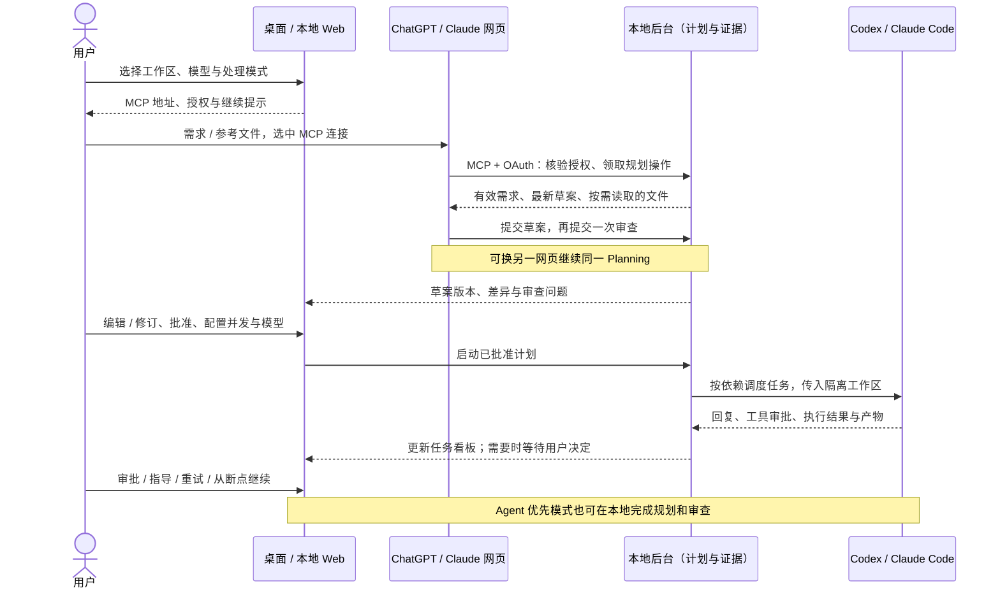

# 协作机制与详细时序

[返回项目首页](../README.md) · [Windows 安装](windows.md) · [浏览器启动](browser.md) · [MCP 连接](mcp.md)

**MCP 是协作通道，本地计划是共同依据。** 网页模型通过获准工具读取工作区、获取规划或审查上下文，并把结构化结果提交到本地。网页聊天中的文字、附件或“已完成”声明，不代替本地提交回执。

三个对象串起执行过程：

- **Planning**：保存需求、草案版本、审查、批准和网页交接状态。
- **Session**：执行一份已批准计划，管理任务依赖、并发和整体状态。
- **Attempt**：记录某个任务的一次执行，包括实际 Prompt、输出、工具活动和结果。重试会留下新的执行记录。

网页负责提出和审查方案；本地控制台负责编辑、批准、执行、审批与恢复。网页不能绕过本地批准直接启动业务任务。

## 首页图的阅读方式

- 蓝色区域：网页模型，按需规划、审查和交接。
- 绿色区域：本地工作台、统一计划、审批与 DAG 调度。
- 紫色区域：Coding Agent，在工作区中修改代码并执行验证。
- 实线表示任务或数据往来；虚线表示执行反馈与需要用户处理的请求。

首页图使用仓库内的 SVG，便于 GitHub 和本地 Markdown 预览；本页保留可编辑的 Mermaid 时序图。

图示组织参考 [Gas Town 的工作流图](https://github.com/gastownhall/gastown#basic-workflow)、[Serena Desktop 的网页与本地分工说明](https://github.com/lifei6671/serena-desktop)，下载与许可入口参考 [agent-orchestrator](https://github.com/OrchestratorInc/agent-orchestrator)。本图为本项目原创绘制。
