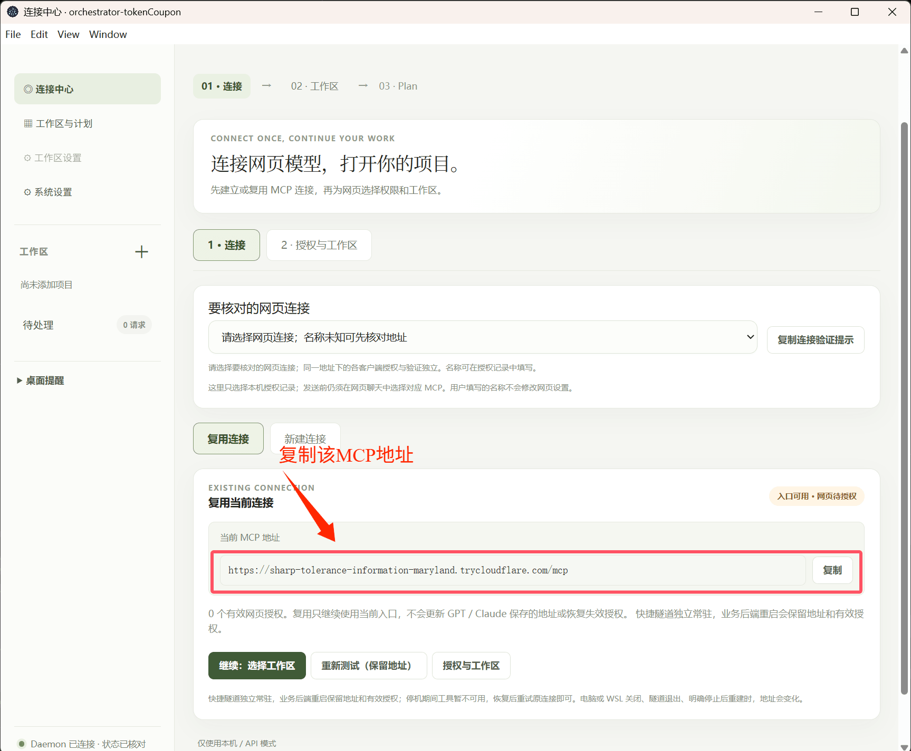
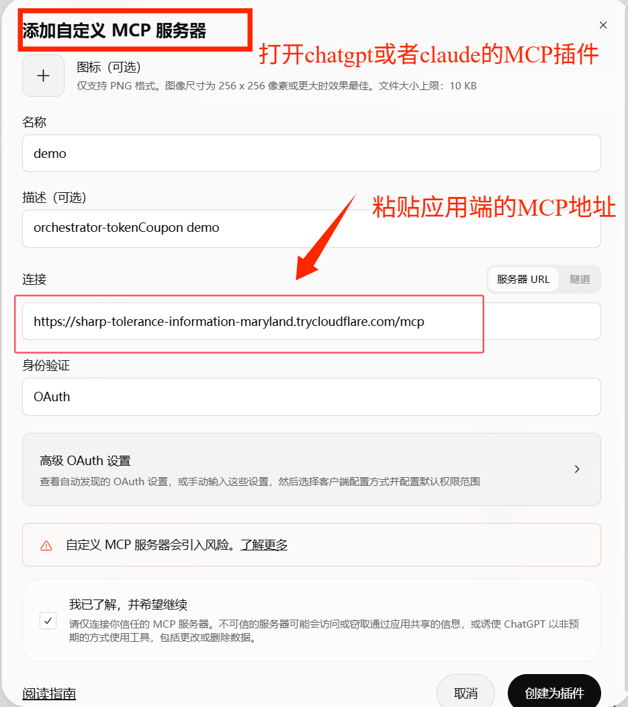
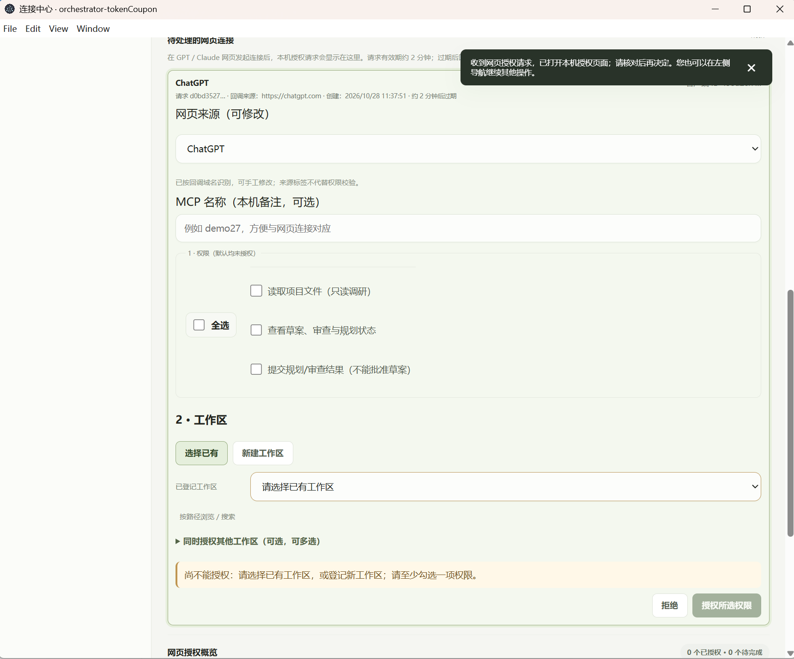
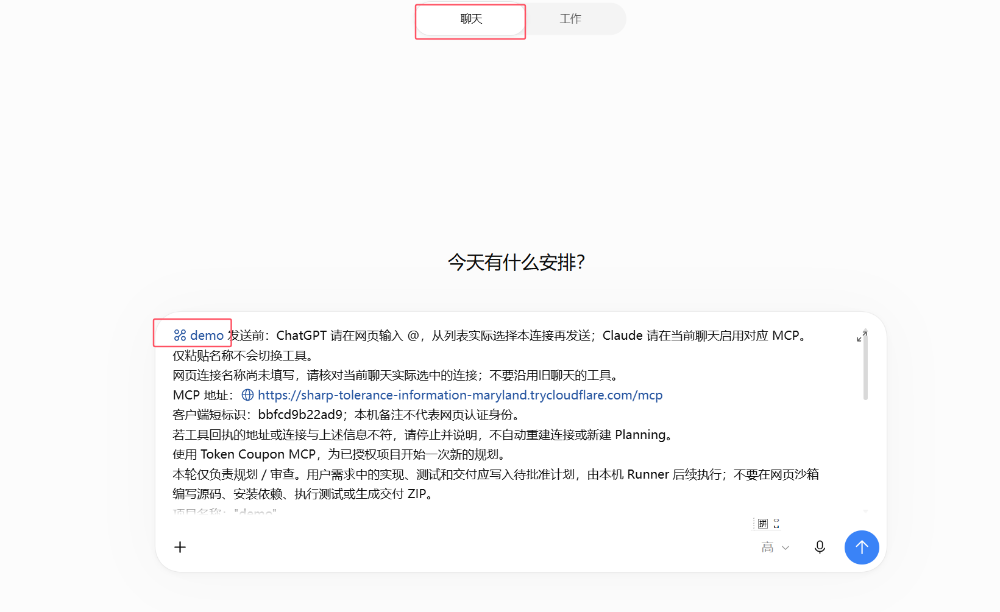
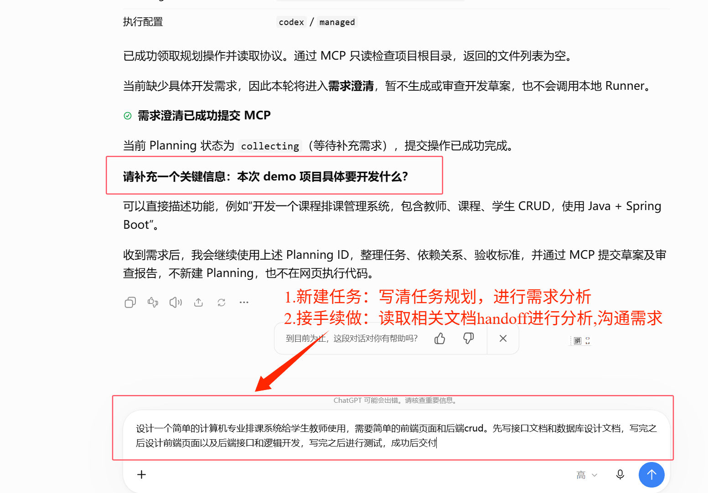

# 连接 ChatGPT / Claude 网页

[返回项目首页](../README.md) · [Windows 安装](windows.md) · [浏览器启动](browser.md) · [MCP 连接](mcp.md)

只使用本机 Agent 时，可以跳过网页连接。

1. 在本地 **连接中心 → 新建快捷连接**，按提示确认获取官方 cloudflared 组件，等待公网自检通过，复制完整 MCP 地址。
2. 在 ChatGPT 或 Claude 的自定义 MCP／连接器设置中添加该地址，使用 OAuth 发起授权。账号或组织需支持这项功能。
3. 返回本地 **权限与工作区**，选择网页来源、允许访问的项目及权限，保存授权，再回到原网页完成连接。
4. 在网页聊天中实际选中刚建立的连接，发送一次验证提示，核对返回的项目名称与工作区标识。

**公网入口可用、权限已保存、网页实际工具调用成功，是三个不同状态。** 本地会展示授权和调用状态，便于区分连接是否真正可用。

快捷连接会通过 Cloudflare 转发 MCP／OAuth 请求；本地控制台本身不作为公网管理页面开放。网页只可按授权访问工作区和工具，但读取到的内容会进入相应服务的处理流程，请按项目需要授权。

快捷隧道支持在后台重启后复用仍存活的连接；隧道进程退出、系统重启或重新创建连接后，地址可能改变。地址变更时，需要更新网页中的 MCP 配置。

## 图文连接示例

### 1. 【应用端新建连接复制MCP地址】

后续可以复用链接无需进行MCP连接，如果链接失效选择新建连接。

### 2. 【LLM网页端进行MCP连接】

在chatgpt/claude端打开“插件”，选择“选择自定义MCP服务器”，填写相关配置参数

### 3. 【应用端接收请求进行配置】

在应用端进行工作区选择、工作区授权等配置

### 4. 【LLM网页端进行连接验证和工具说明】

复制应用端的提示，粘贴到网页端输入框，同时可以@mcp服务器名称（示例中为 @demo,根据自身配置修改）
提示：chatgpt端选择“聊天”模块避免使用订阅套餐API Token用量

### 5. 【LLM网页端进行规划】

像正常聊天说明需求、进行规划即可

## 开始规划

核对实际工具返回的工作区后，按[规划与执行](workflow.md)开始；更换网页或聊天窗口时使用[跨网页交接](handoff.md)。
